# 마작 점수 자동 계산기 — 문제 정의와 개발 과정

> 프로젝트 전체를 짧게 돌아본 글은 이 문서 아래쪽 [회고](#회고) 절에 있습니다.

## 문제 정의

마작은 패 14장으로 정해진 모양을 먼저 완성한 사람이 이기는 게임입니다. 어려운 건 이긴 다음입니다. 완성한 손이 얼마짜리인지 매기는 과정이 생각보다 훨씬 복잡합니다.

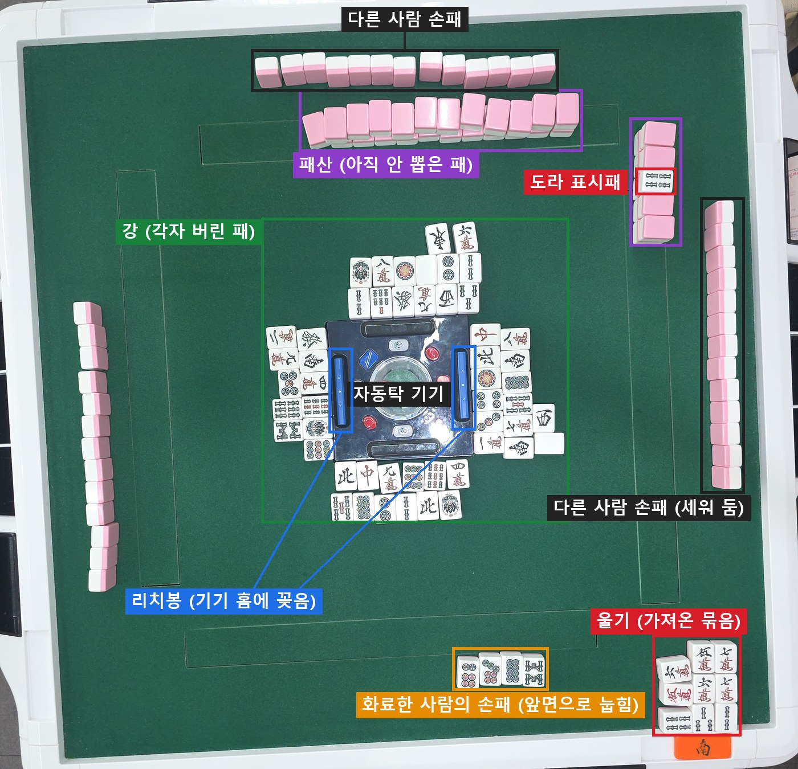

- **손패**: 각자 가진 패입니다. 평소에는 세워 두어 남에게 안 보이고, 이기면 앞면으로 눕혀 보여 줍니다.
- **울기**: 남이 버린 패를 가져와 만든 묶음입니다. 자기 자리 오른쪽 모서리에 공개해 둡니다.
- **강**: 각자 버린 패를 가운데 기기 앞에 차례로 놓은 줄입니다.
- **패산**: 아직 뽑지 않은 패를 2단으로 쌓은 벽입니다. 보너스를 알려 주는 도라 표시패도 여기 한 장 뒤집혀 있습니다.
- **리치봉**: "한 장만 더 오면 이긴다"고 선언(리치)할 때 내놓는 막대입니다. 매장 자동탁에서는 가운데 기기의 홈에 꽂습니다(그림의 파란 막대 두 개).

### 1. 점수 기준이 두 개이고, 곱해진다

점수는 두 가지 숫자로 정해집니다.

- **판(役의 개수·크기)**: 손에 어떤 특별한 모양이 들어 있는가. 화려함 점수라고 보면 됩니다.
- **부(符)**: 패를 어떻게 모았고 어떻게 이겼는가에 붙는 작은 가산점입니다.

이 둘을 더하는 게 아니라, 판이 하나 늘 때마다 점수가 대략 두 배가 되는 식으로 묶입니다. 그래서 같은 판이어도 부가 조금 다르면 점수가 달라지고, 판이 하나만 달라도 점수가 크게 뜁니다. 대부분은 결국 표를 외워서 찾습니다.

> **참고: 매장 점수표.** 매장에서 쓰는 점수 카드를 표로 옮긴 것입니다. 칸마다 "론으로 이겼을 때 받는 점수 / 쯔모로 이겼을 때 각자 내는 점수"입니다.
>
> **선(친)이 이겼을 때** — 쯔모는 세 사람이 같은 점수를 냅니다.
>
> | 부 | 1판 | 2판 | 3판 | 4판 |
> |---|---|---|---|---|
> | 20부 | 1,000 / 400 | 2,000 / 700 | 3,900 / 1,300 | 7,700 / 2,600 |
> | 30부 | 1,500 / 500 | 2,900 / 1,000 | 5,800 / 2,000 | 11,600 / 3,900 |
> | 40부 | 2,000 / 700 | 3,900 / 1,300 | 7,700 / 2,600 | 만관 |
> | 50부 | 2,400 / 800 | 4,800 / 1,600 | 9,600 / 3,200 | 만관 |
> | 60부 | 2,900 / 1,000 | 5,800 / 2,000 | 11,600 / 3,900 | 만관 |
> | 70부 | 3,400 / 1,200 | 6,800 / 2,300 | 만관 | 만관 |
>
> **선이 아닌 사람(자)이 이겼을 때** — 쯔모는 "자가 내는 점수 · 선이 내는 점수"입니다.
>
> | 부 | 1판 | 2판 | 3판 | 4판 |
> |---|---|---|---|---|
> | 20부 | 700 / 200 · 400 | 1,300 / 400 · 700 | 2,600 / 700 · 1,300 | 5,200 / 1,300 · 2,600 |
> | 30부 | 1,000 / 300 · 500 | 2,000 / 500 · 1,000 | 3,900 / 1,000 · 2,000 | 7,700 / 2,000 · 3,900 |
> | 40부 | 1,300 / 400 · 700 | 2,600 / 700 · 1,300 | 5,200 / 1,300 · 2,600 | 만관 |
> | 50부 | 1,600 / 400 · 800 | 3,200 / 800 · 1,600 | 6,400 / 1,600 · 3,200 | 만관 |
> | 60부 | 2,000 / 500 · 1,000 | 3,900 / 1,000 · 2,000 | 7,700 / 2,000 · 3,900 | 만관 |
> | 70부 | 2,300 / 600 · 1,200 | 4,500 / 1,200 · 2,300 | 만관 | 만관 |
>
> **판이 많으면 부와 상관없이 단계로 정해집니다.** 3판 70부 이상, 4판 40부 이상, 5판은 만관입니다.
>
> | 단계 | 판 | 선 론 / 쯔모 | 자 론 / 쯔모 |
> |---|---|---|---|
> | 만관 | 5판 | 12,000 / 4,000 | 8,000 / 2,000 · 4,000 |
> | 하네만 | 6\~7판 | 18,000 / 6,000 | 12,000 / 3,000 · 6,000 |
> | 배만 | 8\~10판 | 24,000 / 8,000 | 16,000 / 4,000 · 8,000 |
> | 삼배만 | 11\~12판 | 36,000 / 12,000 | 24,000 / 6,000 · 12,000 |
> | 역만 | 13판\~ | 48,000 / 16,000 | 32,000 / 8,000 · 16,000 |
>
> **부 세는 법**(같은 카드 아래쪽). 다 더한 뒤 10 단위로 올림합니다.
>
> | 항목 | 부 |
> |---|---|
> | 기본 | 20 |
> | 숨긴 손으로 론(멘젠 론) | +10 |
> | 쯔모로 이김 | +2 |
> | 머리(같은 패 2장)가 삼원패·장풍패·자풍패 | +2 |
> | 같은 패 3장을 숨겨 모음(안커) | 2\~8 숫자패 4 / 1·9·글자패 8 |
> | 같은 패 3장을 가져와 모음(퐁) | 2\~8 숫자패 2 / 1·9·글자패 4 |
> | 같은 패 4장을 숨겨 모음(안깡) | 2\~8 숫자패 16 / 1·9·글자패 32 |
> | 같은 패 4장을 가져와 모음(밍깡) | 2\~8 숫자패 8 / 1·9·글자패 16 |
> | 기다림이 한 가지뿐인 모양: 머리 하나(단기), 가운데 한 장(간짱), 1-2의 3·8-9의 7(변짱) | +2 |

### 2. 역(役)이 40가지쯤 있다

역은 판을 만드는 특별한 조건입니다. "같은 무늬로만 모음", "숫자 1·9와 글자패만 씀", "똑같은 묶음 두 벌" 같은 조건이 수십 가지 있습니다. 하나의 손에 여러 개가 겹칠 수 있고, 서로 같이 못 붙는 조합도 있습니다. 역이 하나도 없으면 모양을 다 갖춰도 이길 수 없다는 규칙도 있습니다.

### 3. 같은 손을 여러 가지로 읽을 수 있다

1·1·1·2·2·2·3·3·3 을 예로 들면, "같은 숫자 3장 묶음이 셋"으로도, "연속된 숫자 1-2-3 묶음이 셋"으로도 볼 수 있습니다. 어떻게 나눠 읽느냐에 따라 붙는 역과 부가 달라지고, 규칙은 가장 높은 점수가 나오는 해석을 고르라고 합니다. 정답이 여러 개인 퍼즐을 모두 풀어 본 다음 그중 최고를 골라야 하는 셈입니다.

### 4. 패만 봐서는 알 수 없는 정보가 필요하다

똑같은 14장이어도 아래 상황에 따라 점수가 달라집니다.

- 직접 뽑아서 이겼는지(쯔모), 남이 버린 패로 이겼는지(론)
- 마지막에 들어온 패가 어느 것이고, 어떤 모양을 완성했는지(기다림의 형태)
- 이긴 사람이 그 판의 선(친)인지
- 지금이 동장인지 남장인지, 내 자리 바람은 무엇인지
- 이기기 전에 리치 선언을 했는지, 첫 바퀴에 이겼는지, 패산의 마지막 패로 이겼는지

탁자 위의 패만 봐서는 이 정보를 알 수 없고, 게임이 어떻게 흘러왔는지를 알아야 합니다.

### 5. 가져온 패와 숨긴 패를 따로 센다

남이 버린 패를 가져와 공개한 묶음(울기)이 있으면 어떤 역은 값이 깎이고, 어떤 역은 아예 사라집니다. 부도 공개한 묶음과 숨긴 묶음이 다르게 매겨집니다. 그래서 같은 패라도 어느 쪽이었는지 구분해야 합니다.

### 6. 보너스 패(도라)가 따로 있다

게임 시작 때 뒤집어 놓은 표시패가 가리키는 패의 다음 패가 보너스입니다. 3이 보이면 4가 보너스인 식입니다. 빨간색 5, 리치로 이겼을 때만 확인하는 뒷면 보너스도 있습니다. 보너스는 판을 올려 주지만 역은 아니어서, 보너스만으로는 이길 수 없습니다.

### 7. 예외가 많다

- 특정 모양은 부가 정해진 값으로 고정됩니다(예: 둘씩 짝 7개 = 25부).
- 부는 10 단위로 올림하지만 예외 상황이 있습니다.
- 판이 어느 이상이면 상한(만관)에 걸려 부를 볼 필요가 없어지고, 더 올라가면 다른 단계(하네만, 배만…)로 넘어갑니다.
- 아주 드문 최상위 손(역만)은 별도로 계산합니다.

### 8. 점수를 매긴 다음에 나누는 것도 복잡하다

- 선이 이기면 1.5배를 받습니다.
- 직접 뽑아 이기면 세 사람이 나눠 내는데, 선은 다른 사람보다 두 배를 냅니다.
- 연속으로 판이 이어진 횟수와 탁자에 쌓인 리치봉을 추가로 주고받습니다.
- 100점 단위로 올림합니다.

### 정리

마작 점수 계산은 수십 가지 조건을 확인하고(역), 여러 해석 중 최고를 고르고(분해), 게임 상황을 반영하고(쯔모/론·선·바람), 작은 가산점을 모으고(부), 표를 찾아 나눠 내는 여러 단계짜리 일입니다.

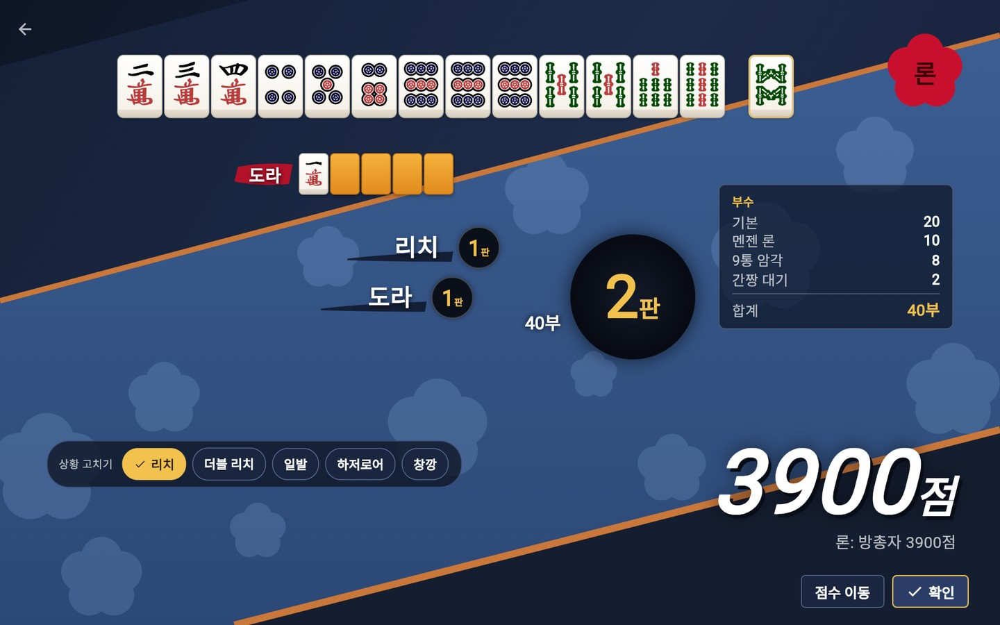

*이 모든 단계를 거친 결과의 예(지금 앱의 태블릿 결과 화면, 2026-11-09 캡처). 맨 위가 손패와 떼어 놓은 화료패(8삭), 그 아래가 도라 표시패입니다. 가운데에 붙은 역(리치 1판 + 도라 1판)으로 2판이고, 오른쪽 "부수" 칸에 부가 어떻게 모였는지 나옵니다. 기본 20부에 숨긴 손으로 론 10부, 9통 세 장을 숨겨 모은 암각 8부, 7·9삭 사이를 기다린 간짱 2부를 더해 40부입니다. 이긴 사람이 선(친)이라 2판 40부는 3900점입니다(위 점수표에서 선 40부 2판 칸).*

## 처음 생각한 것

처음 떠올린 건 단순했습니다. **화료하면 휴대폰으로 탁자 전체를 한 장 찍고, 그 사진에서 점수가 바로 나오는 프로그램**입니다. 손패만 찍는 게 아니라 탁자 전체를 찍으면 울기, 도라 표시패, 리치봉, 누가 버린 패로 이겼는지까지 한 장에 담기니, 위에서 말한 "패만 봐서는 알 수 없는 정보"도 사진에서 꽤 많이 알아낼 수 있다고 봤습니다.

본격적으로 개발하기 앞서, 이 문제를 풀어 본 곳이 있는지 먼저 조사했습니다.

---

## 기존 사례 조사

조사해 보니 이 문제를 푼 곳은 꽤 있었습니다. 다만 대부분 문제의 일부만 풀고 있었습니다. 크게 네 갈래로 나뉩니다.

### 1. 온라인 마작 게임

작혼·텐호 같은 온라인 마작은 점수를 완전히 자동으로 계산합니다. 어떤 패를 쯔모했는지, 누가 버렸는지, 리치를 했는지 같은 게임 진행이 모두 프로그램 안에 기록되기 때문입니다. 앞에서 말한 "패만 봐서는 알 수 없는 정보"가 처음부터 다 있으니 계산만 하면 됩니다. 오프라인 탁자에서는 이 정보를 누군가 채워 넣어야 하는데, 바로 그 부분이 어렵습니다.

### 2. 패를 손으로 입력하는 계산기

웹과 앱으로 많이 나와 있습니다. 손패·화료패·쯔모/론·바람·도라 장수를 입력하면 판·부·점수를 알려 줍니다. 계산 자체는 정확합니다(해외 오픈소스 계산기에 같은 손을 넣어 봤더니 제 계산 엔진과 결과가 같았습니다). 하지만 14장을 하나하나 누르는 게 번거로워서, 대국 중에 쓰기에는 손으로 계산하는 것보다 별로 빠르지 않습니다.

### 3. 손패를 찍으면 점수를 내주는 앱

가장 많은 갈래입니다. 일본에는 あがりかむ, AI麻雀カメラ, 麻雀.AI 得点君, スマート雀 같은 앱이 있고, 영어권에는 RiichiCam, 국내에도 GitHub에 대학 팀 프로젝트와 개인 프로젝트가 여럿 있습니다. 대부분 폰으로 손패를 가까이 찍으면 패 종류를 인식해서 점수를 냅니다.

하지만 공통된 한계가 있습니다.

- **손패만 읽습니다.** 쯔모/론, 누가 쏘였는지, 리치 여부, 장풍·자풍, 본장은 사람이 직접 고릅니다.
- **사람이 폰을 들고 찍어야 합니다.** 화료할 때마다 누군가 폰을 꺼내 손패에 대고 찍어야 합니다.
- **계산에서 끝납니다.** 나온 점수를 네 명의 점수에 반영하고 판을 기록하는 건 여전히 사람 몫입니다.

### 4. 탁자 전체를 다루는 시도

제가 하려는 것과 가장 가까운 갈래입니다.

먼저 패마다 IC 칩을 넣은 전용 패와 탁자로 점수를 계산하는 제품이 있었습니다(일본 パイリーダー, 2009년). 패 종류는 정확히 알 수 있지만, 매장이 패와 탁자를 통째로 바꿔야 했고 값도 비쌌습니다. 결국 널리 쓰이지 못한 채 판매가 끝났습니다.

일반 패를 카메라로 읽는 방식으로는 일본 후쿠이대의 **Projection Mahjong** 연구가 있습니다. 탁자 위에 카메라와 프로젝터를 달고, 화료한 사람이 패를 한 장 엎어 놓으면 화료로 인식합니다. 이어서 화료자가 손패를 그 자리에서 눕히고, 도라 표시패와 화료패를 프로젝터가 비춰 주는 구역에 옮겨 놓습니다. 그러면 패를 인식해서 점수를 내고, 네 명의 점수까지 관리합니다. 상황 정보도 패를 놓는 위치로 알려 줍니다. 예를 들어 화료패를 쏘인 사람의 구역에 놓으면 론으로 처리합니다. 2026년 개선판에서는 패를 놓는 시간까지 포함해 약 15초 만에 점수가 확정되었습니다. 손으로 계산할 때보다 2\~4배 빠르고, 손패 인식 정확도는 99%였습니다.

다만 이 연구에도 남은 과제가 있습니다.

- 도라 표시패와 화료패를 정해진 자리로 옮겨야 하고, 국을 시작할 때는 키보드를 눌러야 합니다.
- 점수는 관리하지만, 국마다 어떤 결과가 났는지 대국 기록으로 남기는 기능은 논문에 없습니다.
- 실험은 연구실 한 곳의 손으로 쌓는 탁자에서 했습니다. 리치봉도 탁자 위 구역에 올려놓는 방식입니다. 그래서 조명이 제각각이고 리치봉을 기기에 꽂는 매장 자동탁에서는 아직 확인되지 않았습니다.

### 조사에서 얻은 결론

"손패를 찍으면 점수가 나온다"는 이미 많이 나와 있어서, 이것만으로는 새로울 게 없습니다. 실제로 마작 커뮤니티에 아이디어를 설명했을 때 가장 많이 들은 반응도 "이미 있다"였습니다.

### 비어 있는 자리

정리하면, 다음 세 가지를 함께 하는 제품은 찾지 못했습니다.

1. **매장에서 쓰는 일반 패와 자동탁 그대로**: 전용 패나 전용 탁자, 천장 공사 없이
2. **탁자 전체를 놓인 그대로**: 손패만이 아니라 울기, 리치봉, 패산 위의 도라 표시패, 강 끝의 화료패와 누가 쏘였는지까지, 패를 옮기지 않고 카메라가 읽고
3. **사람이 거들 일 없이 기록까지**: 패를 정해진 자리에 옮겨 놓을 필요 없이, 점수를 네 명에게 나누고 국마다 결과를 대국 기록에 남기는 것까지

앞선 사례들은 두 가지를 알려 줬습니다. パイリーダー는 **설치 부담이 크면 좋은 기능도 퍼지지 않는다**는 것을 보여 줬습니다. Projection Mahjong은 **위에서 내려다보는 카메라로 자동화하면 손계산보다 빨라질 수 있다**는 것을 보여 줬고, 그 시간 대부분이 사람이 패를 놓는 데 쓰였다는 점도 함께 보여 줬습니다.

그래서 "얼마나 빨리, 사람 손 없이 점수가 확정되는가"를 핵심 기준으로 정했습니다. 패를 옮기는 단계를 없애고, 연구실이 아닌 실제 매장 자동탁에서 손계산과 나란히 시간을 재면서 개발하기로 했습니다. 이때까지는 처음 생각대로 휴대폰으로 탁자를 찍는 방식이었습니다.

---

## 첫 개발

### 공개 모델로 시작하려 했지만

처음에는 YOLO11로 손패를 인식해 점수를 내는 계산기가 공개되어 있어, 이걸 활용해 실제 마작 탁자에서 인식률이 얼마나 나오는지 확인하려고 했습니다. 그런데 시험할 사진부터 구하기 어려웠습니다. 인터넷에는 매장 탁자 전체를 위에서 찍은 사진이 없었고, 손패만 찍은 사진이 몇 장 있을 뿐이었습니다. 그마저도 각도가 제각각이고 화질이 낮았습니다.

구한 사진을 공개 YOLO11 모델에 넣어 보니 결과가 사진에 따라 크게 갈렸습니다.

- **깨끗하게 찍힌 손패 사진**은 꽤 잘 읽었습니다. 국사무쌍 손패 14장을 전부 맞혔습니다.
- **조금 흐린 손패 사진**에서는 13장 중 8\~10장만 맞혔습니다. 8삭을 5삭으로, 7만을 9만으로 읽었고, 빨간 5만은 빨간 5통으로 읽었습니다.
- **탁자 전체를 찍은 사진**에서는 패를 거의 찾지 못했습니다.

패 하나하나는 85\~92%를 맞혔지만, 점수를 내려면 손패 13\~14장이 **전부** 맞아야 합니다. 손패 사진 3장 중 전부 맞힌 건 1\~2장뿐이었습니다. 우리 매장 탁자와 패에 맞게 모델을 새로 학습시키려면, 실제 매장 사진에 패마다 정답을 단 데이터가 수백 장은 필요했습니다. 당장 구할 방법이 없다고 판단해, 우선 **Gemini(구글의 이미지를 읽는 AI)에게 사진을 보여 주고 패를 읽게 하는 방법**으로 개발을 시작했습니다.

같은 사진으로 Gemini를 시험해 보니 가능성이 보였습니다. 탁자 전체를 옆에서 찍은 사진은 Gemini도 거의 못 읽었습니다. 하지만 **눕힌 손패를 위에서 찍어 크게 잘라 주면** 손패 사진 3장을 모두, 빨간 5까지 전부 맞혔습니다. 대신 한 번 읽는 데 7\~15초가 걸렸습니다(YOLO11은 0.2\~0.3초). 정확도를 가르는 건 모델보다 **촬영 조건**이라는 것도 이때 알았습니다.

### Gemini로 읽는 방식 (처음 설계)

역할을 둘로 나눴습니다. **AI는 사진에서 패를 읽기만 하고, 점수 계산은 앱 안의 계산 엔진이 합니다.** AI가 틀려도 계산 규칙까지 틀리지 않게 하려는 것입니다.

처음 흐름은 두 단계였습니다.

1. 탁자 사진을 한 장 찍습니다.
2. **위치 찾기**: Gemini에게 사진을 보여 주고 손패·울기·강·패산이 사진의 어디에 있는지 상자로 받습니다.
3. **읽기**: 앱이 그 상자대로 고해상도 원본에서 구역을 잘라, 구역마다 Gemini에게 "무슨 패가 있는지 정해진 형식으로 답하라"고 동시에 묻습니다.
4. 앱이 답을 모으고, 계산 엔진이 판·부·점수를 내 대국 기록에 반영합니다.

### 방문 전에 확인한 것: 탁자 전체를 찍으면 패가 너무 작다

방송 화면 캡처로 시험해 보니, 패 한 장이 40픽셀 정도로 찍힌 사진은 Gemini가 장수부터 틀렸습니다. 사진 크기를 키워 보내도 Gemini는 이미지를 일정한 크기로 줄여서 보기 때문에 소용이 없었습니다. 반대로 게임 화면에서 패가 90픽셀로 찍힌 손패는 두 번 다 전부 맞혔습니다. 이렇게 **패 한 장이 100픽셀 이상**은 돼야 한다는 기준을 잡았고, 전경을 통째로 보내지 않고 원본에서 구역을 잘라 보내는 구조로 만들었습니다.

여기까지는 인터넷 사진과 게임·방송 화면으로만 시험한 것이었습니다. 실제 매장 탁자에서 어떻게 될지는 직접 찍어 봐야 알 수 있었습니다.

### 첫 매장 방문 (2026-10-24)

집에서는 실제 매장 장면을 만들 수 없어, 테스트 장면을 찍으러 마작 매장(보드카페)을 처음 찾았습니다. 장비는 **휴대폰 한 대와 다이소의 삼각대 겸용 셀카봉**이 전부였습니다. 셀카봉을 삼각대로 펴서 폰을 탁자 모서리 위에 세워 카메라로 쓰고, 노트북으로 촬영과 판독을 조작했습니다.

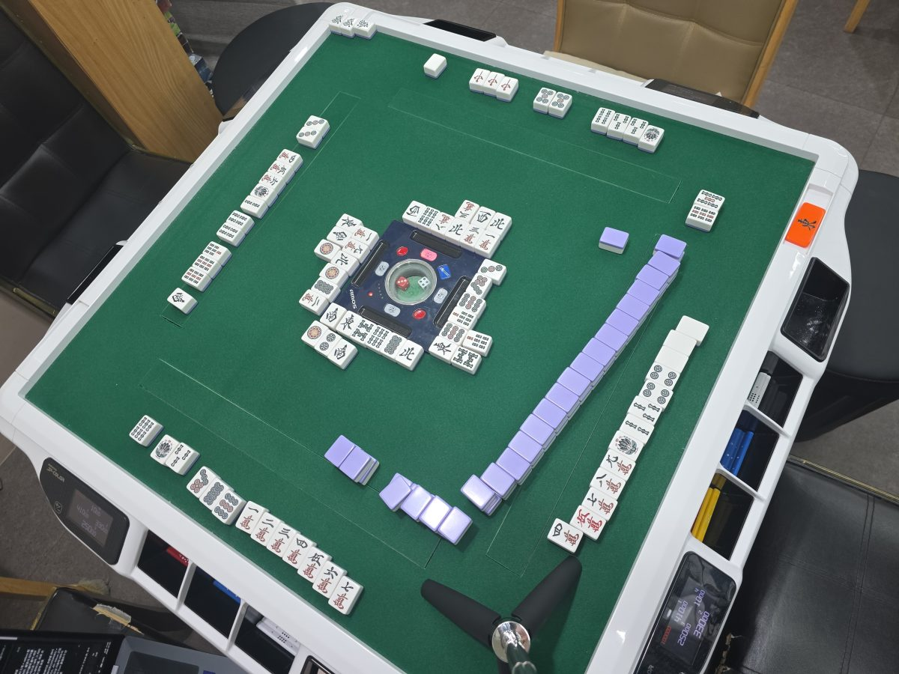

*첫 방문 때 카메라 폰으로 찍은 사진. 아래쪽에 셀카봉 삼각대 다리가 보입니다. 모서리 뒤에서 찍어 탁자가 비스듬하고, 먼 자리 패는 작게 찍혔습니다.*

- **거치는 시험 사진을 찍기 위한 것이었습니다.** 셀카봉 삼각대는 탁자 한쪽 모서리 뒤에 세웠습니다. 탁자 테두리에 집게로 무는 와이어 거치대도 챙겼지만 자동탁 테두리가 두껍고 둥글어 보조로만 뒀고, 2.1m 스틸 삼각대를 의자 자리에 세우는 안도 체크리스트에 적어 두었습니다. 높이 60·70·90cm와 줌 1배·2배를 바꿔 가며 찍을 계획이었고, 렌즈에서 매트까지 줄자로 높이를 쟀습니다. 모서리 뒤에서 찍다 보니 탁자가 사진에서 약 17\~25° 기울었습니다.
- **처음으로 탁자 전체에서 점수가 나왔습니다.** 리치·백·적도라·뒷도라 4판 40부 12000점(친 론)을, 위 자리 강 끝 3만으로 론이 완성된 것까지 읽어 맞혔습니다(18초). 파란 리치봉으로 리치도 알아봤습니다. 오후에는 퐁이 섞인 대삼원 역만 48000점도 여러 번 맞혔습니다.
- **하지만 한 장면에 1분 가까이 걸렸습니다.** 위치 찾기에만 18\~30초, 읽기에 최대 89초가 걸렸습니다. 위치 찾기가 모서리의 퐁이나 도라 표시패를 자주 빠뜨려 장수 부족으로 계산이 막혔고, 강 전체를 읽은 결과도 호출마다 흔들렸습니다.
- **현장에서 바로 고친 것도 있습니다.** 서버가 동시에 2건만 처리하게 설정돼 요청이 줄을 서고 있던 걸 찾아 늘렸더니, 읽기가 38.6초에서 8.6초로 줄었습니다. 탁자를 내려다보는 폰은 가로·세로를 구분하지 못해 사진에 붙는 방향 정보가 촬영마다 바뀌었고, 그래서 자리가 한 칸씩 밀려 읽혔습니다. 이날 방향 정보를 무시하고 센서 방향 그대로 쓰게 고쳤습니다.
- 그날 손으로 찍은 사진 30장(장면 5개)을 밤에 다시 읽어 보니, **눕힌 손패는 10장 모두 정답**이었습니다. 틀린 곳은 거의 다 울기 판단(어느 묶음이 누구 것인지, 도라 표시패와 울기 구분)이었고, 멀고 기울어진 자리에서는 통수·삭수를 잘못 셌습니다.

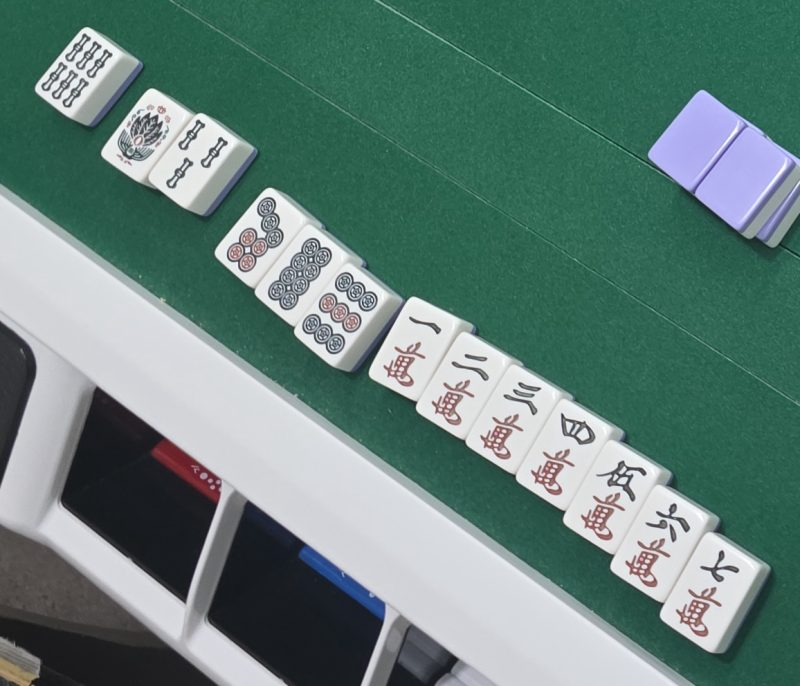

*위 사진의 고해상도 원본에서 앞자리 손패 구역만 잘라 낸 것. 실제로 Gemini에게 보낸 그림입니다. 이렇게 크게 잘라 주면 패를 잘 읽었습니다.*

이날 찍은 사진과 실패 기록이 이후 개발의 평가 세트가 됐습니다. 실제 탁자 사진이 생기고 나서야 무엇을 고쳐야 하는지가 보이기 시작했습니다.

### 휴대폰 촬영에서 고정 카메라로 (방문 뒤)

첫 방문에서는 시험 사진을 찍으려고 폰을 셀카봉 삼각대에 세웠지만, 실제로 쓸 모습은 여전히 처음 생각한 "화료하면 휴대폰으로 탁자를 찍는" 것이었습니다. 매장에서 찍은 사진과 실패를 돌아보니 이 방식에 문제가 있었습니다.

- **결국 누군가 폰을 들어야 합니다.** 손패 촬영 앱의 한계로 꼽은 "화료할 때마다 폰을 꺼내 찍어야 한다"가 제 아이디어에도 그대로 남습니다. 찍는 범위가 손패에서 탁자 전체로 넓어졌을 뿐입니다.
- **찍을 때마다 자리를 다시 찾아야 합니다.** 탁자 전체 사진에서는 패가 작아서, 고해상도 원본에서 손패·강·도라 자리를 잘라 읽어야 합니다. 그러려면 그 자리가 사진 어디쯤인지 알아야 하는데, 손으로 찍으면 각도와 거리가 매번 바뀝니다. 매장에서는 이 일을 위치 찾기 질문이 맡았고, 18\~30초가 걸리면서 울기와 도라 표시패를 자주 빠뜨렸습니다.
- **한 장으로는 알 수 없는 정보가 있습니다.** 누가 언제 리치를 걸었는지, 마지막에 버린 패가 무엇인지, 울기를 누구에게서 했는지는 화료 순간의 사진보다 대국 중의 흐름에 담겨 있습니다. 이걸 알려면 카메라가 대국 내내 같은 자리에서 탁자를 보고 있어야 합니다.

그래서 방향을 바꿨습니다. **휴대폰을 탁자 위에 고정해 카메라로만 쓰고, 화면과 조작은 옆의 태블릿이 맡는 구성**입니다. 카메라가 움직이지 않으니 한 번 맞춘 자리 구분을 계속 쓸 수 있고, 대국 중 변화도 따라갈 수 있습니다. 화료 때는 버튼 하나로 찍으면 됩니다. 쓰던 탁자에 고정 카메라와 태블릿만 더하는 방식이라 설치 부담도 작습니다.

이때부터 판독 정확도는 모델만큼 **카메라를 어디에 어떻게 두느냐**에 달려 있었고, 방문마다 거치 방법을 바꿔 가며 아래 조건을 맞췄습니다.

- **패가 충분히 크게**: 가장 먼 자리의 패도 한 장이 100픽셀 이상 찍혀야 합니다. 폰 12MP 카메라를 90cm 높이에 두면 패가 약 75픽셀이라 부족해서, 60\~70cm로 낮추거나 2배 줌을 써야 했습니다.
- **반듯하게**: 탁자를 비스듬히 찍으면 자리를 나누는 선이 맞지 않습니다.
- **움직이지 않게**: 대국 내내 같은 자리에서 봐야 리치·강 끝 같은 흐름을 따라갈 수 있습니다.
- **대국에 방해되지 않게**: 손님이 패를 치고 손을 뻗는 데 걸리적거리면 안 됩니다.

### 방문 뒤 고친 것 (10-24 밤 \~ 10-26)

**1. 도라 표시패를 울기로 착각한다** (방문 당일 밤)
패산 위의 도라 표시패나 옆자리 울기를 화료자의 울기로 붙이는 일이 있었습니다. 퐁·치·깡 모양이 아닌 묶음은 울기에서 빼고, 울기는 화료자 오른쪽 모서리 것만 받도록 규칙을 넣었습니다. 같은 사진을 다시 읽자 점수를 맞힌 장면이 늘었습니다.

**2. 위치 찾기가 느리고 결과가 흔들린다** (10-25)
매장에서 가장 크게 드러난 문제입니다. 위치 찾기 질문 하나에 18\~27초가 걸렸고, 물을 때마다 답이 달라 울기나 도라 표시패를 자주 빠뜨렸습니다. 그러면 패 장수가 모자라 계산이 안 됐습니다. 그래서 카메라가 고정이라는 점을 이용해, **사용자가 처음 한 번 선 4개를 그어 자리를 나누는 격자**로 바꿨습니다. AI에게는 "어디"가 아니라 "무엇"만 묻는 셈입니다. 한 장면에 60\~70초 걸리던 것이 7\~20초로 줄었고, 같은 사진을 10번 읽어 10번 모두 맞혔습니다.

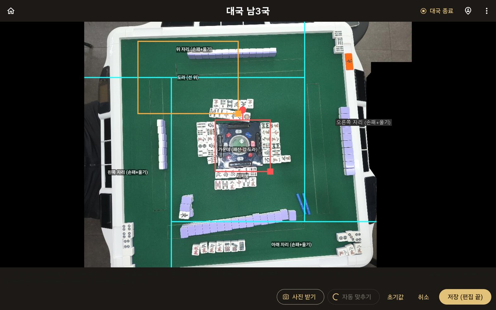

*태블릿의 격자 편집 화면(2026-10-31). 하늘색 선 4개로 탁자를 네 자리와 가운데로 나눕니다. 노란 상자는 도라 표시패를 읽는 칸, 빨간 상자는 가운데 기기 주변 칸입니다. 오른쪽 탁자 밖에 앉은 사람의 팔이 찍혀 그 부분은 검게 가렸습니다.*

**3. 통수·삭수의 개수를 잘못 센다** (10-25)
격자로 바꾼 뒤 남은 오류는 거의 전부 동그라미나 대나무 막대 개수를 잘못 세는 것이었습니다(9삭↔6삭, 5통↔4통). 만수와 글자패는 거의 틀리지 않았습니다. 규칙을 프롬프트에 더 써 넣는 건 효과가 없었습니다. 대신 **자리 사진과 함께 같은 자리를 세 토막으로 크게 자른 그림과 통수·삭수 1\~9 실물 참고표를 한 번에** 보냈더니, 시간은 그대로인 채 자리 판독 정확도가 50%에서 95%로 올랐습니다.

**4. 리치를 강의 가로 패로는 못 알아본다** (10-24 \~ 25)
리치 선언패(강에 눕혀 놓은 패)는 질문 방식을 네 가지로 바꿔도 6번 중 한 번도 못 찾았습니다. 그래서 판단 근거를 바꿔, 자동탁 홈에 꽂힌 **리치봉**을 보게 했더니 6번 모두 맞혔습니다.

**5. 누가 쏘였는지 알려고 강 전체를 읽으면 느리다** (10-25)
매장에서 네 자리의 강을 다 읽으면 느리고, 결과가 호출마다 흔들렸습니다. **강마다 마지막 패 한 장만** 읽고, 그 패로 화료가 완성되는 자리를 쏘인 사람으로 정하게 바꿨습니다.

**6. 같은 사진인데 5초에서 1분 넘게까지 걸린다** (10-24 \~ 25)
매장에서 동시 처리 설정을 고친 뒤에도 가끔 호출 하나가 수십 초씩 멈췄습니다. 원인을 재 보니 Gemini가 같은 내용을 반복해 출력하거나 오래 생각하는 호출이었습니다. 생각을 끄는 설정은 이 모델에서 통하지 않아, 같은 요청을 동시에 여러 개 보내 먼저 온 답을 쓰는 방식 등으로 꼬리 지연을 줄였습니다.

### 바뀐 흐름

방문 뒤 고친 것을 모으면, 읽는 방식은 이렇게 바뀌었습니다.

1. 탁자 사진을 한 장 찍습니다.
2. 앱이 처음 한 번 맞춘 격자대로 고해상도 원본에서 자리마다 구역을 잘라 서버로 보냅니다. 손패·울기, 강 끝, 리치봉, 도라 표시패 구역입니다. 위치 찾기 질문은 없어졌습니다.
3. 서버가 구역마다 Gemini에게 동시에 묻습니다. 자리 판독에는 크게 자른 토막과 통수·삭수 참고표를 함께 붙입니다.
4. 앱이 답을 모읍니다. 누가 화료했는지는 손패가 앞면으로 눕혀진 자리로, 누가 쏘였는지는 강 끝 패 중 화료패가 되는 자리로, 리치는 리치봉으로 정합니다.
5. 계산 엔진이 판·부·점수를 내고, 결과를 대국 기록에 반영합니다.

---

## 두 번째 방문 (2026-10-31)

### 방문 전 (10-26 \~ 10-30): 빠르고 안전하게, 그리고 과적합 확인

첫 방문 사진으로 정확도를 올린 뒤에는 **속도**와 **틀린 점수가 그대로 기록되지 않게 하는 것**에 집중했습니다.

- **세 번 읽어 모두 같을 때만 믿기.** 같은 자리를 동시에 세 번 읽어 답이 모두 같고, 손패가 화료 모양일 때만 자동으로 반영하게 했습니다. 틀린 채 반영되는 비율을 0으로 만드는 대신, 애매하면 사람에게 묻습니다.
- **"어디"는 검출 모델, "무엇"은 Gemini.** 공개 YOLO11은 패 종류를 읽기엔 부족했지만 패의 **위치**는 잘 찾았습니다. 그래서 강 끝과 손패에서 패 위치는 YOLO11로 잡고, 잘라 낸 패 조각만 Gemini에게 읽게 했습니다. 강 끝에 넣은 10-26 운영 배포로 장면 시간 중앙이 8.7초가 됐고, 손패에 넣은 10-28 배포로 자리 판독 p90이 18.1초에서 9.6초로 줄었습니다.
- **과적합을 확인했습니다.** 지금까지는 손으로 찍은 사진 6장(장면 B·C·D)으로 규칙을 고르고, 같은 6장으로 점수를 매겼습니다(12/12). 그런데 첫 방문 때 셀카봉으로 찍은 다른 사진 15장에 그대로 돌리니 **손패 0/15**였습니다. 탁자가 약 25° 기울게 찍혀 격자가 맞지 않았던 것입니다. 이때부터 **개발 세트(B·C·D 6장)와 테스트 세트(매장 15장)를 나눠**, 테스트 세트는 규칙을 고치는 데 쓰지 않기로 했습니다.
- **소프트웨어로 펴기보다 카메라를 반듯하게(10-29).** 기운 사진을 소프트웨어로 펴는 방법도 만들어 봤습니다. 기운 사진에서는 손패 0 → 8/15로 좋아졌지만, 이미 반듯한 사진에 같은 처리를 하면 오히려 정답이 23개에서 12개로 줄었습니다. 그래서 보정 기능을 더 키우지 않고, **카메라를 처음부터 탁자 위에서 반듯하게 내려다보도록 거치**한다는 것을 전제로 정했습니다. 사진에서 잰 기울기는 보정이 아니라 "3° 안으로 맞추세요" 같은 설치 안내에 씁니다.
- **바닥 스탠드로 거치대 바꾸기.** 셀카봉 대신 바닥에 세우는 기둥과 위로 뻗는 붐을 준비했습니다. 기둥은 탁자 모서리에서 10\~15cm 떨어뜨리고, 붐을 위로 15\~20° 들어 렌즈가 **탁자 가운데 위 약 80cm**에 오게 하고, 넘어지지 않게 모래주머니를 겁니다. 설치 때마다 카메라 미리보기에서 **가장 먼 자리 손패의 폭을 픽셀로 재서** 100픽셀이 안 되면 높이를 낮추거나 줌을 쓰게 했습니다.
- **혼자 확인하지 않기 위한 준비.** 두 번째 방문부터는 노트북을 가져가, 태블릿과 카메라 폰의 상태를 실시간으로 보며 기록을 받는 도구를 만들었습니다. "패 뒷면은 연보라색" 같은 첫 매장 탁자에만 맞춘 가정도 이때 찾아 없앴습니다.

### 방문 (10-31): 실제 대국을 처음 찍다

이번에는 **태블릿과 카메라 폰**을 가져가, 폰을 탁자 위에서 내려다보게 고정하고 실제 대국을 진행하며 화료 때마다 찍었습니다.

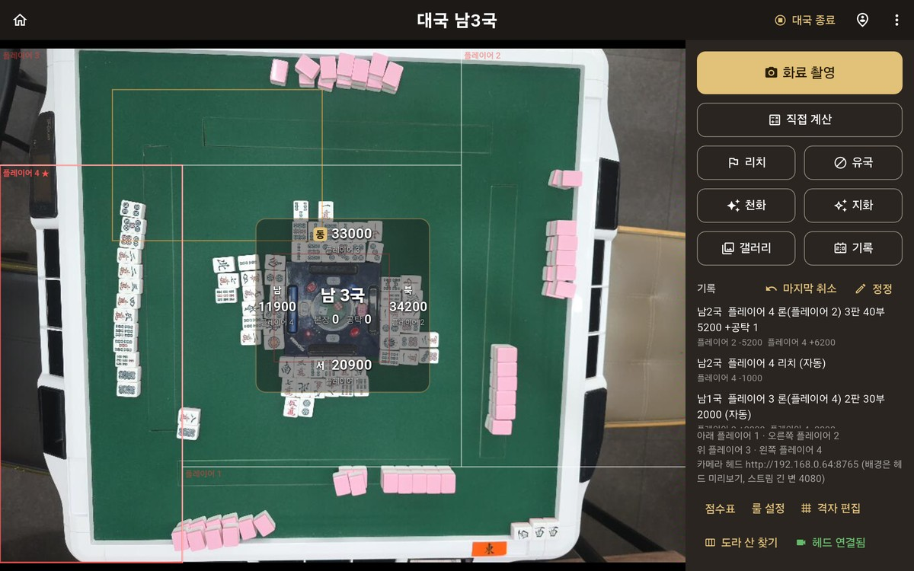

*대국 중 태블릿 화면(2026-10-31). 왼쪽은 탁자 위 카메라 폰이 보내는 화면이고, 가운데에 국과 네 명의 점수가 겹쳐 보입니다. 화료하면 오른쪽 위 "화료 촬영"을 누릅니다.*

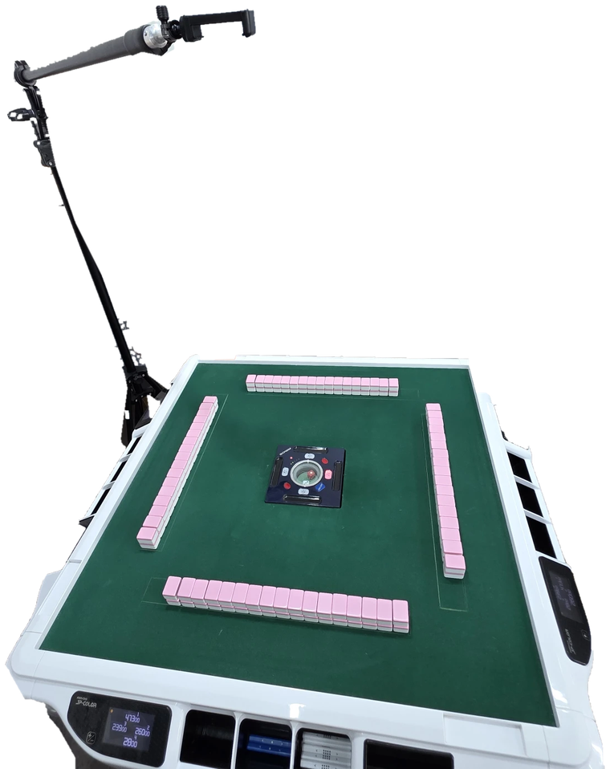

*매장 자동탁과 바닥 스탠드(배경은 지움). 기둥은 탁자 모서리 뒤에 세우고, 위로 뻗은 붐 끝의 집게에 카메라 폰을 물려 탁자 가운데 위에서 내려다보게 합니다.*

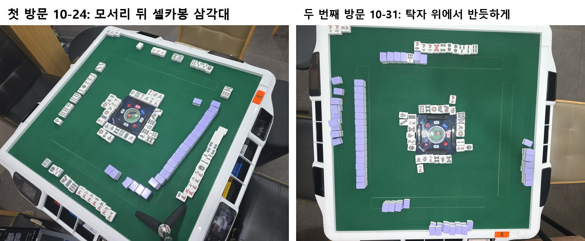

*같은 매장 탁자를 두 거치 방식으로 찍은 사진. 왼쪽(첫 방문, 셀카봉)은 탁자가 기울고 먼 자리 패가 작지만, 오른쪽(두 번째 방문, 바닥 스탠드)은 네 자리 패가 거의 같은 크기로 찍힙니다.*

- **거치**: 바닥 스탠드로 렌즈를 탁자 가운데 위에 두니 탁자가 반듯하게 찍혔습니다. 매장에 정식으로 설치할 때를 대비해 천장 높이·재질·조명 위치도 찍어, 천장 부착이나 압축봉이 되는지 살폈습니다. 태블릿과 카메라 폰은 와이파이로 이어지는데, 매장 와이파이가 기기 사이 통신을 막거나 폰 화면이 꺼지면 연결이 끊기므로 폰 핫스팟을 대안으로 챙겼습니다.
- **오전 10회**: 점수까지 완전히 맞은 게 5/10이었습니다. 격자를 다시 맞춘 뒤로는 4/5였고, 틀린 채 자동 반영된 건 0이었습니다. 하지만 시간은 중앙 17.3초, 최대 41.2초로 집에서 잰 것보다 훨씬 길었습니다.
- **오후 15회**: 손패 장수부터 맞은 게 1/15뿐이었습니다.
- 원인을 보니 **매장의 실제 습관**이 집에서 연출한 장면과 달랐습니다.
  - 손패를 앞으로 내밀어 공개해서, 격자 선이 손패를 잘랐습니다(8/15).
  - 화료자가 쯔모한 패를 손패 앞이나 옆에 **떼어 두었습니다.**
  - 리치 화료면 도라·뒷도라 표시패 두 장을 탁자 위 빈 곳에 내놓았습니다. 표시패 칸 밖이라 읽지 못했습니다.
  - "대국에 반영"을 누르지 않고 다음 판으로 넘어가면, 앱이 새 판이 시작된 걸 몰랐습니다.
- 대국 중 카메라가 계속 남긴 탁자 사진(95분 동안 738장)은 이후 학습과 검증의 재료가 됐습니다.

### 방문 뒤 (11-01 \~ 11-04): Gemini에서 자체 모델로

두 번째 방문의 가장 큰 결과는 **실제 매장 사진이 학습에 쓸 만큼 쌓였다**는 것입니다. 처음에 모델 학습을 포기했던 이유가 사라졌습니다.

- **정답 만들기.** 정답이 없던 오후 사진 19장을 원본을 확대해 하나씩 읽어 정답을 달았습니다. 쯔모/론과 화료패는 직접 확인했습니다.
- **직접 학습한 모델로 교체(11-02 운영 배포).** 매장 사진에서 패 1,550장을 잘라 라벨을 달고, 패를 찾는 검출 모델(YOLO26n)과 종류를 맞히는 분류 모델(MobileNetV3)을 직접 학습시켰습니다. 그 사진을 학습하지 않은 모델로 채점해도 Gemini와 비슷한 정확도가 나왔습니다. 화료 판독 전체를 자체 모델로 바꾸자 **장면 시간이 15.1초에서 5.8초로** 줄었고, Gemini 호출 비용은 0이 됐습니다. 최대 시간도 66.8초에서 7.3초로 줄었습니다. 모델 구성과 학습 방식은 아래 "판독에 쓰는 모델과 학습 방식"에 따로 정리했습니다.
- **격자를 사람이 맞추지 않게.** 설치할 때마다 사람이 선 4개를 맞추던 걸, 녹색 펠트의 색과 곧은 변을 찾아 자동으로 정하게 바꿨습니다. 카메라가 밀려도 약 18초 뒤 스스로 다시 맞춥니다.
- **점수 엔진 검증.** 화료 모양을 무작위로 30만 개 만들어 공개 점수 계산 라이브러리와 답을 비교했습니다. 점수 차이는 0이었고, 일부러 버그 9개를 넣어 보니 9개 모두 잡혔습니다.
- **채점 기준을 엄격하게.** 그동안 "맞음"은 손패만 본 숫자였습니다. 도라 표시패, 리치, 누가 쏘였는지까지 모두 맞아야 "완전 맞음"으로 세게 바꾸자, 숫자가 손패 기준 30/34에서 23/34로 떨어졌습니다. 이후로는 **"경고도 없이 틀린 점수가 기록된 횟수"** 를 안전 지표로 씁니다.
- **패의 역할을 모델이 판단.** 어떤 패가 손패고, 울기고, 떼어 둔 화료패고, 탁자 위 도라 표시패인지를 규칙으로 나누던 걸, 패 배치만 보고 판단하는 작은 모델로 바꿨습니다. 실제 사진이 25장뿐이라 마작 규칙대로 배치를 합성해 먼저 학습시켰고, 테스트 사진 15장에서 규칙 91.4% → **모델 99.6%** 가 됐습니다.

---

## 세 번째 방문 (2026-11-07)

### 방문 전 (11-05 \~ 11-07 아침): "더 고치기"보다 "제대로 재기"

자체 모델로 바꾼 뒤 개발 세트 32회에서 거의 다 맞게 되자, 새 문제가 생겼습니다. **어떤 변경을 해도 점수 차이가 안 나고**, 운영 모델은 개발 사진을 이미 다 학습한 상태였습니다. 이대로 실패 사진을 하나씩 보며 고치면 과적합이 됩니다. 그래서 순서를 "잴 수 있게 → 사진과 무관한 안전장치 → 학습 → 속도"로 다시 잡았습니다.

- **평가 규칙 정리.** 손·팔이 패를 가린 사진과, 손패를 흩어 놓는 등 사용 규칙을 어긴 사진은 채점에서 빼기로 했습니다. 새 사진은 채점 전에 사진만 보고 판단합니다.
- **테스트 세트 살리기와 흔들기 시험.** 기운 테스트 사진 15장을 다시 쓸 수 있게 만들고, 개발 사진을 돌리고·줄이고·흐리게·어둡게 한 변형 21종으로 약점을 찾는 시험을 만들었습니다. 카메라를 1m 넘게 올린 것처럼 사진을 줄이면(0.6배) **틀린 답이 검사를 통과하는 경우**가 생겼습니다. 화면에 탁자 전체를 넉넉히 담겠다고 카메라를 높이 올리면 위험하다는 뜻이라, 높이는 패 크기 기준을 지키는 선에서 정합니다.
- **안전장치.** 같은 패가 5장 나오는 것처럼 마작 규칙상 불가능한 답은 막고, 판독이 불확실한 신호를 붙였습니다. 다만 남은 오류는 늘 같은 쪽으로 틀리는 체계적 오류라, 이런 장치로는 대부분 못 막는다는 것도 확인했습니다.
- **학습은 기준을 먼저 적고 한 번씩.** 합격 기준을 학습 전에 적어 두고, 결과를 본 뒤 바꾸지 않았습니다. 시험한 세 가지 중 하나만 채택했습니다.
- **거치는 고정하고, 다른 탁자에서도 되도록(11-06).** 거치를 바꿀 때마다 판독 규칙이 흔들리지 않게, 지금 거치 방식(탁자 위에서 반듯하게)으로 고정했습니다. 대신 펠트 색에 기대는 격자를 넘어, 어느 탁자에서나 같은 **가운데 기기와 패 한 장 크기**를 기준으로 자리를 나누는 방식을 만들었습니다.
- **운영 배포(11-07 아침).** 위 변경을 넣기 전에 "답이 그대로인지"부터 확인하고 배포했습니다. 개발 32회 손패 30/32, 패 434/436, 경고 없이 틀린 기록 0, 장면 시간 중앙 6.2초였습니다.

### 방문 (11-07): 손님과 함께 한 실제 대국

이번에는 손님을 포함한 4명이 실제로 대국하는 동안 시스템을 켜 두었습니다.

- **실제 대국 화료 11장 중 10장을 맞혔습니다**(손·팔 가림과 사용 규칙 위반 사진은 뺌). 틀린 1장은 경고가 떠서 그대로 기록되지 않았고, **경고 없이 틀린 점수가 기록된 건 0**이었습니다.
- 판독 시간은 중앙 8.6초, 최대 14.6초였습니다. 집에서 잰 6.2초보다는 깁니다.
- 판 중에 패산의 도라 표시패를 미리 읽어 두는 기능은, 값이 있을 때 10/10을 맞혔습니다.
- **새로 드러난 실패**
  - 울기를 탁자 **테두리 위 모서리**에 두면 전혀 읽지 못했습니다(0/3, 0/12).
  - 강 끝에 놓인 3만을 2만으로 확신하고 읽었습니다.
  - 리치봉은 연속으로 맞게 읽었는데도, 손과 팔이 계속 움직여 앱이 "장면이 바뀌었다"고 판단하며 리치 후보를 지워 버렸습니다. 그래서 실제 대국 리치 추적이 0/5였습니다.

### 방문 뒤 (11-07 저녁 \~ 11-08)

- **3만을 2만으로 읽은 원인 찾기.** 사진 한 장의 문제인지 모델의 버릇인지부터 갈랐습니다. 패를 거꾸로 돌려 넣으니 분류 모델이 뒤집힌 만수를 거의 다 2만으로 읽었습니다. 원인은 둘이었습니다. 학습할 때 패를 180° 뒤집는 증강이 빠져 있었고, 학습 라벨에 뒤집힌 三萬 3장과 一萬 1장이 2만으로 잘못 들어가 있었습니다. 둘을 고쳐 다시 학습시키자 3만 오독이 19/37에서 0/37이 됐고, 운영 배포 뒤 개발 32회 손패 31/32, 패 435/436, 장면 시간 중앙 6.1초가 됐습니다.
- **처음 짚은 원인이 틀렸던 사례.** 손패 끝 패를 놓친 사진을 처음에는 "손패가 휘어서"라고 보고 보강 학습까지 했지만 고쳐지지 않았습니다. 대국 중 사진을 거슬러 보니, 화료 직후 손으로 울기를 끌어와 손패에 붙인 장면이었습니다. 사용 규칙 위반으로 채점에서 뺐습니다.
- **남은 문제**: 테두리 위 울기, 리치 추적 버그, 빨간 5만을 보통 5만으로 읽는 오류.

---

## 판독에 쓰는 모델과 학습 방식

11-02부터 화료 판독은 Gemini 대신 직접 학습한 모델 세 개가 맡습니다(태블릿의 거치 화면에 Gemini로 되돌리는 토글이 남아 있고, 기본은 꺼져 있습니다). 사람이 사진을 볼 때처럼 **어디에 패가 있나 → 무슨 패인가 → 누구의 무슨 패인가**를 차례로 나눠 맡깁니다. 마지막 계산은 지금도 앱 안의 점수 엔진이 합니다.

| 순서 | 모델 | 하는 일 | 구조 | 학습 재료 | 학습한 곳 |
|---|---|---|---|---|---|
| 1 | **검출기** | 사진에서 패 한 장 한 장의 위치를 상자로 찾음 | YOLO26n(작은 물체 검출 모델) | 매장 사진 35장(10-31 25장, 카카오톡으로 받은 10장), 앞면·뒷면 패 상자 약 4,000개 | 캐글 무료 GPU, 한 번에 1\~1.5시간 |
| 2 | **분류기** | 상자로 잘라 낸 패 한 장이 37종(34종 + 빨간 5 세 종) 중 무엇인지 맞힘 | MobileNetV3 Small(작은 이미지 분류 모델) | 패 조각 1,550장 + 합성 조각 약 2.3만 장 | 노트북 CPU, 8벌에 약 1시간 20분 |
| 3 | **역할 모델** | 각 패가 손패·울기·강·패산 위 도라 표시패·탁자 위 표시패 짝·떼어 둔 화료패 중 무엇인지 정함 | 작은 Transformer(상자 집합을 한꺼번에 봄) | 실제 사진 25장 + 마작 규칙으로 만든 합성 배치 8,000장 | 노트북 CPU |

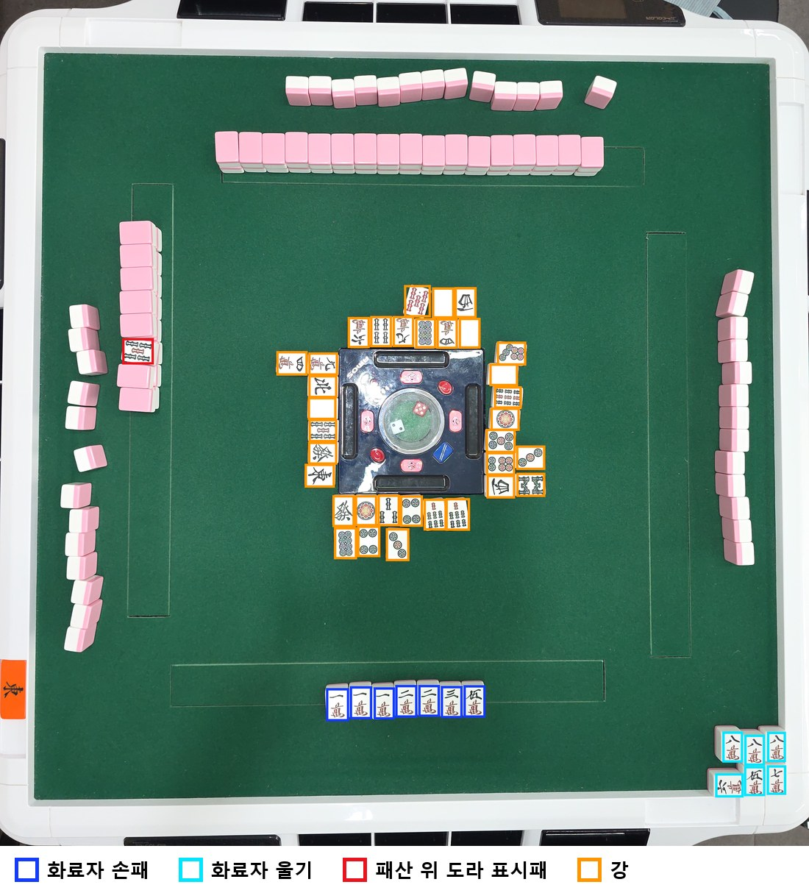

*10-31 매장 화료 장면의 학습용 정답(오른쪽 사람이 이긴 장면을, 이긴 사람이 아래에 오도록 돌림). 상자는 검출기가 찾아야 하는 앞면 패 위치이고, 색은 역할 모델이 맞혀야 하는 역할입니다. 같은 앞면 패라도 화료자 손패(파랑), 오른쪽 모서리의 울기(하늘), 가운데 강(주황), 왼쪽 패산 위 도라 표시패(빨강)를 구분해야 점수를 낼 수 있습니다.*

역할 모델은 **그림을 보지 않고 상자의 배치만 봅니다.** 상자의 위치·크기·기울기, 패가 누웠는지, 앞면인지 뒷면인지만 넣습니다. 손패는 화료자 앞에 한 줄로 길게 놓이고, 울기는 오른쪽 모서리에 서너 장씩 놓이고, 강은 가운데 기기를 둘러싸는 식으로 **패의 역할은 배치에 드러나기 때문**입니다. 처음에는 이걸 사람이 짠 규칙으로 나눴는데, 매장마다 배치 습관이 달라 규칙이 계속 늘어났습니다.

### 정답 만들기: 모델이 먼저 달고, 사람이 고친다

수천 개의 상자를 처음부터 손으로 그리지는 않았습니다.

- **검출기**: 공개 YOLO11과 첫 분류기로 임시 정답을 먼저 만들고, 학습한 모델의 결과를 사진에 겹쳐 빠진 패를 찾아 고치기를 되풀이했습니다. 회전 상자로 바꿀 때는 35장의 상자 4,027개를 AI 에이전트 다섯이 7장씩 나눠 확대해 보고 고칠 곳을 제안했고, 제안 389건은 비교 그림으로 하나하나 직접 확인한 뒤 반영했습니다.
- **분류기**: 원본 사진에서 패 조각을 모아 37종 모두 1,550장에 정답을 달았습니다. 11-07 매장에서 3만을 2만으로 읽은 뒤에는 1,550장 전부를 다시 검사해 잘못 달린 4장을 고쳤습니다.
- **역할 모델**: 규칙으로 정답 초안을 만든 뒤, **학습 전에 다른 세션이 정답만 따로 검토**해 확실한 오류 100개를 고쳤습니다. 학습한 모델이 정답을 따라 배우기 때문에, 틀린 정답이 섞이면 아무리 학습해도 그 오류가 남습니다.

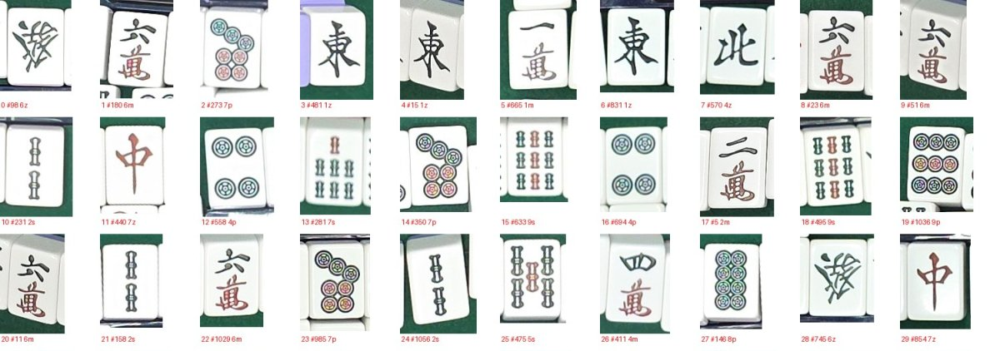

*분류기 학습용 패 조각 표본. 모두 매장 사진에서 상자대로 잘라 낸 것입니다. 아래 글자는 번호와 종류 코드(m 만수, p 통수, s 삭수, z 글자패)입니다. 옆 패가 걸치거나 비스듬한 조각도 그대로 씁니다. 실제 판독 때 들어오는 조각이 이렇기 때문입니다.*

### 모자란 사진 메우기: 증강과 합성

실제 매장 사진은 수십 장뿐이라, 있는 사진을 변형하거나 아예 만들어서 채웠습니다.

- **검출기**: 무늬가 없는 白(흰 패)이 흰 탁자 테두리 위에 놓이면 찾지 못해서, 白 조각을 테두리와 펠트 가장자리에 붙여 넣은 사본을 더했습니다. 그러자 이번엔 서랍 속 종이를 패로 잡아서, 패가 아닌 흰 종이 조각도 "패 아님"으로 붙여 넣었습니다. 白 찾기가 80개 중 68개에서 80개 모두로 올랐습니다. 다른 매장을 대비해 펠트·패 색을 바꾼 사본도 넣었습니다.
- **분류기**: 실제 패 조각을 펠트 위에 놓고 카메라로 찍은 것처럼 만든 합성 장면에서 조각 약 2.3만 장을 잘라 먼저 학습시키고(사전학습), 실제 조각 1,550장으로 마무리했습니다(미세 조정). 회전·색·밝기·흐림 변형을 섞고, 11-07 이후로는 **패를 180° 뒤집은 조각**도 넣었습니다. 강에 버린 패는 맞은편에서 보면 뒤집혀 보이는데, 이게 빠져 있어 뒤집힌 3만을 2만으로 읽었습니다.
- **역할 모델**: 마작 규칙대로 손패 줄, 모서리 울기, 강 6장 줄, 패산, 도라 표시패를 배치하고 검출 오차를 섞은 합성 배치 8,000장으로 먼저 학습한 뒤, 실제 25장으로 미세 조정했습니다. 실제 사진에는 드문 울기·표시패 배치를 합성으로 채운 것이 효과가 컸습니다. 기운 카메라로 찍은 테스트 사진 15장에서 규칙은 91.4%, 모델은 99.6%를 맞혔습니다.

*처음 생성기(v1)로 만든 배치는 실제 탁자와 다르게 보이는 곳이 있었습니다. 일부러 그렇게 만든 것도 있고, 생성기를 단순하게 만들다 생긴 것도 있습니다. 합성 300장과 실제 25장의 상자를 숫자로 비교해 나눠 봤습니다.*

| 보이는 것 | 실제 25장 | 합성 300장 | 의도했나 |
|---|---|---|---|
| 누워 보이는 강 패 | 48% | 48% | 실제와 같음. 왼쪽·오른쪽 자리 강은 카메라에서 옆으로 보이기 때문(리치 선언패도 눕힘) |
| 누워 보이는 뒷면 패 | 51% | 39% | 같은 이유. 왼쪽·오른쪽 패산과 손패 |
| 상자 크기 흩어짐(한 장면 안 패 폭) | 6% | 6% | 실제 검출 상자와 비슷. 패산 상자가 큰 건 두 단 묶음을 한 상자로 잡기 때문 |
| 여러 패산의 빨간 표시패 | 왕패 한 곳 | 패산마다 60% 확률 | 의도. 드문 표시패를 모델이 더 자주 보게 |
| 5° 넘게 기운 앞면 패 | 14% | 35% | 일부러 기울였지만 실제보다 2.4배 많음 |
| 다른 상자와 겹친 상자 | 3% | 12% | 일부만 의도(중복 검출 흉내 1.6%). 나머지는 생성기 결함 |

*겹침의 절반은 강끼리 부딪힌 것이었습니다. 생성기가 네 자리를 펠트 가운데를 중심으로 돌려 놓는데, 강은 가운데 기기(펠트 가운데보다 조금 위)에 붙여 놓아서 옆 자리 강과 어긋나 포개졌습니다. 기기를 펠트 가운데에 두고 다시 만들면 강끼리 겹침이 6.3%에서 1.9%로 줄어듭니다. 나머지는 패산과 다른 사람 패가 모서리에서 부딪힌 것입니다.*

*이런 결함이 있었는데도, 거칠게 만든 8,000장으로 먼저 배우고 실제 사진 25장으로 마무리하는 쪽이 실제 사진만 쓸 때보다 나았습니다(교차 검증 1,138 → 1,172 / 1,204). 지금 운영 중인 역할 모델은 이 v1 생성기로 사전학습한 것입니다.*

11-08에는 생성기를 v3로 다시 만들었습니다. 이전 생성기의 예시 그림을 직접 보고 짚은 규칙을 넣고, 실제 사진 33장에서 잰 거리로 위치를 맞췄습니다.

- 강 장수는 판마다 기준 장수를 하나 정하고 사람마다 −2\~+2장만 다르게 합니다.
- 같은 사람의 울기는 떨어뜨리지 않고, 손패 오른쪽에 한 줄로 잇거나 모서리에 쌓은 덩어리로 붙입니다.
- 패산은 네모 고리에서 주사위 자리부터 한 방향으로 뽑혀 나가, 남은 패산이 한 덩어리로 이어지게 합니다. 표시패도 왕패의 3번째 묶음에 놓습니다.
- 떼어 둔 화료패는 실제 9장의 위치대로, 깡은 장면의 30%에 넣습니다. 리치 화료면 85%는 표시패와 뒷도라를 화료자 쪽 펠트에 짝으로 내놓습니다.

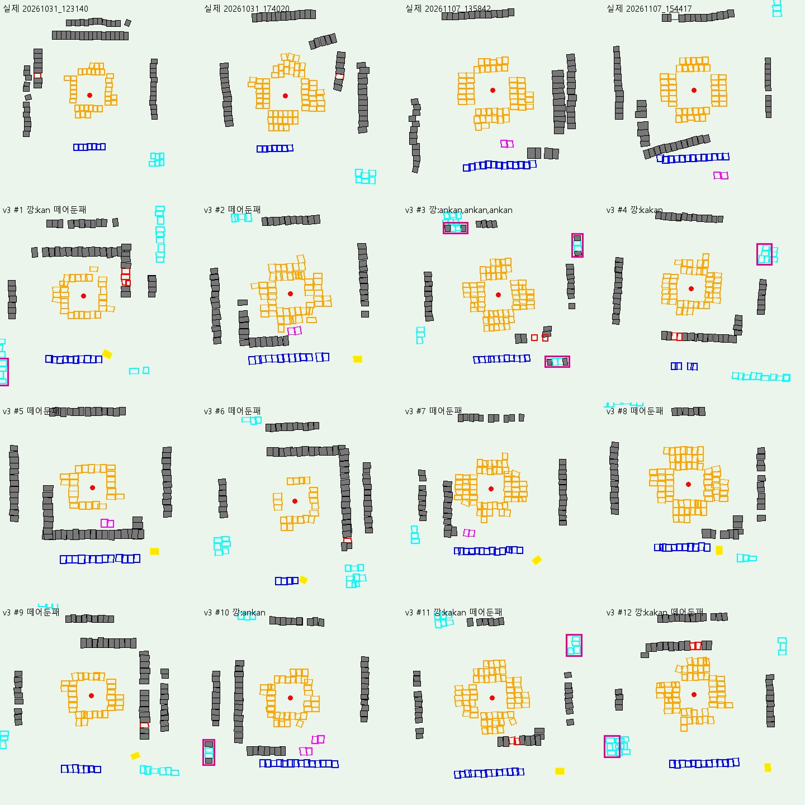

*역할 모델 학습용 합성 배치(생성기 v3, 2026-11-08). 맨 윗줄 4칸은 실제 사진에서 뽑은 입력이고, 나머지 12칸은 생성기가 만든 배치입니다. 사진이 아니라 상자 좌표만 있는 데이터를 그림으로 그린 것입니다. 파랑이 화료자 손패, 하늘색이 울기, 주황이 강, 빨강이 패산 위 표시패, 자주색이 탁자 위에 내놓은 표시패 짝, 노랑이 떼어 둔 화료패이고, 회색 칸은 역할이 없는 뒷면 패(패산·다른 사람 손패), 빨간 점은 가운데 기기, 굵은 분홍 테는 깡 묶음입니다.*

v3 배치로 처음부터 사전학습하고 같은 방식으로 미세 조정해 보니, 학습 전에 적어 둔 1단계 기준을 통과했습니다. 실제 대국 28장에서 화료자 쪽을 다 맞힌 장면은 운영 모델과 같은 23장이고, 상자는 1,582개에서 1,585개로 늘었습니다(metrics 표 1-129). 운영에 넣을지는 앱 흐름·흔들기 시험·색 바꾼 사진까지 재는 2단계를 거쳐 정합니다.

### 공정하게 재기

모델이 늘 쓰는 사진을 외워 버리면 숫자는 좋아도 처음 보는 탁자에서는 틀립니다. 그래서 재는 방법을 정해 두었습니다.

- **그 사진을 배우지 않은 모델로 채점합니다.** 사진을 촬영 시간대(오전·오후·집에서 찍은 B·C·D)로 나누고, 나눔마다 그 사진을 뺀 모델을 따로 학습해 채점합니다. 운영 모델은 사진을 전부 배웠기 때문에, 운영 모델로 잰 숫자는 "배포가 잘 됐는지" 확인일 뿐 채택 근거로 쓰지 않습니다.
- **합격 기준을 학습 전에 적고, 한 번만 학습합니다.** 결과를 본 뒤 기준을 바꾸거나 좋은 씨드가 나올 때까지 다시 돌리지 않습니다. 개발 사진, 흔들기 시험(돌리고·줄이고·흐리게 한 21가지 변형), 처음 보는 기운 사진 15장과 그 색을 바꾼 사본까지 **어느 하나라도 나빠지면 채택하지 않습니다.**

### 채택한 것과 채택하지 않은 것

| 시도 | 날짜 | 결과 | 채택 |
|---|---|---|---|
| 역할 모델(합성 배치로 사전학습) | 11-05 | 테스트 15장 규칙 91.4% → 99.6% | ✅ 지금 운영 |
| 검출기를 회전 상자로(8회차) | 11-05 | 기운 패를 펠트째 감싸지 않게 됨 | ✅ 지금 손패·울기 검출 |
| 분류기 v2: 합성 장면으로 사전학습 | 11-06 | 흔들기 시험의 위험한 답 감소, 나머지 그대로 | ✅ 11-07 운영 |
| 분류기 v3: 180° 뒤집기 + 정답 4장 고침 | 11-07\~08 | 3만 오독 19/37 → 0/37 | ✅ 지금 운영 |
| 검출기 앞면·뒷면 2종(6회차) | 11-04 | 자리 판독 30 → 28 | ❌ |
| 세워 자른 조각으로 분류기 재학습 | 11-06 | 흔들기 시험이 나빠짐 | ❌ |
| 장면 합성으로 검출기도 사전학습(9회차) | 11-06 | 흐림·작은 패에는 강해졌지만 색 바꾼 사진 145 → 139 | ❌ |
| 역할 모델에 패 사이 상대 위치 정보 추가 | 11-08 | 개발 사진은 좋아졌지만 색 바꾼 사진에서 경고 없이 틀린 답 0 → 4 | ❌ |
| 역할 모델을 생성기 v3로 다시 사전학습 | 11-09 | 실제 대국 28장 장면 23 → 23, 상자 1,582 → 1,585 (1단계 통과) | ⏳ 2단계 확인 전 |

자체 모델로 바꾸면서 장면 시간은 15.1초에서 6.1초 안팎이 됐고 판독 비용은 0이 됐습니다. 지금 운영 기준(11-08)은 개발 32회에서 손패 31/32, 패 435/436, 경고 없이 틀린 기록 0입니다.

---

## 회고

*프로젝트 전체를 처음부터 지금까지 짧게 돌아본 글입니다(같은 글: `docs/회고.md`).*

*수치는 `docs/problem_log.md`·`docs/metrics.md`의 측정 기록에서 옮겼습니다. 시간은 따로 적지 않으면 사진 한 장에서 점수가 나오기까지(한 장면)의 시간입니다.*

### 1. 시작

AI 에이전트 프로젝트 주제를 찾다가 오프라인 마작 자동 점수 계산기를 만들면 좋겠다고 생각했습니다. 관련 앱을 조사해 보니 대부분 손패만 카메라로 찍고, 그 밖의 상황은 여러 번 직접 입력해야 하는 구조였습니다. 조사한 앱은 YOLO를 사용했지만, 손패만 인식하는 모델로는 한계가 있다고 봤습니다. 제미나이 모델이라면 더 잘할 수 있지 않을까 생각했고, "제미나이로 AI 에이전트를 개발해 보자"가 이 프로젝트의 출발점이었습니다(2026-10-22).

### 2. 제미나이 인식 실험

먼저 기본적인 점수 계산기 앱을 만들었습니다. 그다음 카메라로 찍은 사진을 제미나이가 잘 읽는지 시험하려고 테스트 사진을 찾았습니다. 하지만 게임 결과 상황을 알 수 있도록 테이블 전체를 위에서 찍은 탑뷰 이미지는 구할 수 없었습니다.

임시방편으로 손패만 찍힌 사진으로 실험했는데, 처음에는 패를 아예 찾지 못했습니다. 프롬프트를 몇 차례 고친 뒤에는 눕힌 손패를 위에서 찍은 실제 사진 3장(13·14·13장)을 전부 맞혔습니다. 다만 한 장에 7\~11초가 걸려, 0.2\~0.3초인 YOLO에 비해 너무 느렸습니다.

그렇다고 YOLO로 돌아가기에는 정확도가 아쉬웠습니다. 공개 YOLO는 패 한 장 단위로는 85\~92%를 맞혔지만, 점수를 내려면 손패가 전부 맞아야 하는데 손패 사진 3장 중 1\~2장만 전부 맞혔습니다. 반듯하게 놓인 손패 인식용으로 학습된 모델이기 때문인 듯했습니다. 직접 추가 학습을 시키기에는 가진 데이터가 없어(실제 패 사진 0장), 일단 제미나이로 진행하기로 했습니다.

실제 사진을 구하기 어려워 게임·방송 화면으로 테스트했습니다. 사진 전체를 한 번에 보내 분석하면 패가 작아져 인식률이 좋지 않았습니다. 패 한 장이 약 40픽셀인 화면은 장수부터 틀렸고, 약 90픽셀인 손패는 두 번 다 전부 맞혔습니다. 그래서 "패 한 장이 100픽셀 이상"을 기준으로 잡고 locate 방식을 도입했습니다.

1. 제미나이에게 구역(손패, 강, 도라 등)을 나누게 하고 각 구역의 상자 좌표를 받습니다.
2. 고해상도 원본에서 구역별로 사진을 잘라 다시 제미나이에게 분석을 맡깁니다.

이 방식으로 게임 화면은 완전하게 분석할 수 있게 되었습니다.

### 3. 첫 매장 촬영과 속도 문제 (10-24)

실제 사진 없이는 개발을 더 진행하기 어렵다고 판단해 오프라인 마작 카페에 가서 직접 사진을 찍었습니다. 테이블 전체가 나와야 해서 다이소에서 셀카봉 삼각대를 샀습니다. 탁자 위에 삼각대로 세워 몇 차례 찍고, 셀카봉 형태로 들어 수직으로도 몇 차례 찍었습니다.

매장에서 처음 찍은 장면은 한 번에 성공해 점수 결과 화면까지 나왔습니다(리치·백·적도라·뒷도라 12,000점, 18초). 하지만 우연이었습니다. 이날 매장 촬영은 약 25회 중 5회(20%)만 점수까지 맞았고, 한 장면에 60\~70초가 걸렸습니다. 원인은 다음과 같았습니다.

- **동시 처리 미흡:** 서버가 동시에 2건만 처리하게 설정돼 있어, locate로 자른 구역 수만큼 판독이 줄을 섰습니다. 16건으로 늘리자 읽기 시간이 38.6초에서 8.6초로 줄었습니다.
- **locate 자체의 시간과 흔들림:** locate 단계만 18\~27초가 걸렸고, 물을 때마다 답이 달라 모서리의 울기나 도라 표시패를 자주 빠뜨렸습니다. 그러면 패 장수가 모자라 계산이 막혔습니다. locate의 thinking 수준을 low에서 기본값으로 올리자 놓치던 모서리 퐁을 3번 중 3번 찾았지만, 결과는 여전히 불안정했습니다.
- **헷갈리는 패:** 모델의 생각이 길어지면 호출 하나가 90초 넘게 멈췄고, 읽기가 89초까지 늘어 시간 제한에 걸려 실패하기도 했습니다. 같은 사진이 5초에 끝나기도, 63초가 걸리기도 했습니다.

여러 방식을 시도한 끝에 두 가지가 남았습니다. 자른 구역 사진은 제미나이에 병렬로 보내고, 제미나이가 하던 locate 작업은 구역마다 격자로 미리 잘라 두는 방식으로 대체했습니다. 처음에는 9칸으로 나눴다가 자리 4개와 가운데의 5구역으로 줄였습니다.

| 방식 | 점수까지 정답 | 한 장면 시간 |
|---|---|---|
| locate 방식 (10-24 매장) | 약 5/25 | 60\~70초 |
| 9칸 격자, 같은 사진 10회 반복 | 10/10 | 약 7초 |
| 9칸 격자, 서로 다른 장면 3개 | 6/12 | 8\~25초 |
| 5구역 격자, 같은 장면 3개 | 9/12 | 11\~21초 |

격자로 바꾼 뒤 남은 오류는 거의 전부 통수·삭수의 개수를 잘못 세는 것이었습니다(9삭↔6삭, 5통↔4통). 프롬프트에 규칙을 더 써 넣는 것은 효과가 없었습니다(18/24 대 19/24). 자리 사진과 함께 같은 자리를 크게 자른 토막 3장과 통수·삭수 참고표를 한 번에 보내자, 시간은 그대로(중앙 6.8 → 6.4초)인 채 자리 판독 정답이 60회 중 30회에서 57회로(50% → 95%) 올랐습니다.

하지만 여전히 시간이 문제였습니다. 이 모델은 thinking을 끌 수 없었습니다. 생각 토큰이 0인 호출은 4\~6초에 끝났지만, 생각이 길어진 호출은 40초까지 걸렸습니다. 생각을 하지 않는 빠른 모델은 3.5초로 안정적이었지만 정답이 30회 중 10회 이하였습니다. 정확도는 thinking에서 나오고 긴 지연은 그 대가였기 때문에, 실사용하기에는 어려웠습니다.

### 4. 촬영 방식 재설계

속도 문제에서 막혀 잠시 다른 문제로 눈을 돌렸습니다.

삼각대로 찍은 사진은 탁자가 약 25° 기울어 격자 방식에 맞지 않았습니다. 그대로 돌리면 15장 중 손패를 맞힌 사진이 0장이었습니다. 소프트웨어로 사진을 펴면 15장 중 8장까지 올랐지만(점수는 10장 중 7장), 틀린 점수가 그대로 기록되는 경우가 2건 생겼습니다. 먼 자리의 패가 작게 찍히는 것도 문제였습니다. 패 높이가 50픽셀대로 내려가면 9삭을 6삭으로 읽는 오독이 시작됐습니다. 쓸 만한 것은 셀카봉을 들어 수직으로 찍은 사진뿐이었습니다. 그러나 점수를 계산할 때마다 누군가 일어서서 셀카봉을 들고 찍는 것은 실용성이 없었습니다.

그래서 구조를 이렇게 바꿨습니다.

- 붐암이 달린 130cm 스탠드에 휴대폰을 거치해 탁자를 계속 촬영합니다.
- 다른 태블릿이나 휴대폰에서 앱을 열어 거치한 휴대폰과 연결합니다.
- 버튼을 누르면 거치한 휴대폰이 찍고 있는 장면을 서버로 보내고, 앉은 자리에서 결과를 확인합니다.

태블릿 UI는 마작 게임을 참고해 설계했습니다. 이 거치로 찍은 두 번째 매장 방문(10-31)에서는 탁자 기울기가 약 ±1°였고, 가장 먼 자리의 패도 폭 87\~90픽셀로 찍혔습니다.

### 5. 속도 개선: 미리 계산과 YOLO 하이브리드

다시 속도를 고민했습니다. 휴대폰이 계속 탁자를 찍고 있으니, 중간 장면을 서버로 보내 미리 계산할 수 있는 것은 미리 해 두면 속도가 크게 줄 것이라고 생각했습니다. 울기를 미리 읽어 두고 화료 때는 손패만 읽는 실험을 해 보니 개선은 소폭이었습니다. 자리 판독 시간의 중앙값은 5.5초에서 5.2초로 거의 그대로였고, 느린 쪽(p90)만 14.1초에서 9.2초로 줄었습니다. 가장 오래 걸리는 연산은 손패인데, 손패는 점수를 계산할 때에야 공개되기 때문입니다. 결국 최종 수행 시간은 손패 판독 시간에 달려 있었습니다.

그래서 모델이 사진을 분석할 때 하는 일을 쪼개 봤습니다.

1. 패가 어디 있는지 찾는다.
2. 그 패가 무엇인지 확인한다.
3. 그 패의 역할이 무엇인지 추론한다.

이 구분은 나중에 직접 모델을 학습시킬 때 중요한 힌트가 되었습니다.

속도를 줄일 방법을 고민하다가 처음에 시도했던 YOLO를 다시 떠올렸습니다. 우선 공개된 YOLO 모델에 제미나이 없이 제가 찍은 사진을 맡겨 봤습니다(10-26). 속도는 사진당 0.2\~0.7초로 제미나이보다 10\~30배 빨랐습니다. 하지만 패 단위로는 85\~92%를 찾아도 손패 전체를 맞힌 사진은 6장 중 0\~1장이었습니다(제미나이는 36회 중 34회).

숙련자는 점수 계산에 10초도 걸리지 않습니다. 그래서 제미나이의 정확도와 YOLO의 속도가 모두 필요했습니다. 패 위치 검출은 YOLO에 맡기고, 잘라 낸 패 조각이 무엇인지와 역할 추론은 제미나이에 맡기는 하이브리드 방식을 고안했습니다.

| 적용한 곳 | 정답 | 시간 |
|---|---|---|
| 강 끝 (10-26 운영 배포) | 자리별 158/180 → 180/180 | 장면 중앙 10.0 → 8.7초 |
| 손패 자리 판독 (10-28 운영 배포) | 60/60 → 60/60 | 중앙 7.8 → 5.7초, p90 18.1 → 9.6초 |

하지만 실제 매장에서는 여전히 느렸습니다. 두 번째 방문(10-31)의 오전 10회는 중앙 17.3초, 최대 41.2초였고 점수까지 완전히 맞은 것은 10회 중 5회였습니다. 오후 15회는 중앙 24.1초, 최대 43.9초였습니다. 방문 뒤 운영 서버에서 다시 재도 중앙 15.1초, 최대 66.8초였습니다. 패가 헷갈리면 제미나이의 생각이 길어져 1분 넘게 걸리는 문제는 그대로였습니다.

### 6. 자체 모델로 제미나이 대체

이것을 제미나이의 한계로 보고 방향을 틀었습니다. 매장에서 찍은 실제 사진으로 딥러닝 모델을 직접 학습시켜 제미나이를 대체하기로 했습니다.

**검출기와 분류기.** 학습을 하기로 한 이상 공개 YOLO는 계속 쓰지 않는 편이 좋다고 판단했습니다. 공개 YOLO는 성능 비교용으로만 두고, 자체 검출기가 그 성능을 넘으면 교체하기로 했습니다. 두 번째 매장 방문으로 화료 사진이 25장 생겼고, 따로 받은 10장을 더한 매장 사진 35장(패 상자 약 4,000개)으로 검출기를, 패 조각 1,550장(37종)으로 분류기를 학습시켰습니다.

- 시험 사진을 학습하지 않은 모델로 채점했을 때, "자체 모델 먼저, 검사에 실패하면 제미나이" 방식이 37회 중 26회를 맞혔습니다. 같은 방식의 공개 YOLO와 제미나이 단독은 모두 25회였습니다.
- 분류기는 날짜를 나눠 평가한 패 777장을 모두 맞혔습니다. 다만 같은 매장, 같은 패 세트의 잘 잡힌 패만 본 값입니다.

화료 판독 전체를 자체 모델로 바꾸자(11-02 운영 배포) 장면 시간이 중앙 15.1초에서 5.8초로, 최대 66.8초에서 7.3초로 줄었고 제미나이 호출은 0이 되었습니다.

**역할 모델.** 검출기와 분류기만으로는 테이블 상황을 이해할 수 없습니다. 어떤 패가 손패고, 울기고, 떼어 둔 화료패고, 도라 표시패인지를 정해야 합니다. 처음에는 이 역할을 사람이 짠 규칙으로 나눴는데, 매장의 배치 습관에 따라 규칙이 계속 늘어났습니다. 이를 대체할 방법을 고민하다가 역할만 따로 학습시킨 모델을 떠올렸습니다. 검출기로 테이블 전체의 패 상자를 뽑고, 각 패의 역할을 라벨링해 학습시킨 것이 역할 모델입니다.

**학습 데이터 생성기.** 실제 사진이 25장뿐이어서, 검출기로 뽑은 테이블 상황을 일일이 라벨링한 뒤 이를 참고해 Claude가 학습 데이터 생성기를 만들게 했습니다. 생성기는 처음에 실제 상황과 맞지 않는 출력을 냈습니다. 여러 시행착오 끝에 마작 규칙으로 범위를 한정하자 의미 있는 데이터가 나왔습니다. 합성 배치 8,000장으로 먼저 학습하고 실제 25장으로 마무리한 역할 모델은, 카메라가 전혀 다른 테스트 사진 15장에서 상자 단위로 99.6%를 맞혔습니다(규칙은 91.4%). 이 모델은 11-05에 운영에 들어갔습니다.

이렇게 제미나이 없이 자체 모델만으로 기능을 구현할 수 있었습니다. 다만 기본 사진의 절대량이 부족하므로, 자체 모델만으로 점수 계산이 어려울 때는 제미나이 방식으로 대체하는 옵션을 안전장치로 남겼습니다. 같은 날 같은 서버로 재면 자체 모델은 중앙 6.2초, 제미나이 경로는 중앙 17.1초입니다(11-07).

### 7. 현재와 다음 단계

세 번째 방문(11-07)에서는 손님을 포함한 4명이 실제로 대국하는 동안 시스템을 켜 두었습니다.

- 혼자 늘어놓은 연출 장면은 11장면 중 9장면을 맞혔습니다.
- 실제 대국은 손·팔 가림과 사용 규칙 위반 사진을 뺀 11장 중 10장을 맞혔습니다. 틀린 1장은 경고가 떠서 그대로 기록되지 않았고, 경고 없이 틀린 점수가 기록된 것은 0건이었습니다.
- 판독 시간은 중앙 8.6초, 최대 14.6초였습니다.

이때 찍은 사진으로 원인을 찾아 재학습했습니다. 분류기가 뒤집힌 3만을 2만으로 읽던 오독은 37장 중 19장에서 0장이 되었습니다. 지금 운영 기준(11-10)은 개발 장면 32회에서 손패 32/32, 패 436/436, 경고 없이 틀린 기록 0, 장면 시간 중앙 6.4초, 최대 8.1초입니다. 다만 운영 모델은 이 사진들을 이미 학습했기 때문에, 이 숫자는 성능 평가라기보다 배포 확인에 가깝습니다.

검출기와 분류기는 당분간 추가 학습이 필요 없는 수준이라고 보고 있습니다. 역할 모델도 데이터를 몇 번 더 보태면 추가 학습이 필요 없을 것으로 보입니다. 남은 문제는 탁자 테두리 위에 둔 울기, 실제 대국에서의 리치 추적, 다른 탁자에서의 검증입니다.

다음 매장 테스트에서는 손님들의 양해를 구하고, 실제 앱으로 점수를 계산해 검증할 계획입니다.

---

## 앞으로: 매장에 설치한다면

바닥 거치대, 천장 부착, 압축봉 중 무엇이 매장에 맞는지는 사장님과 손님 설문에 넣어 물어볼 예정입니다. 장기적으로는 폰 대신 **라즈베리파이 카메라(약 10만 원)와 태블릿**을 탁자마다 고정 설치하는 형태를 생각하고 있습니다.

---

## 참고 자료

- Projection Mahjong (2026): T. Kato, T. Hasegawa, "Projection Mahjong: augmenting real-world Mahjong experience", *Multimedia Tools and Applications* 85, 141. https://link.springer.com/article/10.1007/s11042-026-21151-7
- Projection Mahjong (2023, 첫 버전): 情報処理学会 EC2023. https://ipsj.ixsq.nii.ac.jp/record/227470/files/IPSJ-EC2023023.pdf
- パイリーダー 보도자료 (2009): https://www.atpress.ne.jp/news/10279
- パイリーダー 소개 기사 (2012): https://getnews.jp/archives/165484
- パイリーダー 판매 종료·가격: https://mahjong-item.jp/paireader/
- 손패 촬영 앱·국내 프로젝트 목록과 조사 메모: `docs/market_research.md`
- 패 크기·구역 자르기·고정 카메라로 바뀐 과정: `docs/problem_log.md` 2\~3번, `docs/table_reading_design.md`
- 첫날 사진의 공개 YOLO11 결과: `docs/metrics.md` 표 1-123(`experiments/yolo/day1022.py`)
- 카메라 거치: 방문 체크리스트 `docs/visit_checklist_1024.html`·`docs/visit_checklist_next.html`, 펴기 대 반듯한 거치 결정(10-29)은 `docs/problem_log.md` 31b번, 높이 상한은 42번(흔들기 시험), 거치 고정 결정은 `docs/improvement_plan_1105.md` 8b절, 설치 형태 설문 `docs/survey_questions.md`
- 두 번째·세 번째 방문 전후: `docs/problem_log.md` 16\~48번과 "정확도 변천" 표, 10-31 방문 `experiments/visit_20261031/`·`HANDOFF.md`, 11-07 방문 `docs/problem_log.md` 47번
- 모델 구성·학습 방식: `experiments/tile_classifier/README.md`(검출기 1\~9회차, 분류기 v1\~v3, 역할 모델), `docs/problem_log.md` 35번(자체 모델로 교체)·39번(역할 모델)·40번(검출기 1\~9회차)·44번(기준을 먼저 적는 학습)·48번(분류기 v3), 역할 모델 테스트 `docs/metrics.md` 표 1-59
- 첫 개발(Gemini 방식) 문제와 해결의 숫자: `docs/problem_log.md` 1\~16번, 첫날 실험 `experiments/vlm/RESULTS.md`, 첫 매장 방문 `experiments/field_20261024/NOTES.md`

---

## 개발자용 안내

- 개발 환경·빌드·시험 명령, 코드 구조, 화면 기능: `docs/development.md`
- 층·의존 방향·데이터 흐름: `ARCHITECTURE.md`
- 지금 현황과 이어서 할 일: `HANDOFF.md`
- 인식 서버: [mahjong-recognizer](https://github.com/jjh7757/mahjong-recognizer)
