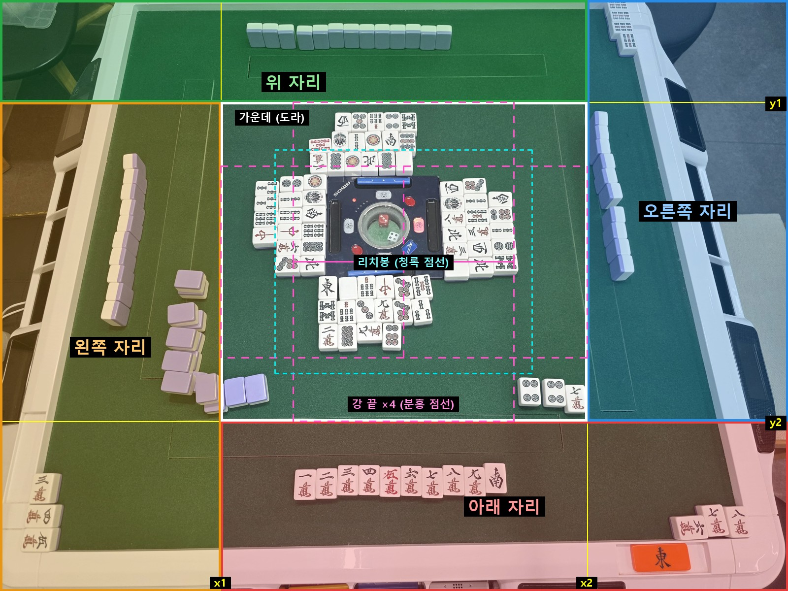
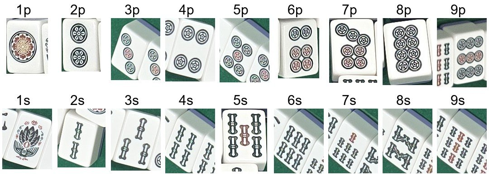

# 개발일지(2026-10-25)

## 한 일

- 운영 배포 7ddefde(격자 구역 판독용 `/v2/corner`·`last`·`sticks`·`dora`). 사용자가 선을 그은 사진 10회 점수 10/10, 중앙 7.1초.
- 평가 세트를 B·C·D(사진 6장)로 정함(사용자 결정: 화료패가 사진에 없는 A·E 는 뺌). 쌓인 결과를 B·C·D 만으로 다시 집계함.
- 강 끝을 못 읽으면 대기패로 화료패·방총자를 정하는 앱 규칙(`winFromWait`) → 저장된 판독 재생으로 B·C·D 점수 11/12 → 12/12, 추가 호출 0.

## 문제 1: locate 가 느리고 흔들림 → 격자로 바꿈

- **원인:** "어디"까지 모델에 맡김. 18~27초가 걸리고 호출마다 울기·왕패를 놓침.
- **해결방안:** 카메라가 고정이니 사용자가 선을 한 번 그어 칸을 나누고 칸마다 동시 호출(사용자 제안), 강은 마지막 패만, 리치는 리치봉만. 9칸 → 5구역(자리 4 + 가운데). 한 장면 60~70초 → 7~20초, B·C·D 점수 6/12 → 9/12. 해결됨.

*5구역 격자(장면 D). 선 x1·x2·y1·y2 로 네 자리와 가운데(도라)를 나누고, 강 끝(분홍 점선)·리치봉(청록 점선)은 가운데 안에서 따로 자릅니다.*

### 시행착오

1. 9칸 격자(장면 D) → 4/4 정답. 도라는 픽셀 흰 덩어리 찾기가 0/10 이라 가운데 칸을 `/v2/dora` 로. 강 끝 크롭을 칸 폭 전체로 자르면 도라가 섞여 15~36초 → 가운데 띠로 좁힘.
2. 장면 5개(A~E) → B·C·D 6/12. 왼쪽 칸에 패산이 들어가 화료자 판정 실패, 도라 표시패가 칸 경계·손패 옆이면 못 읽음.
3. 5구역(사용자 제안) → 처음엔 구역이 커 4삭 안깡을 8삭으로 4/4. 1568 → 3200px 로 보내도 그대로(Gemini 가 일정 토큰으로 줄여 봄) → 이미지 해상도 ULTRA_HIGH 로 2/2. B·C·D 9/12.
4. 손패 칸·모서리 칸을 나눠 보냄 → 8/12. 손패 칸만 보면 오른쪽 손패를 "앞면 아님"으로 답함(16회 중 14회) → 기본은 통째.

## 문제 2: 통수·삭수 개수를 틀림(9삭↔6삭, 5통↔4통)

- **원인:** 멀고 작게 찍힌 패의 무늬 개수를 잘못 셈. 정답 정보는 원본 사진에 또렷이 있었음 — 모델이 아니라 입력 문제.
- **해결방안:** 한 호출에 자리 사진 + 코드가 자른 확대 토막 3장(ULTRA_HIGH) + 통수·삭수 1~9 참고표 → 30/60 → 57/60, 시간 그대로(중앙 6.4초). 앞면 정의를 "그림이 보이면 true" 로 바꿔 "앞면 아님" 오류 12/300 → 0/120(v3a). 해결됨.

*자리 판독 호출에 함께 넣는 통수·삭수 1~9 참고표(매장 패를 잘라 만든 것). 무늬 개수를 셀 때 견줄 실물입니다.*

### 시행착오

1. 프롬프트에 "손패 + 울기 = 13장" 규칙 → 규칙 있음 18/24, 없음 19/24. 효과 없음.
2. "확대 + 참고 그림" 도구(모델이 부르면 확대 그림·후보 실물 그림을 돌려줌) → 18/30 → 27/30. 대신 중앙 9.5 → 13초, 입력 토큰 6.6배. 참고 그림을 293장으로 늘려도 24/30.
3. 실패 15건을 모델이 받은 그림과 함께 봄 → 상자가 패를 자름 7, 틀린 패를 확인 안 함 5. 상자 넓히기는 효과, 후보 확장·확인 강제는 득실이 엇갈림. 같은 조건도 22~27/30 으로 흔들려 30회로는 판단이 안 됨.
4. 다른 모델(3.5 Flash·3.1 Pro·ER2) → 3~15/30. 어느 모델이든 먼 자리의 같은 패를 같은 쪽으로 틀림.
5. 코드가 늘 확대 토막을 붙임 → 50/60, 참고표까지 57/60. 다른 패 세트(집 패)로 만든 표도 56/60 → 매장마다 표를 만들 필요 없음. 34종 전체 표는 50~52/60 으로 나빠 통수·삭수만 둠.
6. 토막별로 따로 적게 하는 스키마(v3) → 생각 0 으로 꼬리는 사라졌지만 47/60 이라 버림.

## 문제 3: 틀린 판독이 그대로 반영될 위험 + 꼬리 지연

- **원인:** 느린 호출은 생각 토큰이 많은 호출(생각 0 이면 4~6초, 3.7k 면 40초)이고 3.8 Flash 는 생각을 끌 수 없음. 한 번 읽으면 가끔 틀린 답이 그대로 반영됨.
- **해결방안:** 자리 판독을 같은 순간 3번 읽어 만장일치일 때만 자동 반영, 아니면 확인 질문(서버 439e035, 배포 전). 앱 흐름 B·C·D 점수 11/12·틀린 채 반영 0. 대신 장면 중앙 18.6초로 느려져 부분 해결.

### 시행착오

1. 생각 끄기(off·예산 0·256) → 무시되거나 400. 출력 상한 800 → 생각까지 세어 7/30 답이 잘림.
2. 시뮬레이션: 처음부터 두 개 보내 먼저 온 답 쓰기(경주) → p90 34.6 → 8.3초. 그러나 v3a 에선 먼저 온 답이 덜 생각한 답이라 정확도 91.7 → 88.8%.
3. 시뮬레이션: 3개 중 2개 일치면 틀린 반영 2.1%, 만장일치면 0%·확인 17% → 만장일치 선택.
4. 서버에 넣고 앱 흐름 20회 → 만장일치인데 틀린 답 2회(E 3삭→2삭, 세 요청 모두). 같은 순간 보낸 요청은 같이 틀릴 수 있음 → 앱 장수·화료 검사와 겹쳐야 함.

## 남은 것

- 운영 서버엔 `/v2/seat`·ULTRA_HIGH 가 아직 없음(7ddefde 는 9칸판). 3번 읽기로 느려진 시간. 평가에서 먼 자리 장면이 빠져 먼 자리 + 화료패 사진이 필요함.

근거: `docs/problem_log.md` 3·4·5·10·13·16번, `docs/metrics.md` 표 1·1-0·2-1·2-2, `experiments/field_20261024/NOTES.md`("격자 구역 판독"~"11."), 서버 커밋 7ddefde·439e035.
