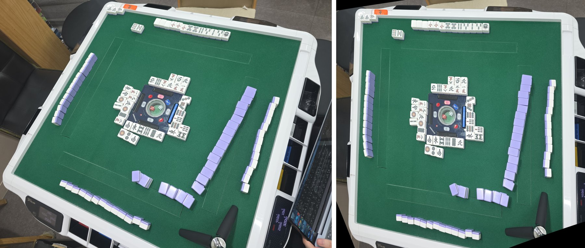

# 개발일지(2026-10-27)

## 문제 1: 10-24 매장 삼각대 사진 15장에서 손패를 하나도 못 읽음(0/15)

- **원인:** 갤러리 B·C·D 6장으로 규칙·문턱·프롬프트를 고르고, 같은 6장으로 점수를 냈음(12/12). 즉 과적합. 게다가 매장 사진은 탁자가 약 25° 기울어 있어서, 축에 나란한 격자 선 4개로는 자리를 나눌 수 없었음.
- **해결방안:** B·C·D = 개발 세트, 매장 15장 = 테스트 세트(규칙을 고치는 데 안 쓰고 한 번만 잼)로 나눔. 탁자를 펴서 읽는 실험으로 테스트 손패 8/15까지 올렸지만 앱에는 안 넣음 → 진행 중. 결국 기울기 보정보다 카메라를 위에서 반듯하게 거치하는 쪽으로 감.

*10-24 매장 삼각대 사진(왼쪽)과 같은 사진을 펠트 네 모서리로 편 것(오른쪽). 왼쪽처럼 탁자가 약 25° 돌아가 있으면 가로·세로 선 4개로는 자리를 나눌 수 없습니다.*

### 시행착오

1. 기본 격자로 노트북 앱 흐름 15장 → 화료자 15/15, 손패 0/15, 점수 0/10. 기운 손패가 가운데 칸에 걸리거나 잘림.
2. 삼각대 위치별로 격자를 맞춤 → 12000 한 장은 맞았지만 너무 오래 걸려 4장에서 중지함.
3. YOLO26 자동 격자 → 손패 0/14. 자동 위쪽 선이 기운 손패 윗부분을 잘라 먹음.
4. "과적합 아니냐"는 지적 → 개발/테스트 세트를 나누고, B·C·D 를 ±10~25° 로 기울인 합성 18장을 개발용으로 만듦.
5. 펠트 네 모서리로 사진을 펴고 표준 격자 하나로 읽음 → 합성 2/18 → 18/18, 테스트 손패 0/15 → 8/15, 점수 0/10 → 7/10.
6. 그런데 테스트에서 틀린 채 자동 반영 2/15가 나옴(리치 12000 → 7700, 적5만 → 5만). 개발 세트에선 0이던 안전장치가 일반화되지 않았음.
7. 판독 확신도로 막아 보려 함 → 리치봉은 있으면 늘 0.9, 5 패는 적5든 아니든 0.99라 신호가 없음. 대신 "표시패 0장", "리치인데 뒷도라 안 보임" 장수 검사만 자동 반영 조건에 넣음.
8. 리치봉 3번 읽기·5 패 확대 재확인을 개발 세트로 시험 → 개발 세트에선 그 실수가 아예 안 생겨서 잡는 능력을 잴 수 없었음.
9. 테스트 세트에 한 번만 잼 → 리치봉은 세 답이 늘 같아 신호 없음. 5 패 재확인은 적5 오독 4장을 하나도 못 잡고 헛경보 4장. 둘 다 미채택.

## 문제 2: 울기를 미리 읽어 두고 화료 때 손패만 읽으면 빨라질까

- **원인:** 처음엔 "울기 정보를 빼면 모델이 더 고민한다"고 잘못 결론 냄. 실제로는 울기를 잘라 낸 사진에 "모서리까지 읽어라, melds 칸" 같은 옛 지시가 그대로 남아 사진과 지시가 어긋난 탓이었음.
- **해결방안:** 손패만 읽는 문구로 다시 짜서 잼 → p90 14.1 → 9.2초, 정답 그대로. 서버에 손패 전용 경로 `/v2/handonly`(3cae334)를 만들고 판 상태 추적 설계를 시작함. 진행 중.

### 시행착오

1. 울기를 잘라 낸 크롭 + 옛 문구 / + "울기는 이미 읽었다" 한 줄 → 생각한 호출이 7 → 26/120으로 늘어 "울기는 그대로 두자"로 결론 냄.
2. 사용자 지적: 프롬프트를 못 짠 것. 사진을 바꾸면 지시도 같이 바꿔야 공정한 비교임.
3. 손패 전용 문구·스키마로 다시 잼(두 회차, 120회씩) → 정답 120/120, 중앙 5.5 → 5.2초, p90 14.1 → 9.2초, 긴 생각 11 → 0번. 결과가 뒤집힘.
4. 장수까지 알려 주는 안은 p90 8.1초로 추가 이득이 작아 넣지 않음.
5. 추적 상태 기계(`tracker.dart`)를 만들고, 합성 프레임으로 노트북 흐름을 확인함.

## 문제 3: 앞면(화료자) 판정과 서버 문구가 "뒷면 = 연보라" 를 전제로 함

- **원인:** 매장 실험이 연보라 뒷면 자동탁 하나뿐이었음. 실제 매장엔 파랑·초록·노랑·주황·검정 뒷면도 많음(사용자 지적).
- **해결방안:** 뒷면 색을 아예 보지 않고, 손패 칸의 앞면 무늬 넓이로만 판정함. 서버 문구에서도 색 이름을 뺌(운영 131275a). 해결됨.

### 시행착오

1. B·C·D 의 뒷면만 5색으로 바꾼 합성 30장으로 잼 → 앱 판정이 파랑조차 못 잡아 20/30.
2. 색마다 문턱을 넓히는 안은 또 과적합이라 버림.
3. 무늬 넓이를 울기 모서리 빼고 손패 칸에서만 셈 → 1·2등 차가 2배 → 6.6배 이상으로 벌어져 30/30.
4. 운영 배포 뒤 앱 흐름 B·C·D 12/12, 틀린 반영 0, 중앙 8.9초.

## 한 일

- 결과 음성: 기기 TTS 가 느려서(배만 13.3초) 미리 만든 음성 파일 86개로 바꿈. 끝 잡음은 응답 WAV 끝에 붙은 C2PA 덩어리를 소리로 읽은 탓이었음 → data 청크만 읽어 6.2초. 목소리 5개 중에서 고르게 함.
- 판독이 확실하면 10초 뒤 자동 반영, 그 전엔 취소 가능하게 함. 처음 규칙은 설명용 플래그까지 막아 0/60이었고, 플래그를 설명용·확인용으로 나눠 58/60, 틀린 반영 0.
- 실험 두 개는 미채택: 먼 자리 크롭 펴기·키우기는 다시 재니 흔들림 범위였고, Gemini Priority 등급은 비용만 2배에 시간 차이가 없었음.
- 노트북(Windows) 앱 흐름 측정: 12/12, 10.5 / 16.5 / 19.3초, 기기 처리 약 2.0초.
- 키오스크 첫 화면을 '대국 시작' 로비로 바꾸고, 대국 기록 되돌리기·정정을 만듦. 매장 설문(18문항)을 구글 폼으로 만듦.

## 남은 것

- 펴기는 앱 미반영. 적5 오독·리치봉 놓침은 판독 자체(해상도·거치)의 문제라 새 매장 사진이 필요함.

근거: `docs/problem_log.md` 26·27·28·29·30·31·31b번, `docs/metrics.md` 표 1(10-27 줄)·2-1·5·6, `experiments/rectify/README.md`, 서버 131275a·3cae334.
