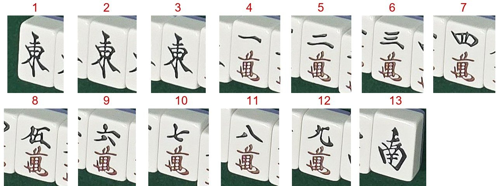

# 개발일지(2026-10-28)

← 이전: [10-27](개발일지%5B2026-10-27%5D.md) · 다음: [10-29](개발일지%5B2026-10-29%5D.md) →

## 문제 1: 장면 꼬리 지연의 주인이 자리 판독(사진 통째 읽기)

- **원인:** 자리 크롭을 통째로 Gemini 에 주면 먼 자리·기운 자리에서 오래 생각함. 입력 토큰도 3번 합쳐 32k로 큼.
- **해결방안:** YOLO11 로 손패 틀을 잡고, 패 조각을 번호 칸 한 장 그림으로 붙여 "종류만" 묻게 함. 못 잡으면 예전처럼 통째 읽기. 운영 배포 dc19e89, 해결됨.

*YOLO11 이 잡은 손패 13장을 번호 칸 한 장 그림으로 붙인 것(장면 C). Gemini 에는 이 그림만 주고 칸마다 종류만 묻습니다.*

### 시행착오

1. 같은 코드 서버 두 개를 같은 순간에 비교(B·C·D 60장면씩) → 정답 60/60 둘 다, 중앙 7.8 → 5.7초, p90 18.1 → 9.6초, 입력 32k → 11k.
2. D 의 눕힌 6만 조각을 3번 중 1번 6삭으로 읽는 엇갈림이 2/20 나옴 → 만장일치가 걸러 확인 질문(틀린 반영 0).
3. 앱 흐름 12회 → 12/12, 중앙 8.1초 같음, p90 10.4 → 8.5초, 최대 17.9 → 10.0초. 앱 흐름에선 꼬리만 줄었음.
4. 운영 재측정과 "운영 vs 로컬 같은 순간" 비교 → 꼬리는 두 서버가 같은 장면에서 같이 느림. 꼬리는 Gemini 쪽, 운영 서버가 더하는 건 장면마다 약 1.2초.
5. 손패 전용(`/v2/handonly`)에도 조각 읽기를 붙이고 앱이 확정 울기 수를 넘기게 함(운영 71b43cd) → 자리 판독 p90 21.4 → 13.0초, 정답 60/60.
6. 표기법(만수 萬 은 숫자 아래·붉은색, 바람패 한자) 사실을 바로잡음(ab56649). 두 회차로 재 보니 "먼저 보낸 쪽이 느림" 순서 효과가 있었음 → 앞으로 두 서버 비교는 순서를 바꿔 두 회차로 함.

## 문제 2: 실제 폰 헤드 미리보기가 1440×1080 까지만 나옴

- **원인:** 카메라 플러그인이 미리보기·촬영·분석 세 가지를 같이 묶어서, 분석 프레임이 1440으로 제한됨. 이러면 판 중 프레임에서 패 폭이 약 40px라 울기를 못 읽음.
- **해결방안:** 헤드 화면만 CameraX 를 직접 써서 미리보기 + 분석 두 가지만 묶음(e4aee93). 해결됨.

### 시행착오

1. S25 Ultra 를 무선 디버깅으로 붙여 잼 → `/capture` 4080×3060 1.04초(셔터음 있음), 미리보기는 2000을 요청해도 1440×1080.
2. 네이티브 헤드로 바꿈 → 미리보기 4080×3060 0.17초, 촬영 0.24\~0.27초·셔터음 없음, 촬영 뒤 복귀 0.05초.
3. 3초 폴링 100번 100/100, 8분 동안 배터리 2% 줄고 온도 약 4°C 오름. 매장에선 충전하며 써야 함.

## 문제 3: 패 없는 장면에서도 판 상태 추적이 헛 이벤트를 냄

- **원인:** 폰을 놓는 움직임과 흰 천장의 노출 흔들림을 "변화"로 봄. 카메라 움직임 검사도 연결돼 있지 않았음.
- **해결방안:** 장면 전체 변화 검사를 넣고, 리치봉 추적은 기본 끔(41d52f2). 헛 모서리 읽기는 줄었지만 헛 강 버림은 남음 → 진행 중.

### 시행착오

1. 노트북 키오스크 + 폰 헤드로 2분 41초 → 모서리 읽기 20회, 리치봉 2회, 강 버림 16개(전부 헛).
2. 폰을 미리 놓고 안 건드림 → 모서리·리치봉 0회, 강 버림 4개. 주원인은 카메라 움직임.
3. 장면 전체 변화 검사 규칙을 세 번 바꿈 → "칸 7개 이상 + 모서리 2개" 또는 "같은 방향으로 바뀐 강 띠 3개" 로 정상 헛 판정 0/34.
4. 같은 프레임 재생 비교 → 모서리 읽기 17 → 3회, 리치봉 4 → 0회. 헛 강 버림은 6 → 5개로 거의 안 줆.

## 한 일

- 앱을 GitHub 저장소로 올리고 CI(analyze·test·APK)를 붙임. 서버는 pytest 를 통과해야 배포되게 함.
- 강 버림 위치·리치봉 추적(2단계)을 만들고 합성 프레임 흐름 테스트를 통과함.
- 더블론 자동 판정(눕힌 손패 둘이 같은 패로 화료형이면 묻지 않음), "판독 후 자동 반영" 켜고 끄기, 대국 시작 이름 칸 키보드 패널.
- 설문을 15문항 새 폼으로 줄이고 거치 방식·요금 방식·패보 질문을 넣음.
- 밤 실험: 손패 칸·모서리 칸 나눠 틀 잡기를 서버에 넣음(커밋 전, 원본 틀 4/6 → 6/6). 탁자 끝 밖 지우기는 C·D 에서 손해였음. 작탁만 남기고 펴서 읽기는 앱 흐름 12/24(지금 23/24)라 앱 기본 끔.

## 남은 것

- 헛 강 버림, 눕힌 울기 조각(6만 → 6삭·北) 엇갈림, 실제 패·매장에서 추적 확인.

근거: `docs/problem_log.md` 24번, `docs/metrics.md` 표 1(10-28 줄)·2-1·2-3·4·8·8-1, `experiments/field_20261024/NOTES.md` 31\~37, 서버 dc19e89·71b43cd·ab56649, 앱 63fa94f·e4aee93·41d52f2·f6c7e9f.

← 이전: [10-27](개발일지%5B2026-10-27%5D.md) · 다음: [10-29](개발일지%5B2026-10-29%5D.md) →
