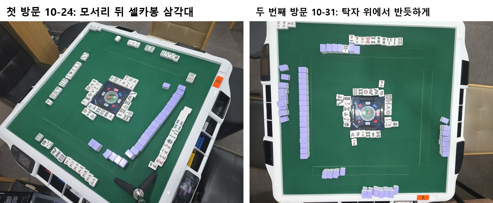

# 개발일지(2026-10-31)

← 이전: [10-30](개발일지%5B2026-10-30%5D.md) · 다음: [11-01](개발일지%5B2026-11-01%5D.md) →

## 한 일: 매장 실제 대국 촬영(위에서 반듯하게 거치, 여러 판 이어 찍기)

- 태블릿(앱 6396644) + 폰 헤드, 운영 4954b47. 거치 기울기 약 ±1°, 먼 자리 패 폭 87~90px.
- 오전 10회: 완전 정답 5/10(격자를 다시 저장한 13:14~13:38 은 4/5), 틀린 자동 반영 0, 17.3 / 41.2 / 41.2초.
- 오후 15회: "대국에 반영"을 안 해서 정답이 없음. 손패 장수 맞음 1/15, 24.1 / 38.9 / 43.9초.
- 25회 전부 매장 개발 세트로 쓰기로 함(사용자 결정). 나누기 전에 오후 크롭까지 원인 분석에 봐서 깨끗한 테스트 사진이 없었음. 테스트는 다음 방문 사진으로.
- 12:38 태블릿 → 헤드 연결이 한 번 끊김. 무선 디버깅을 끈 채, 다른 공유기에서도 재현됨. 원인 미확인.

*같은 매장 탁자를 두 거치 방식으로 찍은 사진. 왼쪽(10-24 셀카봉)은 탁자가 기울고 먼 자리 패가 작고, 오른쪽(이번 방문, 위에서 반듯하게)은 네 자리 패가 거의 같은 크기로 찍힙니다.*

## 문제 1: 대국 시작 직후 격자 자동 맞추기가 0/10

- **원인:** 거치 전·패가 올라오기 전에 자동 재시도 10회를 다 써 버림. 그래서 격자 저장·추적·도라 산 찾기가 안 돎.
- **해결방안:** 패를 돌리고 첫 버림 뒤 "자동 맞추기"를 손으로 한 번 누름 → 1/1, 띠 4개·왕패 상자 맞음(5.5초). 재시도 조건 고치기는 남김. 진행 중.

## 문제 2: 카메라가 밀린 뒤 격자가 손패를 자름

- **원인:** 12:53 부터 카메라가 약 5° 틀어졌고, 13:07 엔 더 밀렸는데 격자를 안 고침.
- **해결방안:** 격자를 다시 저장 → 같은 장면이 41.2초·손패 5장 틀림·리치봉 놓침에서 12.5초·전부 맞음으로 바뀜. 해결됨(그 자리에서).

## 문제 3: 오후 사진에서 손패 장수가 거의 다 틀림(1/15)

- **원인:** 크롭을 눈으로 확인해 보니 세 가지가 섞여 있었음.
  - 앞으로 내민 공개 손패가 격자 선에 잘림(8장).
  - 화료자가 쯔모패를 손패에서 떼어 둠 → 13장만 읽고 마지막 장을 화료패로 가정(온전한 4장 중 3장).
  - 반영을 안 하니 추적이 새 판으로 안 넘어가 지난 판 울기가 남음(모서리 읽기 269회).
- **해결방안:** 첫 번째만 고침. 손패 크롭을 격자 선에서 가운데 쪽으로 40 넓힘(d95ceb0). 나머지 둘은 다음 날 이후로 → 진행 중.

### 시행착오

1. 넓히는 폭 0 / 40 / 80 을 같은 순간에 나란히 잼.
2. B·C·D → 셋 다 12/12. 손패 전용 읽기는 40 에서 B 틀을 못 잡아 통째 읽기로 약 3초 느려짐.
3. 매장 오전 → 0: 6/7, 40: 7/7, 80: 6/7(12:58 틀림, 만장일치 줄어듦).
4. 매장 오후 장수 맞음 → 0: 7/15, 40: 9/15, 80: 9/15. 40 에서 13:07 오독, 13:48·14:31·17:15 장수 틀림이 고쳐짐. 손·팔이 가린 사진 등은 그대로.
5. 80 은 이득이 같고 오전에 틀림이 생겨 미채택, 40 을 채택함.

## 남은 것

- 오전 13:38: 손패 옆이 아닌 곳에 둔 표시패를 가운데 칸에서 읽어 8통 → 4통으로 오독. 자동 반영은 막혔지만 확인 때 사람도 못 잡음.
- 떼어 둔 쯔모패 찾기, 기록 없이 판이 바뀔 때 추적 새 판 넘기기, 자동 맞추기 재시도 조건, 태블릿 ↔ 헤드 끊김.

근거: `docs/metrics.md` 표 1-2·1-3·10(10-31 줄), `HANDOFF.md` "10-31 매장 실험 결과", `experiments/visit_20261031/label_fixes.md`, 앱 d95ceb0.

← 이전: [10-30](개발일지%5B2026-10-30%5D.md) · 다음: [11-01](개발일지%5B2026-11-01%5D.md) →
