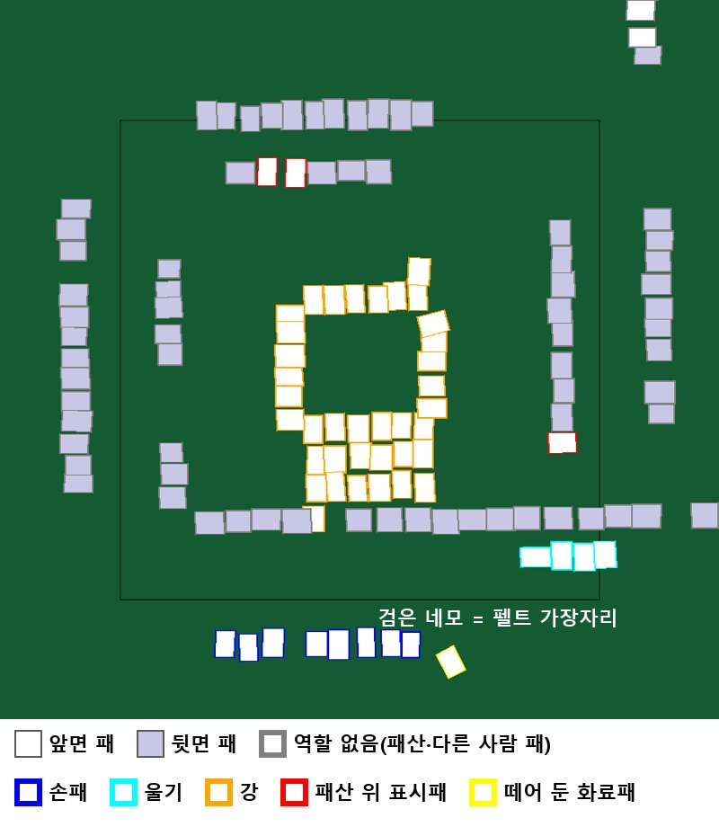

# 개발일지(2026-11-03)

← 이전: [11-02](개발일지%5B2026-11-02%5D.md) · 다음: [11-04](개발일지%5B2026-11-04%5D.md) →

## 문제 1: "틀린 자동 반영 0"이 손패만 본 숫자였음

- **원인:** 채점기가 손패·울기·화료패만 봤음. 표시패·리치·론쯔모가 틀려도 점수는 틀리는데 채점에 안 잡혔음. 한편 자동 반영을 너무 많이 막으면 매번 사람이 확인해야 함.
- **해결방안:** 채점에 "완전 맞음"·"경고 없는 틀린 자동" 열을 더하고, 표시패·확신도 문제는 막지 않고 경고 + 20초 카운트다운으로 바꿈(95c87ec). 해결됨. 이후 모든 표는 "경고 없는 틀린 자동"을 안전 지표로 씀.

### 시행착오

1. 사용자 결정으로 화료 형태 아님·방총자 모름·장수 문제는 계속 막고, 표시패 0장·리치인데 1장·확신도 낮음은 경고만 → 자동 반영 10(틀림 0) → 29(0)/34.
2. 사용자 "채점 보강부터" → 저장 로그를 재채점하니 자체 모델 완전 맞음 23/34, Gemini 25/34. 손패 기준 30/34보다 크게 낮고 차이는 전부 표시패와 D 점수. 운영 Gemini의 "틀린 자동 반영 0"도 손패 기준이었고, 실제로는 170105 표시패를 경고 없이 1300점으로 반영한 1건이 있었음.

## 문제 2: 표시패가 정확도 1순위로 드러남

- **원인:** 손패 밖 틀린 자동 7 중 3이 표시패. 리치 화료면 짝을 탁자 아무 데나 내놓고(사람마다 다름), 화료 사진 한 장으로만 판단했음.
- **해결방안:** 판 중 프레임으로 표시패를 미리 확정하고, 비스듬히 내놓은 짝은 돌려 읽기(앱 d10e41f, 서버 032c746). 진행 중(효과는 다음 매장 고해상 프레임으로 확인).

### 시행착오

1. 사용자 요청 "표시패 판 시작 확정" → 패산 표시패는 판 내내 그대로이니 15초마다 읽어 다수결. 첫 규칙은 맞음 9·틀림 6 → 확신도 문턱 0.7·최근 20번 다수·기록 때 비움으로 고쳐 맞음 11·틀림 2·없음 6.
2. 해상도를 비교 → 원본 4080은 8/0/0, 1020 미리보기는 4/0/4라 앱은 고해상 프레임을 쓰게 함.
3. 첫 앱 측정은 효과 0 → 판독 결과를 한 번 더 감싸는 곳이 확정값을 빠뜨린 버그였음.
4. 사용자 제안 "리치 후 도라 위치가 사람마다 달라" → 격자 구역 밖 짝을 15° 단위로 돌려 읽음 → 비스듬한 170105 짝(5통·5삭)을 처음 맞힘. 매장 오후 완전 맞음 5 → 6, 완전 틀린 자동 3 → 2.

## 문제 3: 다른 탁자에서도 격자가 될까

- **원인:** 펠트 색 격자는 이 매장 탁자로만 쟀음(사용자 지적 "지금 탁자에 과적합"). 위에서 찍은 다른 탁자 사진이 하나도 없음.
- **해결방안:** 펠트 없이 패 상자만으로 격자를 만드는 방법을 시험 → 미채택. 펠트 격자 유지, 다른 탁자 문제는 진행 중(11-05 이후 탁자 기준점으로 이어짐).

### 시행착오

1. 패 상자만으로 화료자 손패 줄 찾기 → 자리 26/29. 다른 탁자 사진 한 장(table2)은 13장 손패 줄을 맞게 잡음.
2. 패 상자로 선 4개를 만들어 판독 경로에 끼움 → 앱 흐름 25/34·완전 맞음 16/34·경고 없는 틀린 자동 2(펠트 29/34·22/34·0). 규칙을 이 사진으로 고친 값인데도 졌음. 미채택.

## 문제 4: 표시패 짝·떼어 둔 패를 나누는 규칙이 과적합

- **원인:** 손패 줄·울기·강·표시패·짝·떼어 둔 화료패를 규칙으로 나누는데, 규칙이 틀리는 바로 그 역할(짝 16장·떼어 둔 패 11장)은 실제 사진에 표본이 거의 없음.
- **해결방안:** 상자 배치만 보는 작은 Transformer를 마작 규칙으로 만든 합성 배치로 사전학습 → 개발 25장에서 규칙을 넘음. 진행 중(11-04 테스트·서버 연결로 이어짐).

*역할 모델 입력의 합성 예(그림은 11-08 에 그린 것). 사진이 아니라 패 상자의 위치·크기·앞뒷면만 들어가고, 모델은 상자마다 역할(색)을 맞힙니다.*

### 시행착오

1. 사용자 "일단 학습해봐" → 패 한 장 주변 그림을 보는 분류기 → 흔한 역할은 95% 이상, 짝 5/16·떼어 둔 패 0/11. 라벨이 규칙에서 나와 규칙을 못 넘음. 미채택.
2. 그림 없이 상자 배치만 보는 집합 Transformer(파라미터 약 10만). 학습 전 라벨을 별도 에이전트가 독립 검토해 확실한 오류 100개를 고침 → 모델 94.5% 대 규칙 95.0%. 드문 역할은 여전히 못 배움. 미채택.
3. 사용자 "규칙은 과적합되잖아 모델로" → 마작 규칙으로 배치 8,000장을 합성해 사전학습. 실제 사진을 안 본 합성 전용 모델이 96.2%로 규칙을 넘고, 실제로 미세 조정하면 97.3%(짝 13/15). 후보.
4. 떼어 둔 패·표시패 합성을 늘린 보강 → 떼어 둔 패 1/7 그대로, 전체 같음. 미채택.

## 한 일

- **앞면·뒷면 2종 검출기 1·2차(캐글):** 1차 뒤 나눔 밖 검출로 라벨을 다시 만들어 2차 학습 → 2차가 나아졌다는 근거는 없음. 2차 첫 학습은 캐글 데이터셋 새 버전 처리가 끝나기 전에 올려 옛 데이터로 돌아 GPU 약 95분을 버림 → 학습 시작 때 라벨 수를 확인하게 고침.

## 남은 것

- 역할 모델은 테스트 세트 비교·서버 연결 전. 표시패 효과는 다음 매장 기록으로 확인.

근거: `docs/problem_log.md` 36·37·38·39·40번, `docs/metrics.md` 표 1-49\~1-58, 앱 커밋 95c87ec·d10e41f, 서버 커밋 032c746.

← 이전: [11-02](개발일지%5B2026-11-02%5D.md) · 다음: [11-04](개발일지%5B2026-11-04%5D.md) →
