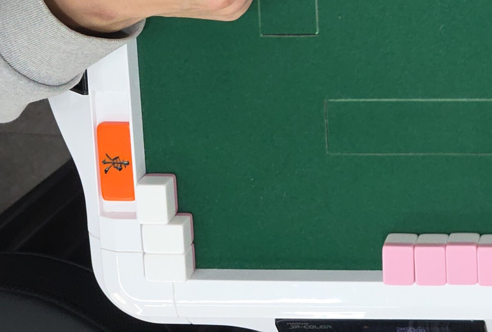

# 개발일지(2026-11-04)

← 이전: [11-03](개발일지%5B2026-11-03%5D.md) · 다음: [11-05](개발일지%5B2026-11-05%5D.md) →

## 문제 1: 역할 모델이 좋아 보이는데 서버 판독에 붙이면 이득이 없음

- **원인:** 역할 모델의 이점은 탁자 전체 맥락(다른 자리 패 거르기, 갈라진 손패 줄 잇기)에서 나옴. 서버는 자리 크롭만 받아 그 맥락이 없었음. 사진 전체를 받는 새 경로에선 손패 줄 끝의 떨어진 3장을 울기로 보는 틀린 자동 반영이 생김.
- **해결방안:** 사진 전체 + 격자를 받는 서버 새 경로 `/v2/localroles` 와 앱 `useRoles` 를 만들되 기본 끔. 진행 중(커밋 전). 11-05에 원인이 모델이 아니라 라벨임을 찾아 운영 bacd3f6 으로 반영됨.

### 시행착오

1. 사용자 "테스트 15장 비교" → 카메라가 전혀 다른 10/24 삼각대 15장(약 25° 기움)에 한 번 → 모델 99.6% 대 규칙 91.4%. 규칙 오류가 개발 세트 때와 같은 두 유형(손패 줄 놓침·다른 자리 울기)이라 "규칙이 10-31 배치에 과적합"이라는 사용자 지적이 확인됨.
2. 자리 판독 벤치에 그대로 끼움 → 맥락이 없어 손패 7장 중 3장을 짝으로 보는 등 모델 틀 20/37. 모델이 고른 상자만 규칙에 넘기는 혼합도 28 = 규칙 28. 남은 실패는 白 미검출·가림 등 검출 문제.
3. 새 경로 `/v2/localroles` 를 만들어 앱 흐름 → 새 경로 29 대 규칙 30/34. 124654 손패 줄 끝 7z 3장을 울기로 봐 2000점으로 틀린 자동 반영 1건. 역할 확신도로도 못 걸러 기본 끔.

## 문제 2: 白(무늬 없는 패), 특히 흰 테두리 위 모서리 白 퐁을 검출 못 함

- **원인:** 흰 테두리 위의 흰 패라 단서가 홈·옆면 그림자뿐. 공개 모델 둘(YOLO11·HaseLab YOLO26)도 0/3.
- **해결방안:** 검출기 3~7회차를 하루에 돌리며 증강을 바꿔 봄. 白은 잡게 됐지만 자리 판독 점수는 운영 2회차를 못 넘어 운영 반영 안 함. 8회차는 합격 기준을 학습 전에 적고 밤에 학습 시작. 진행 중.

*164501 왼쪽 아래 모서리의 白 퐁. 흰 테두리 위에 흰 패 3장이라 단서가 패 사이 홈과 옆면 그림자뿐입니다.*

### 시행착오

1. 3회차: 白 크롭 붙여넣기 증강 → 白 68 → 71/80. 대신 서랍 속 종이를 패로 잡아 1장 잃음. 나중에 白 재료에 시험 사진이 섞인 누수를 발견해 숫자를 버림.
2. 검출 뒤 "패의 1.6배 넘는 상자 버리기" → 2회차엔 해가 없고 종이 헛검출은 없앰. 공통 단계로 둠.
3. 4회차: 재료를 나눔별로 분리하고 흰 테두리 위 白 합성 → 白 79/80, 모서리 白 퐁도 잡기 시작. 종이 헛검출은 그대로라 자리 판독 1장 감소, 보류. 캐글 데이터셋 새 버전 처리 전에 올려 한 번은 옛 데이터로 돌아 버림.
4. 5회차: 패가 아닌 흰 종이·카드를 라벨 없이 붙이는 음성 합성 → 白 80/80, 종이 사라짐. 대신 45° 기운 떼어 둔 9삭 상자가 커져 흰 비율 0.577 → 0.478로 앞면 거르기(0.5)에서 버려짐. 검출 잘못이 아니라 거르기 기준이 기운 패에 빠듯한 것. 보류.
5. 6회차: 앞면·뒷면 2종 → 헛검출 30 → 26, 안깡 뒷면 4/4. 대신 앞면 −3, 白 −1. 보류.
6. 7회차: 회전 상자 + 하위 에이전트 5개가 4,027 상자 전수 조사한 라벨 → 검출은 가장 좋음(무늬 패 놓침 5 → 1, 헛검출 22 → 19). 그런데 판독은 1장 적고 틀린 자동 3. 134815 울기 2만을 8만으로 읽은 원인은 분류기 입력 모양(축 상자 크롭 8만 0.18, 회전 상자대로 세워 자르면 2만 0.87) → 세워 자르기를 넣어 규칙 28(틀린 자동 0). 남은 실패는 전부 흰 테두리 위 白.
7. 사용자 "과적합을 막으면서 학습시키는 방안" → 8회차 합격 기준(테스트 15장·색 바꾼 15장·개발 34장·시간)을 학습 전에 적고, 22:27 캐글 학습 시작. 결과는 11-05.

## 한 일

- **깡 판독 시험:** 10-29~11-03 프레임·사진 1,565장에서 후보 378개를 찾아 눈으로 보니 실제 깡은 안깡 4개뿐 → 0/4. 검출·역할은 맞는데 울기 묶기가 3·4장만 받고 뒷면을 세지 않아 빠짐. 입력 화면으로 가서 틀린 자동 반영은 없음.
- **평가 제외:** 사용자 요청으로 가림 사진(172424·174020)을 모든 채점 스크립트에서 빼게 함(`sg.eval_scenes()`). 손패를 흩어 놓은 183022는 사용자 문제로 `USER_ERROR` 에 넣음. 셋 다 원래 틀리던 사진이라 맞은 수는 같고 분모만 37 → 34.

## 남은 것

- 8회차 검출기 판정(11-05), 역할 모델 기본 끔 상태, 안깡 묶기 규칙. 이날 앱·서버 변경은 모두 커밋 전.

근거: `docs/problem_log.md` 39·40·42번, `docs/metrics.md` 표 1-59~1-69, 커밋 없음(`HANDOFF.md` "2026-11-04 추가" 절, `experiments/tile_classifier/README.md`).

← 이전: [11-03](개발일지%5B2026-11-03%5D.md) · 다음: [11-05](개발일지%5B2026-11-05%5D.md) →
