# 개발일지(2026-11-08)

## 문제 1: 11-07 매장에서 강 끝의 3만을 2만으로 읽음(확신 0.977)

- **원인:** 분류기가 180° 뒤집힌 3만을 2만으로 확신함. 학습할 때 180° 뒤집기 증강이 빠졌고, 학습 라벨에도 뒤집힌 만수 4장이 2만으로 잘못 들어가 있었음.
- **해결방안:** 뒤집기 증강을 넣고 라벨 4장을 고친 뒤 재학습 → 운영 반영(641681b), 해결됨.

### 시행착오

1. 사진 기울기 탓인지 보려고 ±15° 돌려서 다시 읽음 → 같은 답이 나옴. 기울기 문제 아님.
2. 로컬에서 다시 돌려 봄 → 바로 세우면 3만(0.95)으로 맞음. 강 패는 0°·180° 둘 다 읽고 확신이 높은 쪽을 고르는데, 180°가 2만(0.978)이라 그쪽이 이김.
3. 크롭 1,168장을 0°·180°로 넣어 채점 → 바로 세우면 1,168장 다 맞고, 뒤집으면 916장만 맞음. 사진 한 장의 문제가 아니라 모델의 버릇.
4. 규칙만 고치기(180° 쪽이 0.1 넘게 높을 때만 채택) → 3만 오독은 사라지지만, 거꾸로 놓인 패를 맞히는 수가 1,139 → 1,081로 줄어 미채택.
5. 뒤집기 증강을 넣어 재학습(cls5) → 3만 오독 0/37. 그런데 반쪽 잘린 發 퐁에서 경고 없이 틀리는 경우가 3 → 11로 늘어 미채택.
6. 학습 라벨 전수조사(1,550장) → 예전 모델 예측으로 붙인 라벨에 뒤집힌 三萬 3장·一萬 1장이 2만으로 들어 있었음. 4장을 고치고 잘린 조각 2장은 뺌.
7. 뒤집기 증강 + 고친 라벨로 재학습(cls6) → 3만 오독 0/37, 경고 없는 틀림은 3 → 5. 기준에 한 장면 모자랐지만 배포하기로 결정.
8. 운영 확인 → 손패 31/32, 패 435/436, 경고 없는 틀린 자동 0, 판독 6.1 / 6.8 / 8.3초.

## 문제 2: 손패 끝 3삭을 인식하지 못함(153638)

- **원인:** 처음엔 역할 모델이 휜 손패 끝 3삭을 떼어 둔 패(0.605)로 본 것이라고 진단함. 실제로는 끝 6장이 치 두 묶음(받은 패 눕힘)이었고, 이 울기는 대국 내내 모서리에 있다가 화료 직후 손으로 끌어온 것이었음. 즉 사용자 문제.
- **해결방안:** 153638은 채점에서 뺌. 그와 별개로 역할 모델 학습 재료를 실제 사진 기반으로 바꾸는 시도를 함 → 아직 운영 반영 못 함.

### 시행착오

1. "휜 손패 끝 = 손패"를 가르치는 합성 보강 → 교차 검증 손패 장수는 13 → 15/18로 올랐지만 153638은 안 고쳐짐. 미채택.
2. 모델 입력을 확인 → 6삭·1삭이 눕힌 패로 들어가 있었음. 직접 확인해 보니 치 두 묶음이고 실제 점수는 7,700점(울기 없는 12000으로 잘못 봤던 것). 진단이 틀렸음.
3. 3초 간격 프레임을 다시 봄 → 울기를 화료 직후 끌어온 것이라 사용자 문제로 채점에서 뺌. 울기를 모서리로 되돌린 합성 사진은 운영 모델이 맞힘.
4. 역할 모델 구조 개선: 패끼리의 상대 위치(몇 장 떨어졌나·눕힘·뒷면)를 어텐션에 직접 넣음.
   - 첫 실행은 NaN 버그로 모든 패를 손패로 찍어서 고침.
   - 교차 검증 1,032 → 1,046, 실제 테스트 점수 5 → 8/10으로 좋아짐.
   - 그러나 색 바꾼 15장에서 틀린 자동이 0 → 4가 되어 미채택.
   - 원인: 역할이 좋아져 손패가 13장으로 맞게 되자, 그동안 장수 검사가 막아 주던 적5만 → 5만 오독이 통과함.
5. 합성 생성기 점검(직접 지적한 것: 상자 크기 제각각, 누운 패, 겹침) → 처음엔 의도한 거라고 잘못 답했는데, 실제와 나란히 재 보니 겹침은 생성기 결함이었음. v2로 고쳤지만 생성기보다 실제 입력을 고쳐 쓰기로 함.
6. 매장 사진을 역할 모델 입력으로 변환하고 직접 검수함 → 41장 확정.
   - 손·팔 가림: 다시 그리기·inpaint는 더 나빠서 이전 프레임을 겹쳐 메움.
   - 리치 화료: 도라를 화료자 쪽으로 옮김.
   - 151320은 폐기.
   - 다른 사람 울기도 울기(meld)로 하고 누구 것인지만 구분함. 깡은 묶음 표시만 하고, 연출 사진은 학습에만 씀.
   - 검수 내용과 그림은 아래 "역할 모델 입력 검수" 절.
7. 41장으로 학습 → 화료자 쪽 맞은 장면이 운영 23 대비 연출 넣음 20, 연출 뺌 22로 미채택. 외톨이 패(패산 끝 표시패, 떼어 둔 패)를 울기로 보는 오류가 새로 생김.
8. 연출 뺀 33장만으로 합성 5,000장면을 만들어 처음부터 학습 → 18/28로 더 나빠져 미채택. 사진 수가 적어 배치 종류가 부족함.
9. 생성기를 실제 규칙으로 다시 만든 v3로 8,000장면 사전학습 + 33장 미세 조정.
   - 넣은 규칙: 강 장수 차이 3~4장, 같은 사람 울기는 붙어 있음, 패산은 한쪽으로만 줄어듦, 손패와 패산 사이 거리, 떼어 둔 패 위치, 깡 30%.
   - 노트북을 꺼야 해서 캐글에서 돌림(11-09 00:02~00:58).
   - 결과 23/28로 1단계 통과. 외톨이 → 울기 오류가 줄었음.

## 역할 모델 입력 검수(문제 2의 6번)

매장 사진을 Claude 가 역할 모델 입력으로 바꾼 것을 사진과 쌍으로 보고 라벨로 쓸 만한지 직접 평가함. 각 그림은 왼쪽이 사진(화료자가 아래로 오게 돌림), 오른쪽이 역할 모델 입력.

색: 파랑 손패 · 하늘 울기(대각선 = 다른 사람 울기) · 주황 강 · 빨강 패산 위 표시패 · 자홍 탁자 위 짝 · 노랑 떼어 둔 화료패 · 회색/보라 뒷면 · 흰 테두리 역할 없음 · 분홍 테 깡 묶음.

"검수 때 본 그림" 은 어제 검수 직전에 띄운 그림을 그대로 잘라 온 것(10-31 사진만 남아 있음). 11-07 사진은 고친 라벨을 되돌려 다시 그렸음.

### 133826: 오른쪽 상단 울기패 위에 회색 상자가 겹쳐져 있음
→ 앞면과 0.4 넘게 겹친 뒷면 상자를 버리게 고침. 그 울기가 하늘(울기)로 제대로 보이게 됨. ✅

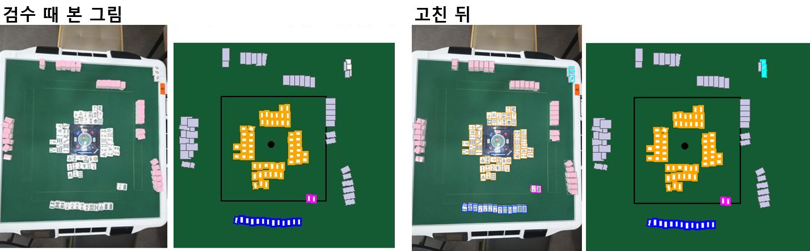

### 132954, 121515, 123102, 122315, 123721, 124650, 130623: 연출용 사진이라 화료자 외 사용자 손패는 대충 모여져 있어 학습용으로는 검토가 필요
→ '연출' 로 표시. 학습에 넣은 것과 뺀 것을 비교해 보니 넣으면 한 장면 더 틀려서(20 대 22/28) 그 뒤로는 뺀 33장을 씀. ✅

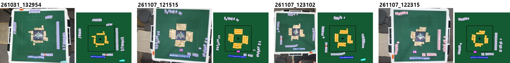
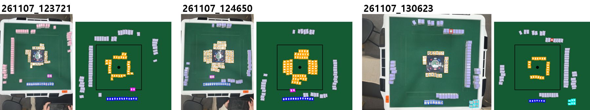

### 134815: 사진이 기울어져 오른쪽 상단 울기가 짤림, 학습에 쓸지 말지 검토 필요
→ 학습·평가에 둘 다 씀(11-09 결정). 빠졌던 다른 사람 白 퐁 3장을 라벨에 더함. ✅

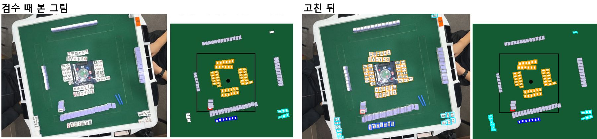

### 165614 · 181209: 오른쪽 상단 울기 깡인데 울기 2개 회색2개로 이루어짐 → 별도 깡으로 라벨할지 검토 필요
→ 깡 역할을 새로 만들지 않고 "울기 + 깡 묶음 표시" 로 정함(앞면은 울기, 양끝 뒷면은 뒷면 그대로). ✅

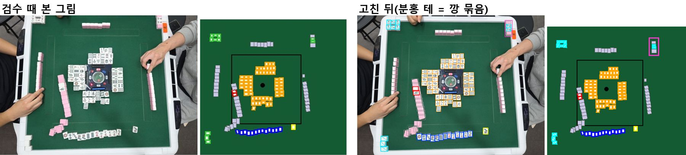
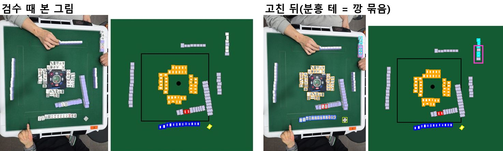

### 171505: 손패 오른쪽 삼만 쯔모패인데 그냥 손패로 처리되어 있음
→ 3만을 손패 → 떼어 둔 화료패로 고침. ✅

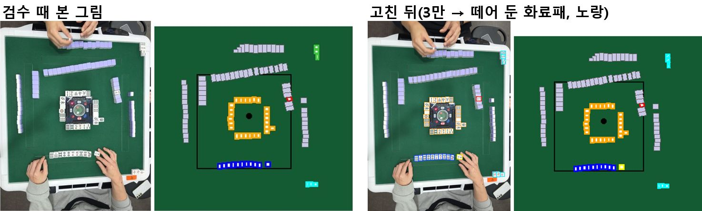

### 151320: 폐기
→ 기본 입력에서 뺌(42 → 41장). 9통 퐁이 있어 리치일 수 없는데 뒷도라를 붙여 합성했던 실수였음. ✅

### 124654 · 130743: 리치 화료이므로 도라표시패 옆을 까는게 아닌 2개를 화료자 쪽으로 가져와야됨 EX) 172424
→ 패산의 표시패는 옆 뒷면으로 덮고, 표시패와 뒷도라를 화료자 쪽 펠트에 짝으로 놓아 다시 합성함. 새 검출에서 짝 2장(자홍)이 정상으로 잡힘. ✅

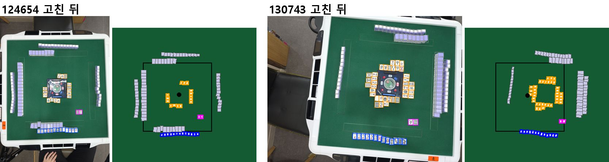
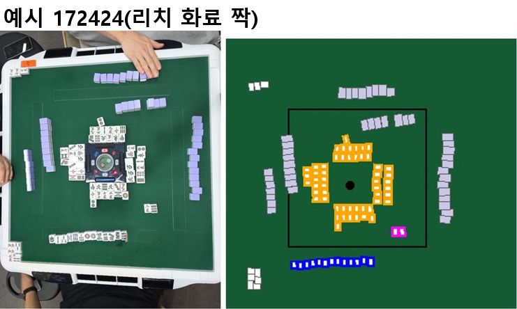

### 132239: 연출용 사진이라 화료자외 사용자 손패가 모여있고 리치 화료라 도라를 화료자쪽으로 가져와야됨, 학습에 쓸지 검토 필요
→ 짝을 화료자 쪽으로 다시 합성. 검출이 짝을 반쪽 상자로 잡아 넓혀 줌. 연출이라 지금 실험(33장)에는 안 씀. ✅

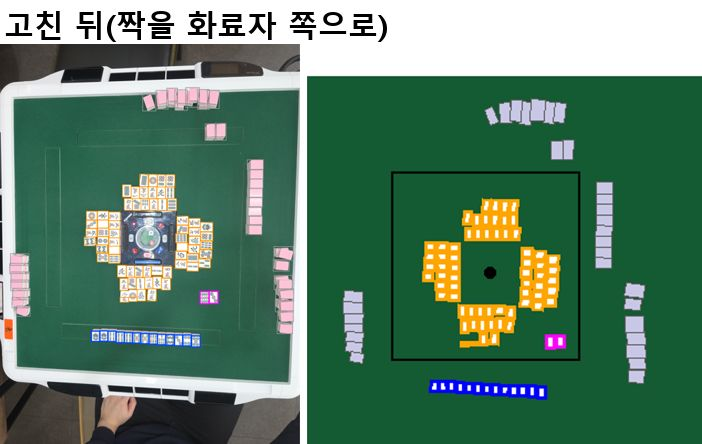

### 170105: 5만 화료인데 쯔모인지 론인지 이전 프레임으로 확인해야 될듯
→ 추적 프레임이 16:55:37 → 17:00:55 로 끊겨 화료 순간이 없어서 확인 못 함. 기록된 정답(11-01 답)은 '론 8통' 이라 5만과 다름. 역할 라벨은 장수만 써서 학습엔 영향 없음. ⚠ 5만인지 8통인지 확인 필요

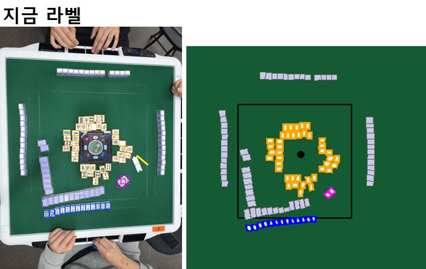

### 154417: 상단 잘못된 도라 표시패 있음
→ 아래 사람이 세운 손패 앞의 白 을 표시패 → 역할 없음으로 고침. 독립 검토 세션도 같은 판단. ✅

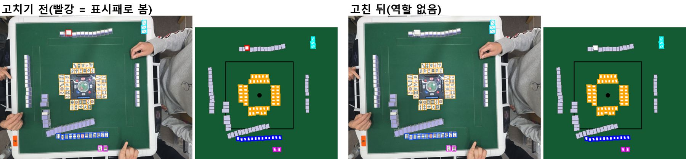

### 154904: 정황상 손패제일 오른쪽 7만이 쯔모패로 보임
→ 7만을 손패 → 떼어 둔 화료패로 고침. 기록된 정답(쯔모 7만)과 맞음. ✅

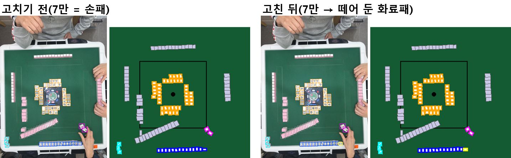

## 남은 것

- 역할 모델 v3는 11-09 2단계 평가로 넘어감. 운영 역할 모델은 그대로.

근거: `docs/problem_log.md` 39·47·48·49번, `docs/metrics.md` 표 1-116~1-129.
