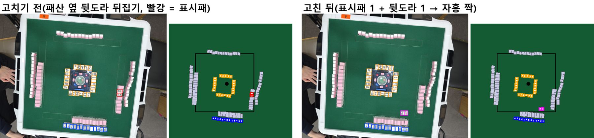
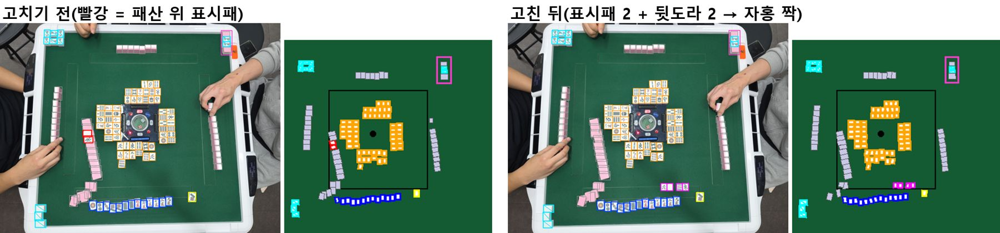
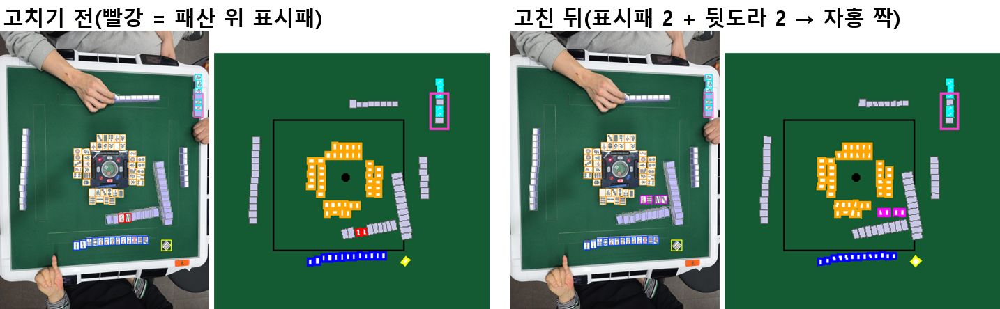
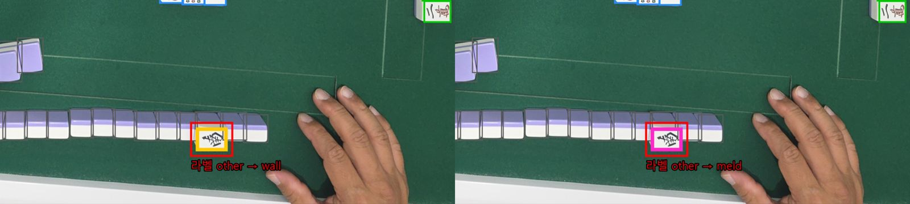
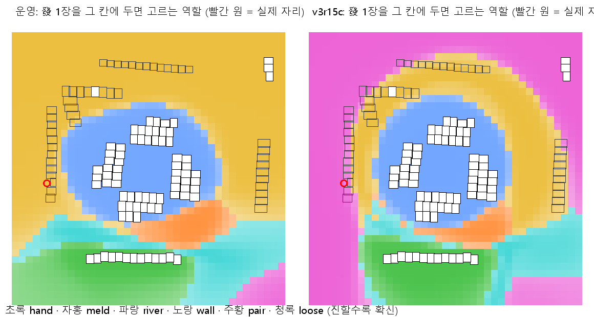
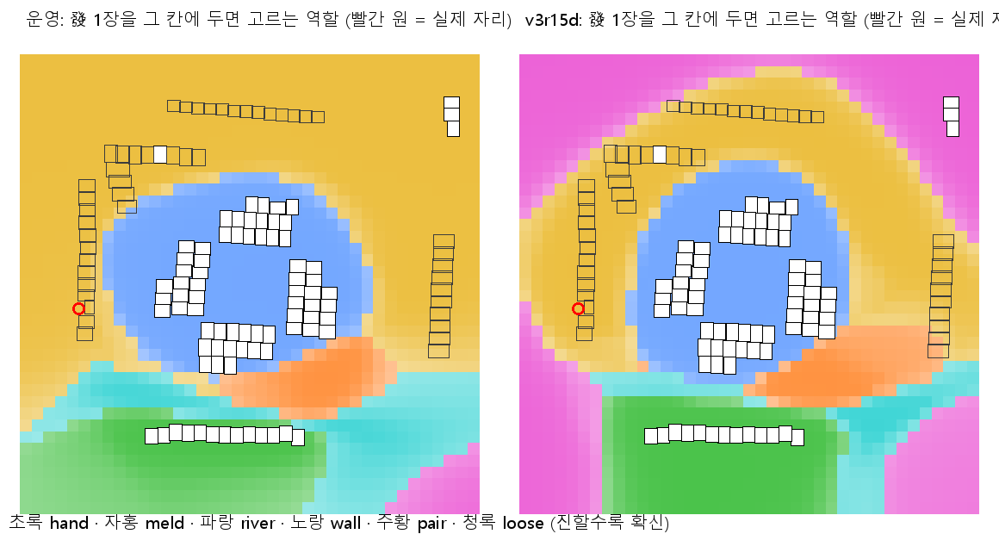
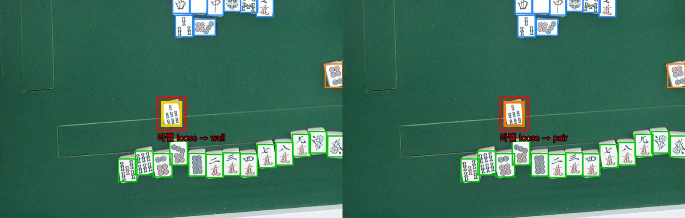

# 개발일지(2026-11-09)

← 이전: [11-08](개발일지%5B2026-11-08%5D.md) · 다음: 없음 →

## 문제 1: 역할 모델 v3(생성기 v3 사전학습)가 1단계는 통과했지만 2단계 회귀 세트에서 떨어짐

- **원인:** 회귀 세트 손실이 거의 −25° 회전 한 변형에서 나옴. 장면마다 손패 끝 1\~2장이 빠짐. 생성기 v3 에서 사진 전체 회전을 실제 비율(큰 회전 4%, σ1.5°)로 줄인 탓으로 추정함. 운영 모델의 v1 생성기는 큰 회전 25%, σ3° 였음.
- **해결방안:** v3 2단계는 미리 적은 기준대로 미채택. 회전 한 변수만 넓힌 v3r15 도 2단계 미채택(−10° 손실) → 원인으로 찾은 라벨 위치 2개를 고친 v3r15b 는 1단계 미채택(155553 한 장 차이, 문제 3). 이어진 v3r15d 로 해결(문제 3·4, 저녁에 운영 배포).

### 시행착오

1. v3 나눔 모델을 다시 학습하고 ONNX 로 내보내 2단계 서버 단독 측정(08:48\~09:28).
   - 회귀 21변형 패 fold 8,118 → 8,101, prod 8,196 → 8,164, prod unsafe 11 → 12 → 기준 b 미충족.
   - 나머지 변형은 오히려 +12 였고 143104 unsafe 도 고침.
   - 색 바꾼 15장 패 145 → 161(틀린 자동 0 그대로), 테스트 15장 자리 맞은 장면 6 → 9. 상대 위치 바이어스가 잃었던 곳에서 이번엔 얻음.
   - 판정이 이미 정해져 앱 흐름은 재지 않음.
2. 사용자 질문 "돌린 사진은 빼는게 낫지 않나" → 회전 변형별로 다시 셈(판정에는 안 씀). ±25° 를 빼도 prod 패 −4 라 기준을 못 넘음. −10° 두 장면에서도 손패 끝을 잃었기 때문. 실제 회전 사진과 생성기 배치를 나란히 그려 비교함.
3. v3r15: 생성기 v3 의 사진 전체 회전만 바꿈(65% σ1.5°, 35% 3\~15°). 학습 전에 기준을 적음.
   - 회귀 판정은 ±25° 두 변형을 뺀 19변형으로 하기로 함. 근거는 매장이 위에서 고정 거치라 5° 넘게 돈 실제 사진이 25장 중 1장이고, 이번 생성기도 ±25° 를 넣지 않기 때문. 앞의 v3 판정은 바꾸지 않음.
   - 노트북에서 사전학습 → 4겹 교차 검증 → 나눔 ONNX 까지 돌림(10:09 끝).
   - 1단계 통과: 화료자 쪽 장면 23/28, 상자 1,583/1,604, 테스트 15장 705/706(기준 23·1,579·704).
   - 2단계 미채택: 회귀 19변형에서 fold unsafe 23 → 24(143104 −10° 에서 떼어 둔 화료패 7삭을 놓쳐 13장으로 통과), prod 패 7,520 → 7,516(B 세트 k25·k28 −10° 에서 손패 끝 9통이 빠짐, v3pre 에서도 똑같음).
   - 얻은 것: ±25° 손실이 줄었고(prod 패 8,164 → 8,183), 테스트 15장 자리 맞은 장면 6 → 9·틀린 자동 8 → 5, 색 바꾼 15장 패 145 → 161, 서버 처리 0.79 → 0.75초.
   - −10° 는 학습 회전 범위(±15°) 안인데도 빠져서 회전만으론 설명이 안 됨 → 그 사진들에서 역할 확신을 보니 손패 끝·근처 한 장이 0.54\~0.66 으로 반반이던 상자가 뒤집힌 것. 학습 라벨에서 손패 줄 끝에 붙은 채 떼어 둔 패(loose)로 라벨된 상자 2개(153939·154904, 틈 거의 0)를 찾음(사용자 짐작이 맞음).
4. v3r15b: 사용자 "손패에서 거리를 둬서 떼어둔패로" → 그 두 상자의 입력 위치만 손패 줄 바깥으로 1장 옮김(라벨은 loose 그대로). 학습 전에 기준을 적음(채점은 두 장면 + 합성본이 된 165614·181209 를 뺀 24장).
   - 사용자 지적 "파생된 것도 고쳐야" → 생성기 v3 의 떼어 둔 패 틈 하한(0.5장)이 바로 그 두 장을 섞은 측정에서 나온 값이었음. 0.8장으로 고치고 사전학습도 새로 함(첫 실행은 결과 보기 전에 멈춤).
   - 결과: 24장 장면 19(운영 20), 상자 1,361(운영 1,358) → 1단계 미채택. 장면 차이는 155553 한 장(문제 3). 손패 끝 문제(171505·153311)는 그대로.

## 문제 2: 리치 화료인데 화료자 쪽 짝이 없는 라벨 3장면(125839·165614·181209)

- **원인:** 매장에선 리치 화료 때 표시패와 뒷도라를 화료자 쪽으로 가져와 짝으로 놓는데, 이 사진들은 뒷도라를 안 뒤집고 찍음. 125839 는 어제 '패산 옆 뒷도라 뒤집기' 로 합성해 둔 상태였고, 165614·181209 는 리치 + 깡 1개라 표시패가 4장 보여야 하는데 패산에 2장(도라·깡도라)뿐이었음.
- **해결방안:** 사용자 결정대로 셋 다 화료자 쪽 짝 방식으로 다시 합성(165614·181209 는 표시패 2 + 뒷도라 2 = 4장, 짝 둘) → 라벨 다시 만듦. 채점은 28장 그대로(입력을 고친 153939·154904 를 빼면 26장, 이후 기본). 해결됨 — 운영 모델을 이 라벨로 다시 재니 26장 중 22.

### 시행착오

1. 124654 합성본의 짝 위치(화료자 오른손 쪽 끝, 패산 안쪽 펠트)를 본떠 짝 자리를 고름. 패산 표시패 자리는 옆 뒷면 패 윗면으로 덮고, 뒷도라는 같은 사진 강의 패를 씀.
2. 첫 합성 → 165614 의 東이 위아래 뒤집혀 들어가고(화료자 강 패와 방향이 반대), 181209·165614 표시패 조각에 옆 뒷면 테두리가 묻음 → 회전 방향을 바꾸고 조각을 안쪽으로 6\~12px 잘라 다시 합성.
3. 운영 서버 판독으로 초안 다시 만듦 → 165614 는 짝 4장을 바로 짝으로 잡음. 125839 는 짝을 반쪽 상자 + 패산 표시패로, 181209 는 짝 4장을 강으로 봄 → 상자 넓히기·역할 고침. 다른 사람 울기 11장·5장과 안깡 묶음은 새 검출 좌표로 다시 붙이고, 안깡 양끝 뒷면을 앞면으로 잡은 상자는 뒷면으로.
4. 예전 라벨과 비교 → 세 장면만 바뀌고, 바뀐 것은 패산 위 표시패 2 → 짝 2·4 뿐(손패·울기·강·떼어 둔 패 수 그대로).
5. 학습 스크립트를 확인하다 걸린 점: 채점은 원본 사진(kind=photo)만 하는데 165614·181209 가 합성본이 되어 채점 세트가 28 → 26장이 됨 → 사용자 결정 "28장 그대로 채점"(표시패 자리만 합성이라). 두 장면을 채점에 남기게 고침.
6. 그사이 다른 세션이 바뀐 라벨로 v3r15b 를 이미 돌리고 있었음(11:12 시작, 두 장면을 뺀 24장으로 기준을 적음, 표 1-134) → 그 실행은 시작할 때 채점 코드를 불러와서 영향 없음. 기준도 그대로 두고, 다시 잴 때를 위해 옛 동작 스위치(`ROLE_EVAL_COMPOSITE=0`)를 남김.

## 문제 3: 다른 자리 패산 앞에 혼자 나온 發(역할 없음)을 역할 모델이 울기로 봄(155553)

- **원인:** 처음엔 학습 때 상자를 8% 무작위로 빼는 증강이 외톨이 울기를 만든 탓으로 봤지만 틀림. 실제 원인은 합성 생성기 v3 에 역할 없는 앞면이 한 장도 없다는 것. 다른 자리 패산 바깥 앞면은 합성에서 늘 다른 사람 울기라, 모델이 위치만 보고 울기로 고름. 실제 사진의 역할 없는 패(other 3장)는 손실에서 빠져(ignore) 반대 신호도 못 줌.
- **해결방안:** 생성기에 다른 자리 쪽 외톨이 앞면을 넣고 "손패·울기·떼어 둔 패가 아님" 손실로 가르침(v3r15d) → 155553 發이 울기 0.83 → 0.004. 2단계까지 통과해 저녁에 운영 배포(문제 4). 해결됨.

### 시행착오

1. 155553 에서 운영·v3r15b 판정을 사진에 그려 봄. 운영은 發을 패산 위 표시패(wall), v3r15b 는 울기로 봄. 그림 상자가 처음엔 패보다 왼쪽 위로 밀려 그려짐(라벨 좌표가 왼쪽 위 기준인데 중심으로 그림) → 고쳐 다시 그림.
2. 사용자 질문 "학습 데이터에 한 장만 울기로 라벨한 게 있었니" → 실제 41장에서 혼자 떨어진 울기는 134815(사진 끝에서 잘린 다른 사람 울기) 1장뿐. 2장 묶음은 안깡 둘(165614·181209)과 팔에 반쯤 가려진 퐁(144348). 반면 학습 증강(상자 8% 무작위 빼기)과 생성기 검출 누락 때문에 합성 2,000장면 중 294장면(15%)에 외톨이 울기가 생김 → 이걸 원인으로 짚음.
3. 사용자 지적 "산이나 강은 몰라도 울기패·손패·떼어 둔 패·도라패는 무작위로 빼지면 안 되지 않나" → 맞음(12장 손패·외톨이 울기 같은 없는 모양을 정답으로 가르침). 무작위 빼기를 강·뒷면만으로 고치고(`ROLE_DROP_SAFE`), 144348 은 가려진 퐁 1장에 상자를 더해 울기 3장으로(`role_v2_apply.py` 에 상자 더하기 기능). → v3r15c: 26장 장면 20(운영 22), 테스트 700 → 미채택, **155553 은 그대로 틀림**. 원인을 잘못 짚었음.
4. 가설 확인(학습 없이): 생성기 3,000장면에 역할 없는 앞면 0개, 發 자리에 온 앞면은 모두 울기. 發 한 장만 격자로 옮겨 가며 예측을 보니 v3r15c 는 패산 바깥 테두리 전체를 울기로 칠함(1,521칸 중 556칸, 운영 30칸).
5. 사용자가 생성기+학습으로 고치기를 고름 → v3r15d: 장면 40% 에 다른 자리 쪽 외톨이 앞면 1\~2장(실제 other 3장 위치를 본뜸)을 넣고 "손패·울기·떼어 둔 패 아님" 손실. 26장 장면 23·테스트 705 → 1단계 통과, 發 이동 지도에서 패산 줄과 바로 바깥이 다시 표시패로 돌아옴.
6. 2단계(운영 대비, 같은 시각): 회귀 19변형 fold 장면 502 → 513·위험 통과 23 → 19, prod 같음, 테스트 15장 앱 흐름 점수 5 → 8/10, 색 바꾼 15장 145 → 161, 개발 32회 같음. 서버 시간은 측정 중 노트북 부하로 디코딩까지 두 배가 되어 오염 → 후·전·후 진단으로 0.74초 같음을 따로 적음.
7. 사용자 "꼬라지 보니까 none 으로 학습시켜야 될 거 같애"(143104 떼어 둔 7s → 짝, 155553 發 → 표시패처럼 '남은 역할 중 아무거나'를 고름) → 7번째 역할 none 으로 v3r15e: 26장 장면 20 → 미채택. none 은 실제 other 3장 중 1장만 잡고, 패산 위 표시패 1장 → 울기가 새로 생김. 실제 other 3장이 모두 11-07 오후 사진이라 그 나눔은 생성기 것만 보고 배움. 서버가 점수에 쓰는 역할은 손패·울기·떼어 둔 패뿐이라 none 은 접음.
8. 잡음 측정: v3r15d 를 씨드만 바꿔 두 번 더 → 장면 22\~23·테스트 703\~705. 1단계 1장 차이는 판정할 수 없음을 확인(v3r15d 의 이득은 회귀·테스트 앱 흐름에서 나옴).

## 문제 4: 손패 앞에 떼어 둔 화료패(143104 7삭)를 역할 모델이 짝으로 봐서 13장 텐파이로 통과

- **원인:** 모델이 장수 단서(짝은 늘 2장)를 못 쓰고 위치만 봄. 실제 라벨·합성 모두 1장짜리 짝이 0개인데도 7삭을 짝 0.91(v3r15d)·표시패 0.52(운영)로 봄. 서버의 크롭 밖 떼어 둔 패 찾기는 떼어 둔 패(loose) 역할만 찾아서 놓침.
- **해결방안:** 사용자 규칙("탁자 위 표시패는 2장 이상, 낱장은 떼어 둔 화료패")을 서버 규칙으로 — 손패가 13장이고 떼어 둔 패 후보가 없으면 손패 근처에 혼자인 짝 1장을 떼어 둔 화료패로 읽음(`LONE_PAIR_LOOSE`). v3r15d 와 함께 운영 596101e 로 배포. 해결됨.

### 시행착오

1. 서버 판독을 그 사진 하나로 재현 → 7삭은 자리 크롭 밖에 있고 역할이 loose 가 아니라 빠진 것. 학습 대신 규칙을 고름(장수는 규칙이 정확함).
2. 규칙 끔·켬 비교(역할 모델은 둘 다 v3r15d): 개발 32회 앱 흐름 31 → 32/32, 회귀 fold 위험 통과 19 → 6(전부 143104), 테스트 15장 같음, 서버 시간 0.76 → 0.72초. 약점 하나: −25° 회전 165043(론)에서 짝 2장 중 1장을 놓치자 남은 1장이 화료패로 붙음(화료 형태 검사에 걸려 경고 붙음).
3. 사용자 "중지 나중에 할게" → 테스트 15장 앱 흐름만 남기고 멈춤 → "재개" → 끔·켬 같음 → 기준 a\~d 통과.
4. 앱 흐름 시간이 2.2 → 3.9초로 부풀었는데, 규칙과 무관한 표시패 단계 디코딩도 90 → 193ms 로 같이 늘어 노트북 부하로 봄(이날 세 번째, 원인 미확인).
5. 사용자 "배포해" → 서버 596101e(v3r15d 파일 + 기본 경로 + 규칙, 예전 모델은 되돌리기용으로 남김) push → deploy 성공, git_sha·라우트 22 확인. 운영 확인 측정 32회: 손패 32/32·패 436/436·경고 없는 틀린 자동 0·6.2 / 6.8 / 7.6초·메모리 최대 935MB.

## 한 일

- 배경 프레임 기록을 긴 변 2400px 사본으로 바꿈(기본 켬, 더보기 토글). 1020px 프레임은 패 한 장이 20px 안팎이라 학습에 쓰기 애매했음(11-07 매장 비교). zip 은 JPEG 합 40MB 에서 끊음. 실기기 확인 전.
- README 를 프로젝트 배경·개발 과정 문서로 바꾸고, 옛 개발 안내는 `docs/development.md` 로 옮김.
- 개발일지 폴더를 만들고 11-08 일지를 씀.
- **운영 서버 596101e 배포**(20:19): 역할 모델 v3r15d + "짝은 늘 2장" 규칙. 되돌리기는 운영 `.env` 의 `LOCAL_ROLE_MODEL`(예전 `tile-roles-rot.onnx`)·`LONE_PAIR_LOOSE=0`. 태블릿 APK 는 그대로(서버만 바뀜).

## 남은 것

- 손패 끝 손패 ↔ 떼어 둔 패(171505·153311)와 짝 → 손패(154417)가 그대로 → 서버 장수 제약 규칙(손패 + 3 × 울기 + 떼어 둔 패 = 14 가 되게 반반인 상자부터 고침) 후보.
- 측정 중 노트북 부하로 시간이 두 배가 되는 일이 세 번 — 원인 찾기.
- 데이터 몫을 키우려면 다음 매장 사진이 필요함(역할 없는 패를 다른 자리 앞에 놓은 사진도).

근거: `docs/problem_log.md` 49번, `docs/metrics.md` 표 1-130\~1-147, 서버 596101e, 앱 32e835c·b680833·bd11daa.

← 이전: [11-08](개발일지%5B2026-11-08%5D.md) · 다음: 없음 →
