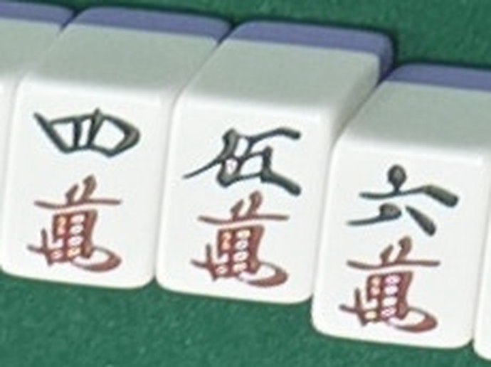
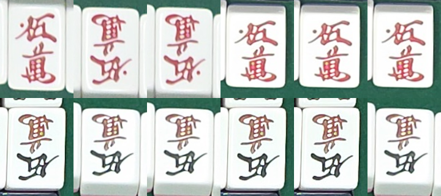
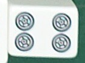

# 개발일지(2026-11-10)

← 이전: [11-09](개발일지%5B2026-11-09%5D.md) · 다음: [11-11](개발일지%5B2026-11-11%5D.md) →

## 문제 1: 실제 대국에서 리치 추적 0/5 — 장면 전체 변화가 리치봉 후보를 지움

- **원인:** 11-07 매장 2차 대국에서 서버 `/v2/sticks` 는 리치봉을 맞게 읽었음. 그런데 손·팔 때문에 "장면 전체 변화"가 판마다 18\~25번(프레임의 약 40%) 나서, 추적기가 진행 중 읽기와 후보를 지움. 읽기 한 번이 7\~10초라 두 읽기 사이에 거의 늘 장면 변화가 낌.
- **해결방안:** 장면 변화가 나도 리치봉 후보를 남기고 자리별로 확정하게 고침(재생 0/4 → 2/4). 이어서 리치봉을 Gemini 대신 프레임 픽셀로, 색과 무관하게 판정함 → 재생 **4/4**, 하루 전체 프레임 헛 리치 0. 앱만 바뀜, 태블릿 실기기 확인 전.

### 시행착오

1. 11-07 2차 대국 배경 프레임을 앱 흐름 순서 그대로 다시 넣는 재생(`experiments/tracking/replay_visit_riichi.dart`)을 만듦. 고치기 전 코드로 실측 0/5 를 0/4 로 재현(남1 1본장은 리치 무렵 프레임이 없어 뺌).
2. Projection Mahjong(2026) 논문의 "자리별 리치 구역 + 연속 감지 + 한 사람당 한 번"을 우리 식으로 바꿈: 장면 변화가 나도 후보·진행 중 읽기는 남기고, 자리별로 두 읽기가 같으면 그 자리만 확정, 확정한 리치는 판 끝까지 유지 → 2/4, 헛 리치 0. 한 번 읽기로 확정하면 3/4 지만 헛 읽기를 막을 장치가 없어져 미채택.
3. 남은 2판은 리치 뒤 16\~19초 만에 화료해 8초 읽기 두 번이 들어갈 시간이 없음 → 3초 프레임마다 기기에서 바로 판정하는 쪽을 고름.
4. 처음엔 "파란 화소 비율"로 하려 했으나 사용자 지적 "파란 봉이 다 떨어지면 노란 봉·빨간 봉으로 대체한다" → "채도 높은 가늘고 긴 덩어리가 홈 방향으로"로 바꿈. 실제로 11-07 크롭에 노란 봉이 5장 있었음. Python 원형: 봉 있음 105/109, 봉 없음 1,059/1,059(헛 잡음 0).
5. Dart(`lib/table/stick_slots.dart`)로 옮기니 추적 프레임(리치봉 구역 160px 안팎)에서 봉이 끊겨 71/109 → 열기 생략·블록 평균 축소로 104/109.
6. 하루 전체 프레임에 돌리니 오전 연출(빈 홈)에서 헛 리치 5 — 구역 가장자리의 가는 색 줄이 길이·비율 하한을 넘음 → 길이/두께 상한 9(진짜 봉 4.2\~7.3) → 헛 리치 0. 크롭 재생 4/4 만 봤으면 못 찾았을 오류.
7. 결과: 재생 **4/4**, 확정이 Gemini 첫 읽기보다 38\~41초 이름(프레임을 보니 실제로 봉이 그때 있었음). 실제 노란 봉도 잡음. 테스트 726 통과, 커밋 fbed22e.

## 문제 2: 테스트 F1400 의 "적5만 → 5만" 체계적 오류 — 알고 보니 정답이 틀림

- **원인:** 11-05 부터 규칙 검증기·불확실성 신호·프레임 투표 모두 "못 잡는" 체계적 오류로 다뤄 왔는데, 확대해 보니 **F1400 의 5만은 보통 5만**이었음. 伍 가 옆 四·六 과 같은 검은색이고, 이 패 세트의 적5만은 伍까지 빨감. 10-24 에 정답을 적을 때 萬 의 빨강을 적5 로 본 것으로 보임. 모델이 맞고 채점이 틀렸던 것.
- **해결방안:** 정답을 5만으로 고침 → 테스트 15장 서버 단독 자리 9 → **13/15**, 패 189 → **193/196**, 틀린 자동 5 → **1**. 이어서 테스트 세트 자체를 새로 정함(문제 3).

### 시행착오

1. 사용자 지시 "실제 매장 사진에서 0p·0s·0m 충분히 학습되게 데이터 뽑아서 학습" → 11-06·11-07 매장 사진(어느 평가 나눔에도 없음)에서 운영 검출기 회전 상자로 5 계열 크롭 216장(0m 22·0p 10·0s 11·5m 52·5p 49·5s 72)을 뽑고, 눈 확인 + 학습 전 독립 검토로 라벨 확정.
2. 합격 기준을 먼저 적고 분류기 cls7 학습 → a·b·c 모두 통과했지만 달라진 게 거의 없고 **F1400 은 cls7 도 5만**. 재료를 고르다 보니 운영 cls6 가 이 매장 사진의 5 계열을 이미 다 맞히고 있었음.
3. 처음엔 "표본 수가 아니라 촬영 조건 문제"로 결론 냈다가, 사용자가 F1400 그림을 보자고 해서 확대 → 보통 5만임을 확인(원인을 잘못 짚었다가 바로잡음).
4. 학습 로그 홀드아웃이 옛 분류기와 비교해 찍혀 기준값과 안 맞던 것도 같은 크롭에서 cls6 를 따로 재서 맞춤.
5. 나머지 틀린 두 장(F1434 안깡 4삭, F1240 모서리에 남겨 둔 發 3장을 퐁으로)은 정답이 맞고 판독이 틀림 → 사용자 결정 "F1434, F1240 폐기: 거치 화면으로 부적합" → `USER_ERROR` 로 빼 13장, 서버 단독 13/13·169/169·틀린 자동 0(판독 결과를 본 뒤 뺀 것이라 15장 값과 이어 볼 때 주의).
6. cls7 은 이득이 회귀 unsafe fold −2 뿐이라 서버 반영하지 않음.

## 문제 3: 테스트 세트 재정의 — 원본 B·C·D + 10-31 + 11-07 만

- **원인:** 10-24 매장 테스트 15장은 이미 여러 번 봤고 포화됨. 정답 오류까지 나옴.
- **해결방안:** 사용자 지침으로 테스트 세트를 **원본 B·C·D + 10-31 매장 + 11-07 매장만**으로, 변형(회전·흐림·재색칠 등)도 이 원본으로 만든 것만 쓰기로 함. 10-24·A·E 는 평가 밖. CLAUDE.md·metrics.md 규칙도 고침.

### 시행착오

1. 11-07 실제 대국 14장을 넣어 운영 모델로 잼 → 원본 44/46. 틀린 2장(125510·130623)도 **정답이 틀림**(거꾸로 놓인 八萬을 2m 로, 울기 적5삭을 5s 로 저장). 고치니 원본 46/46·606/606·unsafe 0, 회귀 21변형 790/966·unsafe 11(운영 모델이라 홀드아웃 아님).
2. 사용자 "틀린 4장 사진 줘봐" → 분류기 홀드아웃의 세운 크롭 틀린 4장도 라벨 문제였음. 홀드아웃 목록(11-06)이 11-08 라벨 고침 전에 만들어져 옛 2m 라벨이 남아 있었음. 학습 라벨 2m 40장을 눈으로 다 보고, 목록이 지금 라벨을 따르게 하니 1,164 → 1,168/1,168.
3. 배운 것: 모든 장치가 못 잡는 오류가 여러 단계에 걸쳐 남으면 정답부터 다시 봄. 적5 는 확대 그림으로 따로 확인.

## 문제 4: 부품별 성능 따로 재기 — 검출기·역할 모델

- **원인:** 회귀 변형에서 판독이 무너지는 곳이 어느 부품 몫인지 몰랐음(사용자 "검출기 성능도 테스트해봐", "역할 모델 성능 테스트해줘").
- **해결방안:** 사람이 단 정답 상자로 부품마다 따로 잼. 검출기는 거의 안 놓치고, 무너지는 곳은 역할·격자·앞면 판정 쪽임을 확인.

### 시행착오

1. 검출기(8회차 회전 상자)만: 홀드아웃 재현 99.1\~99.8%(손 가림 빼고). 원본에서 놓친 4장은 전부 흰 테두리 모서리 위 白. 전구색 `wb_tung` 은 재현 99.6\~100% 인데 판독 0/46(앞면 흰 비율 거르기 탓), `rot_±25` 도 재현 99%+ 인데 판독 5·15/46. 노출 +1EV 에서 뒷면을 앞면으로 보는 혼동이 크게 늘어남(홀드아웃 221).
2. 역할 모델(운영 v3r15d)만: 홀드아웃 26장 중 23·상자 98.8%. 손패·울기·강은 거의 안 틀리고, 틀린 18상자 중 14개가 표시패·짝·떼어 둔 패 셋 사이. ±10° 까지는 그대로, ±25° 에서 무너짐(학습 회전 범위 밖).
3. 틀린 장면 그림을 보고 사용자 "153311 은 떼어둔패 맞잖아" → 손패 줄 끝 4p 는 **눕혀 둔 쯔모 화료패**였는데 라벨이 hand. 고치니 홀드아웃 23 → 24/26. "손패 끝 hand ↔ loose 약점"으로 잘못 짚었던 것 중 하나가 라벨 오류였음.
4. 사용자 "틀린 라벨로 학습시킨 거 고쳐야 되지 않니" → 고친 라벨로 다시 학습한 v3r15dfix: 1단계 통과, 2단계에서 unsafe 11 → 10 이지만 unsafe_app 5 → 6(−25° 123721)이라 미리 적은 기준에 걸려 미채택. 재학습 흔들림이 라벨 한 장 효과보다 큼. 고친 라벨은 다음 학습에 들어감.
5. 그사이 검출 입력 크기(960·1280·1920)도 학습 없이 바꿔 봄(사용자 "해상도를 늘리면 성능이 좋아지는지") → 960 은 나쁘고 1920 도 원본 1장 나빠짐. 제대로 보려면 그 크기로 재학습해야 해서 도중에 멈춤.

## 문제 5: 눕혀 둔 손패·떼어 둔 패를 돌리지 않고 읽음(153311 4p → 2p)

- **원인:** 고친 라벨 모델이 153311 `rc_gray` 를 맞힌 게 우연(틈 1px 차이로 다른 경로를 탐)임을 따라가다 찾음. 분류기는 눕힌 4p 를 그대로 넣으면 2p 0.78\~0.93, 90°·270° 돌리면 4p 0.94\~0.97 로 읽음. 서버에서 손패 줄(`read2`)과 틀 안 떼어 둔 패는 상자가 가로로 길어도 돌리지 않았음(울기와 틀 밖 패만 돌림).
- **해결방안:** 손패·떼어 둔 패 상자가 가로(w > 1.15h)면 90°·270° 중 확신 높은 쪽으로 읽는 서버 규칙 `TURNED_HAND`. 기준을 먼저 적고 a·b·c 모두 통과 → 사용자 "커밋하고 배포해" → **운영 f71464a 배포**. 해결됨.

### 시행착오

1. `experiments/speed/debug_153311{,b,c}.py` 로 사진별 경로를 따라감. 원본은 기하 틀이 통과해 4p 가 틀 밖으로 → 돌려 읽어 맞음. `rc_gray`·`blur1` 은 기하 틀이 떨어져 역할로 틀을 짜고, 그때 손패 줄·떼어 둔 패로 들어가면 돌리지 않고 읽어 2p.
2. 학습 대신 읽기 규칙을 고른 이유: 원인이 분류기 입력 방향이라 일반 규칙으로 고쳐지고, 역할 재학습은 흔들림이 라벨 효과보다 컸음.
3. 끔·켬 비교(같은 시각 연달아): 회귀 21변형 패 11,823 → 11,828·장면 790 → 796, unsafe 11·unsafe_app 5 같음, 원본 시간 같음, 개발 32회 앱 흐름 32/32·436·0 같음. **171505 의 떼어 둔 3m 도 눕혀 둔 패라 함께 고쳐짐**(흐림·−25° 에서 5s 로 읽던 것). 나빠진 것은 이미 틀린 −25° 134815 의 패 1장뿐.
4. 운영 배포(16:47) 뒤 확인 측정 32회: 32/32·436/436·경고 없는 틀린 자동 0·6.4 / 6.9 / 8.1초·메모리 최대 1,026MB. 측정 때 늘었던 앱 흐름 시간은 노트북 부하 몫으로 봄.

## 한 일

- 리치 추적 고침 + 리치봉 홈 픽셀 판정(색 무관) 커밋 fbed22e.
- 실험 스크립트·문서 정리 커밋 c54d40e(역할 모델 v2·v3 실험, 패보 시험, 논문 요약, 작업 규칙).
- 테스트 세트 규칙을 CLAUDE.md·metrics.md 에 반영(원본 B·C·D + 10-31 + 11-07, 변형도 이 원본만).
- **운영 서버 f71464a 배포**(16:47): 눕힌 손패·떼어 둔 패 돌려 읽기 `TURNED_HAND`. 되돌리기는 운영 `.env` 의 `TURNED_HAND=0`. 태블릿 APK 는 그대로(서버만 바뀜).

## 남은 것

- 리치봉 픽셀 판정: 태블릿 실기기에서 프레임마다 판정 시간, 실제 빨간 봉, 다른 기기·홈 모양, 리치 시점의 정답 확인.
- 역할: 짝 → 손패(154417)가 그대로 → 서버 장수 제약 규칙 후보. 자리 크롭 판독(`localseat`) 경로의 손패 읽기는 `TURNED_HAND` 를 넣지 않음.
- 노출 +1EV 의 뒷면 혼동, 전구색 조명에서 앞면 거르기.
- 테스트 세트도 포화 — 판별력은 다음 매장 사진 몫.

근거: `docs/problem_log.md` 49·51·52번, `docs/metrics.md` 표 11·11-1·1-148\~1-161, 서버 f71464a, 앱 fbed22e·c54d40e.

← 이전: [11-09](개발일지%5B2026-11-09%5D.md) · 다음: [11-11](개발일지%5B2026-11-11%5D.md) →
