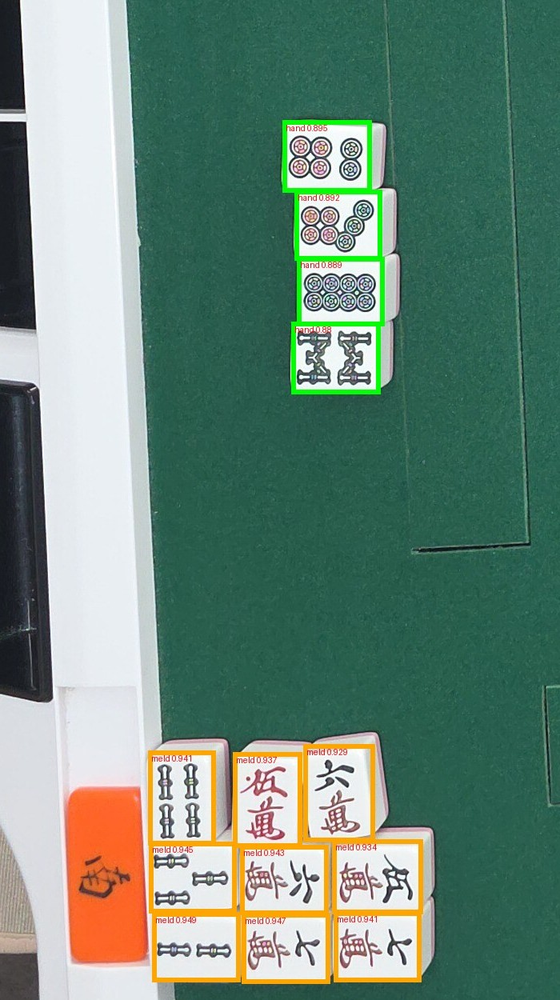
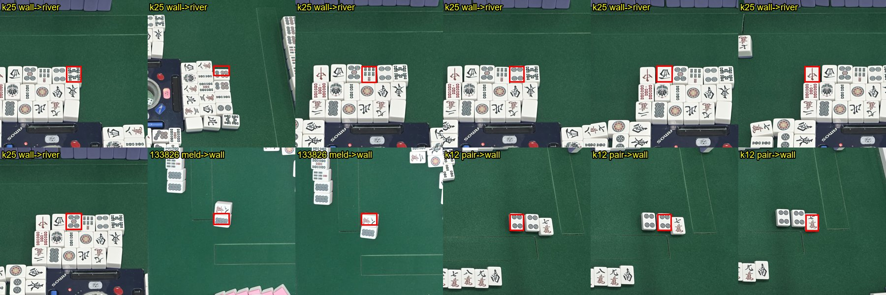
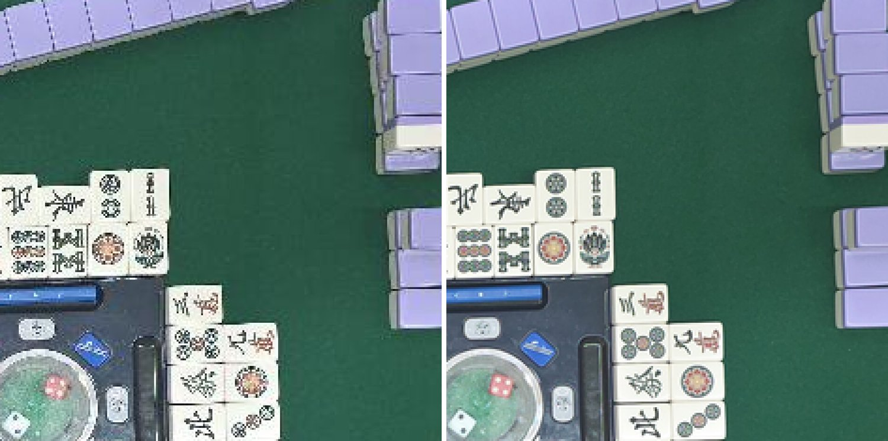

# 개발일지(2026-11-11)

← 이전: [11-10](개발일지%5B2026-11-10%5D.md) · 다음: 없음 →

## 문제 1: 위아래로 붙여 쌓은 울기(3×3·퐁 + 깡)를 통째로 버림

- **원인:** 11-07 연출 135420(왼쪽 아래 모서리에 울기 셋 3×3)은 당일 0/12, 지금 운영 f71464a 로도 손패 4장만 나오고 울기 0. 당일엔 "자체 모델이 울기를 못 찾음"으로 적었는데, 다시 보니 **검출 13/13·역할 모델도 울기 9장 meld(0.93\~0.95)로 맞음.** 버려지는 곳은 묶기였음 — 붙어 쌓인 9장이 한 덩어리가 되고, 덩어리 장수가 3·4·6·8 이 아니라 통째로 버림. 115802(오른쪽 위 3m 퐁 + 1m 명깡, 7장)도 같은 원인.
- **해결방안:** 틀을 잡은 뒤 울기 덩어리의 패를 **먼저 모두 읽고**, 울기 모양(퐁·치·깡)이 되는 나눔을 고르게 함. 못 고르면 예전 규칙으로 나누되 울기 확신을 0.5 로 낮춰 앱의 울기 확인 경고가 뜨게 함(가드레일, 앱 변경 없음). 사용자 "커밋하고 배포" → **운영 348f0f9 배포**(10:59). 해결됨.

### 시행착오

1. 처음엔 "y 틈이 패 높이 0.4 넘는 곳마다 줄 끊기"를 넣었으나 135420 이 그대로였음. 눕힌 패가 같은 줄 세운 패보다 16\~48px 아래로 처져(패 높이 110) 줄 안에서 끊김 → 가운데 y 순으로 k장씩 잘라 **경계 틈만** 보는 방식으로 바꿈. 3×3 장면 10장 장수 4 → 13.
2. 사용자 "깡도 제대로 처리하니? 115802" → 줄당 장수를 고정(3×3, 3×4·4×3)해 둔 탓에 3 + 4 를 못 받음 → 줄마다 3·4장 아무 조합으로 일반화. 115802 계열 0/3 → 3/3.
3. 사용자 "특정 상황만이 아니라 특정 그룹을 분류기에 넣고 판단하는 파이프라인을 미리 실험" → 장수·모양 규칙 대신 덩어리 패를 읽어 나눔을 고르는 실험(`experiments/visit_20261107/meld_partition.py`). 처음엔 위아래 후보에 경계 조건이 없어 퐁 + 깡에서 줄 한가운데를 자름 → 줄 경계가 0.4 넘는 후보만.
4. 서버에 넣으면서 규칙 경로(`split_frame`)에도 임시 나눔을 넣었더니 회귀 ev_p1 124654 가 손패 22장으로 틀어짐(경고는 있었음) → 임시 나눔은 역할이 meld 인 상자만 쓰는 model 경로에만 둠.
5. 결과: 모서리 울기 13장 장수 맞음, 정답 32장 그대로, 실제 울기 64묶음 전부 ok(헛경고 0), 회귀 21변형 합계(장면 796·패 11,828·unsafe 11·unsafe_app 5) 전과 같음. 배포 뒤 운영 앱 흐름 32회: 32/32·436/436·경고 없는 틀린 자동 0·6.0 / 6.9 / 7.6초(전과 같음).
6. 원본 사진의 붙은 울기 빈도도 세어 봄: 실제 대국 28장 중 6\~7장면, 전부 6장(울기 둘), 한 줄 7장은 0 → 한 줄 7장 나눔은 넣지 않음.

## 문제 2: 매장 망·서버에 기대지 않고 태블릿만으로 판독할 수 있나 (실험)

- **원인:** 매장 와이파이가 불안정하고(핫스팟으로 버팀), 운영 2 vCPU 서버에서 세 호출이 겹치는 것이 앱 흐름 시간의 큰 몫. 사용자 "YOLO26 이 태블릿에서도 돌아가나 → 태블릿만으로 가능한가 → 일단 실험, 안 되면 원복".
- **해결방안:** 서버 자체 판독 Python(약 3,000줄)을 옮겨 짜지 않고 **Chaquopy 로 앱 안에서 그대로** 돌림(실험 브랜치 `exp/on-device-read`, 거치 화면 더보기 스위치·기본 끔). 테스트 원본 40장에서 **PC 와 답 0/40 다름**, 앱 흐름 장면 시간은 서버와 같은 바이트로 5.92초(운영 서버 5.87초), 재저장 생략으로 4.46초. 실험 단계, 운영 반영 전.

### 시행착오

1. 처음엔 "판 중 울기 모서리·리치봉 읽기가 Gemini 라 그것도 바꿔야 한다"고 답했는데 코드를 보니 이미 아니었음(울기 추적은 11-02 부터 픽셀만, 리치봉은 11-10 부터 프레임 픽셀). 남은 서버 의존은 화료 판독 세 호출과 판 중 `localdora` 뿐.
2. 먼저 추론만 태블릿에서: onnxruntime-android 4스레드로 검출 0.25초/회(8스레드는 작은 코어가 섞여 더 느림), PC 출력과 최대 차이 0.0026. 자리 판독 흐름에서 추론만 태블릿으로 보내도 답 0/40 다름, 추론 합 0.54초/장.
3. Chaquopy 의 opencv 는 Python 3.10 용뿐이라 서버가 쓰는 cv2 함수 6개를 numpy 로 흉내 냄. warpAffine 을 처음엔 OpenCV 4.x 고정 소수점 식으로 짜서 픽셀 23% 가 달랐음 → 서버는 opencv 5.0(float32 계산)이라 그쪽으로 고쳐 0.014%. onnxruntime 은 앱의 onnxruntime-android 로 넘기는 흉내 모듈(`OrtBridge`).
4. 빌드에서 걸린 것: Flutter 가 armeabi-v7a 를 더해 Chaquopy 실패 → arm64 만. 릴리즈 R8 이 Python 에서만 부르는 `OrtBridge` 를 지움 → keep 규칙. adb 셸이 만든 `Android/data/<패키지>` 폴더는 앱이 못 읽음 → 앱이 폴더를 만들게.
5. 앱 안 전체 판독(localroles 한 호출): 답 0/40 다름(46/46·606/606), 3.5\~3.7초/장. 프로파일해 보니 서버의 q90 재저장 + 두 번째 디코딩이 약 1.1초 → 재저장 생략 2.67 / 3.08 / 3.21초.
6. 앱 흐름 전체를 스위치 끔 ↔ 켬으로(사용자 지시): `flutter drive` 는 앱을 지웠다 깔 위험이 있어 쓰지 않고 앱 안 Dart 측정 입구를 만듦. 답은 0/40 다름인데 시간이 끔 5.99초 → 켬 **8.41초로 느려짐** — 세 호출이 Python 한 줄(락)로 차례로 돌고, 같은 원본을 세 번 재저장·디코딩함.
7. prepare 공유 + 전역 락 없앰 + Kotlin 스레드 3개를 넣고 다시: 같은 바이트 5.92초(서버 5.87), **재저장 생략 4.46 / 5.58 / 5.84초(서버보다 중앙 −1.41초).** 세 조건 답은 서로 0/40 다름. APK 86 → 125.5MB.

## 문제 3: 재저장 생략 — 회귀 채점에선 미채택, 사용자 결정으로 채택, 알고 보니 채점 한계

- **원인:** 재저장 생략은 서버와 입력 바이트가 달라짐. 고정 21변형 회귀에서 장면은 796/966 으로 같고 패는 +13 인데 **unsafe·틀린 자동이 11 → 13(앱 기준 5 → 7)** 으로 늘어 미리 정한 채택 규칙에 걸림. 늘어난 것은 wb_fluo k12 — 울기 [6m 7m 8m] 에 5z 가 끼어 4장 울기로 통과.
- **해결방안:** 처음엔 미채택. 사용자 "실사용 때 1.4초는 매우 체감되는 시간이라 재저장 없는 게 나을 것 같다" → **기기 판독 기본을 재저장 생략으로**(기준 미충족을 알고 고름, 운영 서버 경로는 그대로 재저장). 이어 별도 세션 조사로 그 unsafe 가 **채점 탓**임을 확인 — 실제 앱에선 경고·자동 반영 막힘이 걸리는 경우였음.

### 시행착오

1. 사용자 "재저장이 원인인건 확실하니?" → 답이 갈린 3변형(120행)을 두 방식으로 한 번씩 더 돌림. 같은 방식끼리는 0/120, 방식 사이 8/120 이 그대로 재현 → 잡음이 아니라 재저장 여부 때문. 다만 "더 나쁜 방법"이라는 뜻은 아님(나아진 5장·나빠진 3장, 경계 조건에서만 갈림).
2. `[6m 7m 5z 8m]` 을 따라가 보니(별도 세션, 브랜치 `claude/priceless-galileo-6fbae7`): "가드레일이 4장 덩어리를 깡으로 받아 안 걸렸다"는 처음 짐작이 틀렸음. 서버는 fallback → 울기 확신 0.5 로 **걸렸고**, 앱도 `hand_rules` V4(4장인데 같은 패 아님)와 울기 확인 경고로 막음. unsafe 로 센 것은 회귀 채점(`judge`·`app_flags`)이 울기 모양·확신을 안 보는 탓. 표 1-164 의 unsafe_app 5 중 4 도 같은 경우였음.
3. 5z 의 출처는 울기 7m 바로 아래 **기기 흰 테두리 위 헛검출**(검출 0.27, 7m 과 가로 89% 겹침)을 분류기가 白으로 읽은 것. 재저장하면 이 상자가 안 나와 서버 방식에선 맞았던 것.
4. 서버 실험 `exp/meld-drop-overlap`(커밋·배포 안 함): 세운 패끼리 가로로 크게 겹치면 줄에서 먼 쪽을 빼고 다시 나눔. 첫 판은 뺀 白이 떼어 둔 화료패로 다시 잡혀 손패 14장 → 뺀 상자를 들고 다니게 고침. 21변형 장면 796 → 800·unsafe_app 5 → 1, 재저장 생략 조건은 796 → **802**·unsafe_app 7 → **1**(서버 방식보다 나음). 원본 40장·정답 32장 그대로.
5. 배운 것: 입력 바이트만 달라져도 경계 장면의 답이 갈림(11-05 벤치 낙관 사례와 같은 성격). 그리고 unsafe 가 늘면 서버·앱 경고가 실제로 어떻게 걸리는지부터 재현해 볼 것.

## 문제 4: 판 중 패 인식 겹쳐 보기 — 시연에서 오인식 (실험)

- **원인:** 3초 프레임마다 기기에서 패 종류·역할을 읽어 미리보기에 겹쳐 그리는 실험 기능을 만듦(표시용, 판독 답엔 안 씀, 합계 2.04 / 2.55 / 2.75초). 가짜 헤드 시연에서 사용자 "잘못된 게 몇 개 있다". PC 재현으로 원인 셋: ① 가짜 헤드가 고화질 요청을 2400 으로 줄여 보내 패가 작은 B·C·D 사진에서 10장 틀림(4080 에선 맞음) ② 역할을 "상자가 든 격자 칸의 자리 기준 답"으로 골라 가운데 칸에 걸친 손패가 wall, 패산 위 표시패가 hand ③ 흰 테두리·자리 표지판 헛검출.
- **해결방안:** 사용자 "둘 다 고치기" → ① 프레임 원래 크기로 요청 ② 어느 자리든 hand ≥ 0.8 이면 그 자리 손패, 아니면 네 자리 답의 확신도 합 투표. 역할이 바뀐 23장을 잘라 눈으로 보니 **모두 맞는 쪽.** ③ 은 검출기 학습 몫이라 그대로. 사본 앱만 고쳐 깔았고 실제 헤드 화면은 아직 못 봄.

### 시행착오

1. 실험은 원래 앱을 두고 사본 앱(`dev.jjh.mahjong_calc.ondevice`)으로 함(사용자 "기존 앱은 그대로 두고 사본 앱으로"). 원래 앱은 깔기 전 APK 로 되돌림(md5 같음·데이터 유지).
2. ② 대안으로 칸 경계 넓히기는 손패 위치가 사진마다 달라 안 맞음. 네 자리 답을 찍어 보니 진짜 손패는 자기 자리 기준 hand 0.83\~0.90, 헛 손패는 한 자리에서만 0.63 → "강한 hand 우선 + 투표".
3. 울기·짝 주인을 "확신 큰 자리"로 했더니 오른쪽 위 울기가 left 로 나옴 → 주인은 격자 칸으로.
4. 사용자 "동시 론은 잘못 처리될 확률이 높지 않니?" → 합성 동시 론 2장으로 확인(평가 밖). 화료 판독을 화료자마다 돌리면 4/4 정답. 겹쳐 보기는 두 손패 모두 hand 로 보지만 손 안 刻子 일부를 meld 로 봄. 합성 2장뿐이고 역할 학습 재료에 동시 론이 0장이라 믿을 만한 값은 아님.

## 문제 5: 판 중 프레임(1020)이 화료 사진보다 많이 틀림 — 저화질 학습 전에 원인부터

- **원인:** 사용자 제안 "프레임 같은 화질 안 좋은 데이터로 학습시켜 안 좋은 입력도 읽게 하자" → "먼저 재 보기". 11-07 세 판 프레임 154장을 정답 100칸과 프레임 단위로 대조하니 **검출 98.1%, 한 프레임 읽기 93.0%(오독 166)** — 분류 몫이고 통수 83%·만수 88% 에 몰림. 그런데 같은 장면의 12MP 화료 사진을 1020 으로 깨끗이 줄이면 94/94(4080 과 같음) → 해상도 탓이 아님. 헤드(`HeadCamera.kt subsample`)가 **12MP 에서 4픽셀마다 한 픽셀만 뽑아**(평균 없이) 프레임을 만들고 있었음(무아레·계단, 통수 동그라미가 검게 뭉개짐).
- **해결방안:** 화료 사진에 그 방식을 흉내 내니 86/94·같은 혼동(5p→8s·3p→6z·9m→5m)으로 재현, 같은 자리에서 4×4 평균으로 바꾸면 93/94. 평가 장면 34장 강 1,372패로 넓혀도 건너뛰기 94.5% → 평균 99.3%. 측정만 하고 앱은 안 바꿈.

### 시행착오

1. 재기 전엔 내가 "패 한 장 20\~25px 라 정보 자체가 모자랄 수 있다"·"프레임용 모델을 따로"를 유력하게 봤는데 둘 다 아니었음.
2. 화료 사진에서 기계 위치를 다시 쟀더니 펼친 손패·손이 끼어 37px 어긋나 놓침 11 → 프레임에서 고정한 값을 그대로 씀(두 사진은 같은 화각, 어긋남 ≤0.5px).
3. **시험 정답이 틀려 있었음:** 세 모델이 12MP 에서도 6p 0.97 로 읽는 "정답 4p"(R3a 왼쪽 셋째 버림)를 사진으로 보니 6통 → `truth.json` 고침. 위 숫자는 고친 정답 기준이고 문서엔 고치기 전 값도 같이 적음.

## 문제 6: 그 프레임으로 이어 학습하면 읽히나 (실험)

- **원인:** 사용자 "프레임용 모델은 프레임 사진 데이터가 많아 학습할 여지가 많지 않니" → "일단 학습해보고 생각하자". 나는 "건너뛰기로 16픽셀 중 15개가 버려져 학습해도 평균으로 줄인 것만큼 못 읽는다, 헤드를 먼저 고치자"며 미루자고 했음.
- **해결방안:** 같은 판 12MP 화료 사진 판독을 라벨로 삼아 프레임 크롭을 모으고(15판 616칸 20,531장), 운영 분류기에서 이어 학습. 날짜가 다른 **10-31 프레임 254칸 1,790장만** 더한 `clsF_A` 가 11-07 오후 실제 프레임을 **한 프레임 99.5%(오독 166 → 12, 통수 83% → 99%)** 로 읽고 12MP 강 94/94 도 유지. **내 예상이 틀렸고 사용자 판단이 맞았음.** 실험만, 서버·앱 반영 전.

### 시행착오

1. 첫 수집은 기계 위치 추정이 10-31 한 판에서 100px 어긋나 강 패를 반 넘게 잃음 → 기계 위치 없이 사진 좌표로 이음.
2. 멈춘 줄 알았던 백그라운드 수집이 죽지 않고 새 수집과 같은 파일에 씀 → 프로세스를 직접 확인해 끄고 한 번만 다시 돌림.
3. 사용자 "학습평가 자료 만드는 것은 Opus 5.5 중간으로 여러 대 병렬, 넌 검토만" → 에이전트 5대가 그림을 보고 정리(5\~10분씩). 화료 사진 라벨 오류는 **0/720**, 오염은 프레임 크롭 576장(2.8%) — 검출 상자가 패 절반만 잡은 것 약 240, 같은 자리에 전에 있던 다른 패 183, 손 가림 146. 검토에서 몫마다 놓친 반쪽 상자 15장은 자동 규칙으로 더 뺌.
4. 미리 적은 기준: 오독·통수·12MP 유지 통과, 마지막 프레임은 고친 정답으로 통과(92/94, 남은 2장은 검출 몫). **패보 규칙 뒤 헛 "울어 감" 1 로 한 항목 미달** — 새 모델은 읽기의 99% 가 확신 ≥0.9 라 운영 모델에 맞춘 확신도 문턱이 안 맞음.
5. 11-07 오전 프레임 360칸을 더한 B 는 A 와 같음(오독 14) → 지금 필요한 것은 양이 아니라 다른 조건(다른 패 무늬·탁자).
6. 에이전트가 만든 확장 평가 세트(82패 1,006장, 한 판은 카메라 위치가 다름): 90.7% → 97.1%.
7. 화료 판독 회귀(21변형)는 17변형까지 전·후가 같았으나(패 9,404 → 9,406, unsafe 11 → 11) 사용자 지시로 중단 — 판정 없음.

## 문제 7: 헤드를 싼 단독 카메라로 바꿀 수 있나 (검토)

- **원인:** 사용자 "검출기랑 분류기 둘 다 프레임 데이터로 학습하면 헤드 카메라 성능이 떨어져도 문제 없겠지?" — 휴대폰 배터리 때문에 단독 카메라를 생각 중이고 휴대폰급 카메라는 비쌈.
- **해결방안:** 화료 사진을 더 거칠게 줄여 잼. 프레임 학습은 **한 단계쯤**(패 23px → 18px: 운영 66 → clsF_A 90/94) 여유를 주고, 패 15×19px 아래에선 분류·검출이 같이 무너짐(77\~83, 11×14px 에선 45\~50). 30만 화소 웹캠(패 약 14×18px) 한 대로 탁자 전체는 안 됨. 16:9 도 되지만 세로 줄 수로 골라야 함. 다만 사용자의 실제 고민은 "선 없이 오래 쓰기"였고 단독 카메라는 전원선이 필요해 답이 아님 → **휴대폰 유지 + 보조배터리·헤드 앱 절전**을 권함. 결정 전.

### 시행착오

1. 쿠팡에서 4K 웹캠 가격 확인(AOC AC310 58,000원·필립스 SPL6418 60,800원·로지텍 BRIO 4K 254,150원 등). 센서 사양은 확인 못 함, 3\~4만원대 "4K" 는 보간일 수 있어 뺌.
2. USB 웹캠은 태블릿 직결이든 작은 PC 경유든 앱 개발이 필요하고, 화료 판독(손패·울기)이 1080p·4K 상당에서 되는지는 재지 않음.

## 한 일

- 아침 정리: 11-09\~11-10 문서·실험 스크립트 커밋, master 에 따로 있던 개발일지·README 를 합쳐 master 와 `fix/seat-read-grow` 를 맞춤. 태블릿에 80d1b8f(리치봉 픽셀 판정 포함)를 `adb install -r` 로 설치(데이터 유지).
- 헤드 끊김 원인 정리(사용자 결론): 매장 와이파이 탓 → 휴대폰 핫스팟 내부망으로 해결. "화면 켜 두기 누락" 가설은 원인이 아님.
- **운영 서버 348f0f9 배포**(10:59): 울기 덩어리 읽고 나서 나누기 + 가드레일. 태블릿 APK 는 그대로.
- 결과 화면·화료 기록에 본장 가산 점수 표시(`(본장 2 · +600점)`), 엔진 테스트 추가 — 커밋 d88d255.
- 문서: `docs/회고.md` 추가(README 회고 절), README 한눈에 보기 요약·모델 구조를 고른 이유·학습·평가 방식 절, `docs/학습방식.md` 추가.
- 실험(커밋 전, `exp/on-device-read` 작업 트리): 태블릿만으로 판독, 재저장 생략, 판 중 패 인식 겹쳐 보기. 서버 실험 `exp/meld-drop-overlap` 도 커밋·배포 안 함.
- 오후: 프레임 오독 원인 나누기(`experiments/paifu_frames/frame_split.py`), 프레임 크롭 수집·이어 학습(`frame_train.py`, 모델 `clsF_A`·`clsF_B` 는 커밋 안 함), 화질 한계(`frame_lowres.py`), 패보 정답 한 장 고침(`truth.json`).

## 남은 것

- 프레임: 헤드 줄이기를 4×4 평균으로 바꿀지(실기기 시간·픽셀 기반 추적 재생 확인), `clsF_A` 화료 판독 회귀 남은 4변형 + 앱 흐름, 확신도 문턱을 쓰는 규칙 재조정, 검출기 프레임 학습(반쪽·합쳐진 상자), 다른 패 세트·탁자 프레임.
- 헤드 전원: 휴대폰이 헤드로 몇 시간 버티는지, 보조배터리·헤드 앱 절전. 단독 카메라로 가려면 화료 판독을 1080p·4K 상당으로 줄여 먼저 재기.

- 기기 판독: 판 중 추적과 겹칠 때 시간·발열, 첫 실행 시간, 매장 망에서 끔/켬 비교, 태블릿 위 회귀 채점, AGPL 판단(모델을 앱 안에 넣어 배포).
- 겹친 세운 상자 빼기 서버 반영 여부(사용자 결정), 회귀 채점 `app_flags` 에 울기 V4·확신 < 0.7 을 경고로 보는 열 추가.
- 겹쳐 보기: 실제 헤드로 화면 확인, 4080 을 3초마다 받는 망 부담, 배경(1020)과 계산 사진(4080)의 시각 차로 상자가 어긋날 수 있음.
- 울기: 치 끝 패 오독, 뒷면 있는 안깡, 한 줄 12장 깡 셋. 매장 태블릿에서 모서리 울기 실제 확인.
- 매장 몫: 리치 추적 실기기·노랑/빨강 봉, 새 개발/테스트 사진.

근거: `docs/problem_log.md` 53번(운영 348f0f9)·54·55번, `docs/metrics.md` 표 1-162\~1-166·표 4-1. 54·55번과 표 4-1 은 브랜치 `exp/on-device-read`, 53번 덧붙임과 표 1-166 은 브랜치 `claude/priceless-galileo-6fbae7`(dc08ba9)에 있음. 서버 348f0f9, 앱 d88d255. 문제 5\~7 은 `docs/problem_log.md` 56번, `docs/metrics.md` 표 12-1\~12-5(브랜치 `exp/on-device-read`).

← 이전: [11-10](개발일지%5B2026-11-10%5D.md) · 다음: 없음 →
