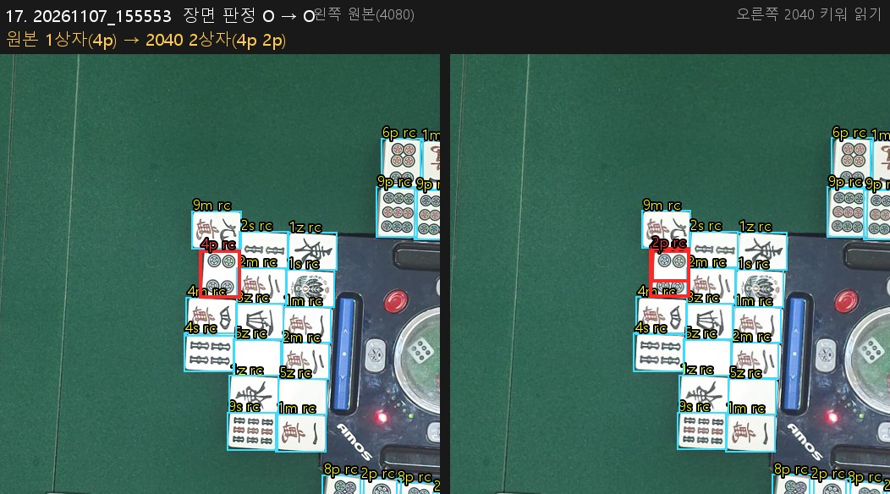

# 개발일지(2026-11-12)

← 이전: [11-11](개발일지%5B2026-11-11%5D.md) · 다음: 없음 →

## 문제 1: 겹쳐 보기가 화료 순간의 짝·떼어 둔 화료패를 못 가림 — 역할 + 주인을 한 번에 내는 모델

- **원인:** 겹쳐 보기는 화료자를 모른 채 역할 모델을 네 자리 기준으로 4번 돌려 투표함. 같은 토큰·같은 모델에서 화료자 기준 1회는 pair 19/28·loose 6/8 인데 4회 + 투표는 pair 6/28·loose 1/8 → 투표가 화료자 기준 역할을 잃음. 사용자 "굳이 아래쪽만 자기 손패라고 학습시켜서 돌리는 작업을 추가할 필요가 있어?" 에서 시작.
- **해결방안:** 주인 자리 라벨(화료 사진 41장)과 판 중 프레임 평가 세트(개발 35장·시험 49장 1,852상자)를 만들고, 역할과 주인 자리를 한 번에 내는 모델 D 를 학습. 화료 26장 역할 + 주인 틀림 **37 → 11**, 판 중 시험 5 → 1, 강 주인 틀림 0 — 미리 적은 기준 여섯 모두 충족. 끝단(사진 → 검출 → 분류 → 역할) 장면 21 → 31/40, 태블릿 답 = PC 2,414상자 모두 같음. 채택 후보, 실제 겹쳐 보기 화면은 아직 지금 방식.

### 시행착오

1. 기준선부터 재 보니 내 진단 하나가 틀렸음 — "판 중에는 펼친 손패가 없어 틀릴 것" 이라 봤는데, 판 중 시험 프레임 중 펼치지 않은 것은 역할 + 주인 틀림 0. 남은 이득은 화료 순간 pair·loose 뿐.
2. 사용자 "지난 학습 데이터를 90° 씩 돌려 학습하면 되는 거 아니야?" → 회전만(R) 학습. 화료 순간 역할은 좋아졌지만(틀림 34 → 16) 역할 + 주인 37 → 63(주인을 격자 칸으로 정하니 화료자 손패 43장이 "center"), 판 중 5 → 18 로 기준 둘 미달 → 미채택.
3. R 에서 배운 것: 회전 증강만으로는 주인, 그리고 화료자가 없거나 여럿인 장면이 안 생김. 지금 방식이 판 중에 강한 것은 투표 덕이고, 1회 실행 모델은 그 장면을 재료로 봐야 함.
4. D 학습 전에 합성 배치를 실제 토큰과 견주니 울기 옆 위치가 0.45 로 실제 0.72~0.75 와 달랐음. 그대로면 "울기 주인 = 방향" 을 가르칠 뻔 → 울기 위치·판 중 강 장수·세운 손패 거리를 실제 통계 범위로 고친 뒤 학습.
5. 끝단에서 새로 틀린 장면 1(k28): 탁자 모서리 흰 테두리 위의 發 퐁을 loose 로 봄.
6. ONNX(1.34MB)로 내보내 태블릿에서 역할 단계 46 → 17ms. 겹쳐 보기 전체 2.05초의 1.4% 라 얻는 것은 속도가 아니라 정확도.

## 문제 2: 쯔모한 패를 그대로 냈는지 손에서 냈는지 위 카메라로 알 수 있나

- **원인:** 사용자 "세운 손패를 감시하면서 쯔모할 때마다 쯔모한 패를 내는지 손패에서 내는지 알 수 있니, 새 카메라는 안 됨". 패 면은 안 보여도 동작(집는 위치·줄 빈칸·13 ↔ 14장)은 보임. 다만 3초 간격 프레임으로 충분한지는 모름.
- **해결방안:** 11-07 세 판 버림 100건의 손패 띠 대조표를 Opus 5.5 에이전트가 눈으로 라벨, 이 세션이 표본 20장을 가리고 대조(다름 1). 울기 뒤 6건을 뺀 94건에서 흔적이 보이는 비율은 고정 정의로 35%, 검토 보정으로 50%. 화질은 충분하고 걸림돌은 **시간**(3초 간격 + 8초 넘게 비는 구간 22%)과 손 가림(약 11%). → 영상 속도로 봐야 해서 헤드 앱에 시험용 녹화 모드를 만듦.

### 시행착오

1. 정답이 없는 측정이라 "정확도" 가 아니라 "흔적이 보이는 비율". 검토 보정은 결과를 본 뒤 정한 것이라 따로 적음.
2. 영상 시험 계획서(`docs/tedashi_video_plan_1112.md`): 정답은 소리가 아니라 전체 프레임을 두 에이전트가 따로 본 판정이 같은 것으로(사용자 "소리는 필요없잖아"). 합격 기준은 촬영 전에 적음.
3. 헤드 녹화 모드: 12MP 스트림을 2×2 평균으로 줄여 2040×1530·초당 10장 JPEG. S25 Ultra 에서 31.3분 동안 저장 초당 10.0장·버림 0, 장당 0.44MB(시간당 약 15.8GB), `/capture` 지연 없음.
4. **발열은 녹화보다 헤드 자체에서 남.** 책상 위 54분에 AP 52°C·발열 단계 3, 녹화를 꺼도 안 내려감. 오후에 충전하며 다시 재니 22.5분에 단계 4(위험)·43분 AP 56.0°C 까지 오르고 멈추지 않음(동작은 멀쩡, 버림 0). 고속 충전기를 꽂아도 이 부하에선 배터리가 거의 안 참.

## 문제 3: 헤드 녹화(2040)를 태블릿으로 계속 받기

- **원인:** 사용자 "2040으로 태블릿으로 보내는거 구현해줄래?" → "실시간 계속 보내기". 녹화가 헤드에만 쌓이면 태블릿은 3초마다 받는 1020 미리보기밖에 못 씀.
- **해결방안:** 헤드는 저장소에 먼저 쓰고, 태블릿이 "받은 마지막 시각 뒤" 를 묶음으로 계속 당김 → 끊겨도 다시 붙으면 빠진 데부터 이음. 집 와이파이 7.8분 확인: 지연 중앙 0.07·p90 0.21·최대 0.40초, 빠짐 0, 밀린 약 2,700장을 45초에 따라잡음. 이어서 저장 없이 최신 한 장만 받는 "실시간 보기" 를 더함(약 70초 586장, 초당 약 8.4장).

### 시행착오

1. 대역폭(초당 10장 × 0.44MB ≈ 35Mbps)이 판독의 `/capture`·서버 전송과 겹칠 수 있다고 먼저 알림. 재 보니 `/capture` 는 중앙 +0.06·p90 +0.2초.
2. 사용자 "화면에도 띄워줘" → 따라잡은 상태에서 받은 마지막 프레임을 배경으로. 밀린 것을 받는 동안은 안 띄움.
3. 사용자 "실험 자료는 헤드에 쌓이니 태블릿 저장은 필요 없다" → 메뉴를 "실시간 보기" / "받아 태블릿에 저장" 둘로, 하나만 켜짐.
4. 핫스팟에서는 실시간 보기 초당 약 4.9장. 매장 핫스팟에서 초당 10장이 나는지는 아직 모름.

## 문제 4: 받고 있는 2040 을 판 상태 추적에도 쓰기, 1020 미리보기는 그만 받기

- **원인:** 사용자 "1020 추적용 2400으로 해도 문제 없을거 같은데" → "2040 계속 받고 있는데 1020 쓸 이유 없으니 대체할 수 있게 테스트해줘".
- **해결방안:** 11-07 화료 원본 14장을 4080 / 2040 / 1020 으로 만들어 추적 통계를 비교. 리치봉 홈(정답 56곳, 봉 9곳)에서 1020 은 봉 3곳을 놓치고(6/9) 2040·4080 은 9/9·헛 잡음 0. 태블릿 시간은 장당 0.16 / 0.62 / 2.38초 → 2040 은 3초 간격 안. 추적 입력을 받은 2040 프레임으로 바꾸고, 실시간 보기 중엔 1020 미리보기를 안 받게 함(헤드 요청 1분 1020 20회 → 0회).

### 시행착오

1. 확인하다 바로잡음: 기록용 "2400" 요청은 헤드에서 실제로 **4080 원본(약 2MB)** 이 옴 — 3초마다 1020 + 4080 을 받고 있었음.
2. 합성 버림·리치 시퀀스 재생: 2040 은 1020 과 같은 사건·같은 시각. 다만 **입력이 바뀌는 프레임에 놓인 버림은 사라짐** → 사용자 "막아줘": 받기가 끊겨도 30초까지는 1020 으로 안 바꾸고 추적을 쉬었다 이어 봄.
3. 펠트 감시를 1020 / 2040 으로 40장 비교: 같은 답(38/38), 태블릿 장당 0.26 / 0.45초.
4. 헤드 요청 수를 세려던 때 헤드 휴대폰을 사용자가 다른 앱으로 쓰고 있었고(그 화면을 한 번 잘못 누름), 다시 깐 뒤엔 태블릿과 헤드가 서로 안 보였음 → 태블릿 핫스팟 + USB 로 바꿔 셈.
5. 판 중 추적 경로 자체는 집 책상에 탁자가 없어 기기에서 못 돌려 봄 → 매장 몫.

## 문제 5: 겹쳐 보기도 2040 으로 — "분류기가 못 읽는다" 는 틀린 진단, 학습 없이 풀림

- **원인:** 겹쳐 보기만 4080 을 따로 받고 있음. 화료 원본 40장을 2040 으로 줄여 돌리니 장면 32 → 10/40, 패 523 → 463/528, 틀린 것은 만수 한자. 오후엔 "운영 분류기가 패 약 40px 의 한자 무늬를 못 읽는다" 고 적음. 사용자 "2040 크기로 줄인 크롭을 섞어 학습한 분류기를 만들고 싶다, 계획서 뒤 실행은 Opus 5.5·너는 검토".
- **해결방안:** 계획서에 학습 없는 대조군을 먼저 넣음 — 겹쳐 보기는 크롭을 줄이기만 하고 키우지 않아, 2040 에서는 패가 128 칸 안에 절반 크기(긴 변 중앙 71px, 원본 142px)로 들어감. 분류 직전에 긴 변 96 미만 크롭을 96 으로 키우면(모델 그대로) 그 사진을 안 배운 조합에서 원본 25/40·517/528 → 2040 **24/40·518/528**, 운영 모델 32·523 → 31·522. 사용자 "키우기만 재 보고 4080 만큼 나오면 추가 학습 안 함" → 미리 적은 기준(패 −5·장면 −3 이내) 통과 → **학습 안 함.** 앱 반영 전.

### 시행착오

1. 오후 진단이 틀렸음. 못 읽는 것이 아니라 넣는 크기가 달랐음. 서버에는 작은 패를 키워 읽는 `read_small` 이 이미 있었는데 겹쳐 보기가 안 쓰고 있었음.
2. 원본(4080) 입력은 크롭이 모두 96 이상이라 키워 읽기가 답을 하나도 안 바꿈.
3. 같이 맡긴 2040 사본 크롭 만들기는 도중에 멈춤. 내가 적은 재현 기준("평균 화소 차 ≤ 2")이 저장된 크롭의 JPEG 압축 잡음을 생각하지 않은 값이라 5.9% 가 걸림 — 다시 자른 크롭은 1,548장 모두 바이트까지 같았으므로 기준이 틀린 것.
4. 사용자 "4080이랑 다른 거 사진 보여줄래" → 다른 상자 17곳을 나란히 그려 보니 **숫자에 안 잡힌 문제가 나옴.** 2040 에서는 한 패에 상자가 겹쳐 잡히는 곳이 9곳 생기고(원본 0), 4통은 위쪽 반쪽 상자가 2통으로 읽힘. 장면 채점은 화료자 손패·울기만 세서 강의 패는 빠져 있었음. 검출 몫이라 키워 읽기·분류기 학습으로는 안 고쳐짐.
5. 사용자 "그래도 4080 입력은 받아야 하니?" → 겹쳐 보기 몫은 없앨 수 있지만 화료 판독(판 끝 한 장)·도라 표시패(11-03 측정 2040 6/8 대 4080 8/8)·기록용 저장·자동 격자는 아직 4080.
6. 그 사이 4080 요청은 줄여 둠: 기록용 고화질은 남길 프레임일 때만, 겹쳐 보기는 추적이 변화를 본 차례이거나 15초마다만(헤드 요청 겹쳐 보기 몫 1분 2회 안팎).

## 문제 6: 토요일(11-14) 매장 준비 — 인터넷 없는 핫스팟에서 서버로 가던 호출

- **원인:** 매장에선 태블릿 핫스팟(인터넷 없음)을 씀. 점검하다 찾음 — 리치봉 서버 읽기는 기기 판독 목록에 없어 인터넷이 없어도 서버로 가고, 기다리는 동안 버림 추적 프레임이 버려짐(변화 한 번에 최대 3번 × 시간 제한 90초).
- **해결방안:** 연결 실패·시간 초과면 2분 동안 리치봉 서버 읽기를 안 부름(`ServerBackoff`). 이어 사용자 "자체 판독을 이 기기에서 고르면 서버 읽기는 아예 막자" → 스위치가 켜져 있으면 서버 요청을 보내지 않고 바로 실패 처리(리치는 픽셀 확정이 따로 잡음). 테스트 760 통과, 태블릿 사본 앱에 `adb install -r`.

### 시행착오

1. 인터넷 없는 태블릿 단독 판독을 다시 잼: 테스트 세트 40장 앱 흐름 44/46, 장면 6.33초, 재저장 생략 **5.55초**, 두 답 다른 사진 0/40. 판 중 추적·겹쳐 보기가 같이 돌아 11-11 보다 0.4~1.1초 느림.
2. 태블릿 화면엔 판 중 추적 이벤트를 보여 주는 곳이 없음 → 노트북 `supervise.py track` 으로 가장 최근 추적 기록을 읽어 버림·리치 요약.
3. 장면 전체 변화(`rebase`)는 평소 대국에도 판당 20~70번 나와 경고로 치지 않기로 함.

## 한 일

- 역할 + 주인 모델: 라벨(화료 41장·판 중 프레임 84장) → 기준선 → 회전만(R) 미채택 → D 기준 통과 → 끝단·태블릿 확인.
- 쯔모기리 / 손에서 냄 흔적 세기, 영상 시험 계획서, 헤드 앱 녹화 모드(2040·초당 10장)와 발열 측정 두 번.
- 헤드 녹화 태블릿 이어 받기·실시간 보기, 추적 입력 2040, 1020 미리보기 생략, 4080 요청 줄이기.
- 2040 분류기 계획서(`docs/cls_2040_plan_1112.md`) → 키워 읽기 기준선 → 학습 안 함, 다른 상자 그림(`experiments/ondevice/overlay_diff_sheet.py`).
- 매장 준비: 인터넷 없는 측정, 서버 읽기 막기, 추적 요약 도구.
- 오늘 앱·실험 변경은 모두 사본 앱 `dev.jjh.mahjong_calc.ondevice`·브랜치 `exp/on-device-read` 작업 트리에 있고 **커밋하지 않음**(이 일지만 커밋). 서버·운영 모델·원래 앱은 안 바꿈.

## 남은 것

- 겹쳐 보기 2040: 겹친 상자 정리(큰 상자 안에 든 작은 상자 버리기) 재기, 키워 읽기를 `ondevice.overlay` 에 넣기, 실제 헤드 녹화 2040 프레임으로 확인. 모자라면 "키우지 않고도 읽도록 학습".
- 도라 표시패·화료 판독을 2040 으로 내릴 수 있는지는 안 잼.
- 역할 + 주인 모델 D: 실제 겹쳐 보기 화면에 넣을지, 판 중 프레임 끝단·실제 대국 확인.
- 영상 시험: 쓰임새·촬영 기기·분량 결정 뒤 촬영.
- 헤드 발열: 스트림 초당 장수 제한 빌드로 다시 재기, 매장 핫스팟에서 초당 10장이 나는지.
- 매장(11-14): 받기를 켠 채 추적 이벤트(리치·버림·울기)가 평소처럼 나는지, 변화 때만 받는 4080 이 실제로 줄어드는지, 인터넷 없는 상태에서 서버 호출이 바로 실패하는지.

근거: `docs/metrics.md` 표 4-3~4-9, 표 12-6~12-10, 표 4-1 아래 "다시 — 인터넷 없는 태블릿 단독". `docs/problem_log.md` 55번. 계획서 `docs/role_owner_plan_1111.md`·`docs/tedashi_video_plan_1112.md`·`docs/cls_2040_plan_1112.md`. 표와 계획서는 브랜치 `exp/on-device-read` 작업 트리에 있고 아직 커밋 전.

← 이전: [11-11](개발일지%5B2026-11-11%5D.md) · 다음: 없음 →
